# Architecture Diagrams — Implemented Scope

> **Repository:** AI-Powered Upskilling Platform  
> **Diagram format:** Mermaid  
> **Scope rule:** This document contains diagrams **only for code that exists and runs** in the repository. Planned or placeholder features are listed in [Section 12](#12-deferred-features-not-diagrammed) and intentionally excluded from the diagrams.  
> **Last verified against source:** November 2026

---

## Table of Contents

1. [Implemented Scope and Evidence](#1-implemented-scope-and-evidence)
2. [System Context](#2-system-context)
3. [Deployment and Runtime Topology](#3-deployment-and-runtime-topology)
4. [Backend Gateway Module Architecture](#4-backend-gateway-module-architecture)
5. [Client Architecture: Web and Android](#5-client-architecture-web-and-android)
6. [Authentication and Security](#6-authentication-and-security)
7. [Assessment Engine: CAT and Skill Graph](#7-assessment-engine-cat-and-skill-graph)
8. [Persistence Model](#8-persistence-model)
9. [Mentor Subsystem](#9-mentor-subsystem)
10. [AI Voice Companion and Assistant Service](#10-ai-voice-companion-and-assistant-service)
11. [Implemented API and Frontend Route Map](#11-implemented-api-and-frontend-route-map)
12. [Deferred Features (Not Diagrammed)](#12-deferred-features-not-diagrammed)
13. [Verification Topology](#13-verification-topology)

---

## 1. Implemented Scope and Evidence

### 1.1 Implemented subsystems

| Subsystem | Evidence in repository | Diagrammed |
|---|---|---|
| Spring Boot Gateway | `gateway/ai-upskilling-platform/src/main/java` | Yes |
| Authentication and OAuth2 | `authentication/**` | Yes |
| Adaptive assessment engine | `assessment/**` | Yes |
| Mentor management | `mentor/**` | Yes |
| User profile | `user/**` | Yes |
| Shared API/error envelope | `shared/**` | Yes |
| React web application | `web-app/src` | Yes |
| Capacitor Android wrapper | `mobile-app/` + `web-app/src/services/mobile*.js` | Yes |
| SkillUp Assistant | `skillup-assistant/src` | Yes |
| PostgreSQL persistence | JPA entities + `docker-compose.yml` | Yes |
| Docker Compose topology | `docker-compose.yml` | Yes |
| Gateway integration tests | `src/test/java/**` | Yes |

### 1.2 Not implemented, therefore not diagrammed as runtime architecture

- AI roadmap generation and roadmap persistence.
- Capstone project verification and badge/certificate issuance.
- Career hub, ATS matching, and mock interviews.
- The `ai-worker/` service (contains README files only; no implementation).
- BullMQ/Redis background processing (Redis container is provisioned, but current Java/Node code does not use it).
- Mobile native app written in React Native/Flutter (the implemented mobile path is a Capacitor wrapper around the web build).

---

## 2. System Context

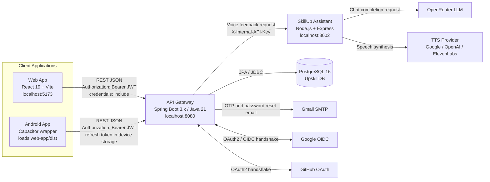

**Notes**

- The web app never stores the JWT access token in `localStorage` or `sessionStorage`; it is held in memory in `web-app/src/services/api.js`. The refresh token is an `HttpOnly` cookie on web.
- The Android build is a Capacitor shell whose `webDir` points at `web-app/dist`. It uses `Capacitor.Preferences` for the refresh token instead of cookies.
- The voice companion request is proxied through the gateway, keeping `X-Internal-API-Key` server-side.
- The assistant also exposes `/api/assistant/chat`; the current landing-page chatbot is a local scripted FAQ, not a live call to that endpoint.

---

## 3. Deployment and Runtime Topology

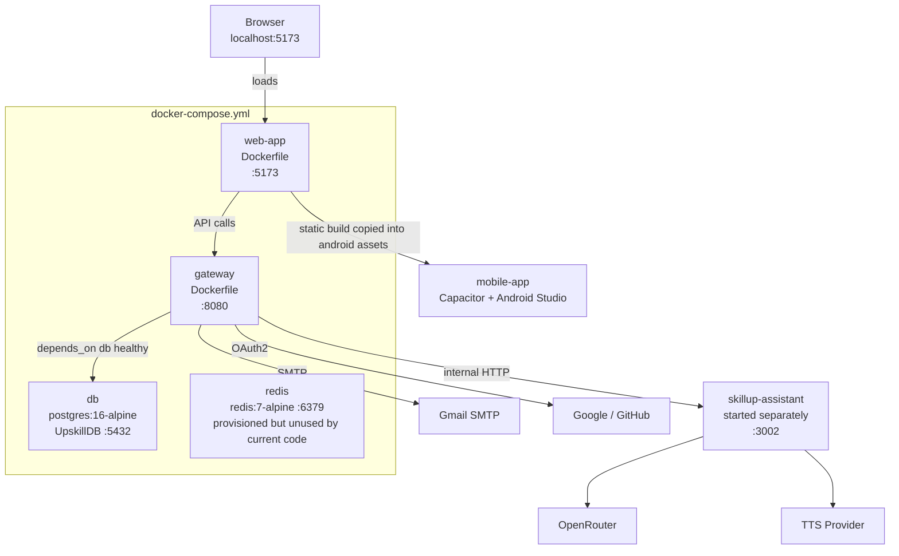

**Runtime modes**

| Mode | Gateway | Web app | Assistant | Database |
|---|---|---|---|---|
| Docker Compose | Container `upskill-gateway` | Container `upskill-webapp` | Not in compose | Container `upskill-postgres` |
| Local development | `mvnw.cmd spring-boot:run` | `npm run dev` | `npm start` in `skillup-assistant` | Local PostgreSQL or Compose DB |

---

## 4. Backend Gateway Module Architecture

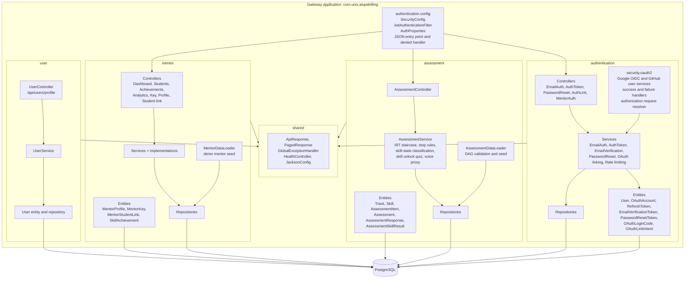

**Module responsibilities**

| Module | Key classes | Responsibility |
|---|---|---|
| `authentication` | `SecurityConfig`, `JwtAuthenticationFilter`, `AuthTokenServiceImpl`, `EmailAuthServiceImpl`, `OAuthAccountLinkingServiceImpl` | Stateless JWT API security, email + OTP, OAuth2, refresh rotation, account linking, password reset |
| `assessment` | `AssessmentController`, `AssessmentService`, `AssessmentDataLoader` | Adaptive CAT lifecycle, item selection, theta calculation, skill states, node unlock quiz, voice proxy |
| `mentor` | `MentorDashboardController`, `MentorStudentController`, `MentorAnalyticsController`, `MentorKeyController` | Mentor profile, student linking, cohort dashboard, analytics, achievements |
| `user` | `User`, `UserController`, `UserService` | Identity entity and profile read/update |
| `shared` | `ApiResponse`, `GlobalExceptionHandler`, `HealthController` | Uniform response envelope, error normalization, health endpoint |

---

## 5. Client Architecture: Web and Android

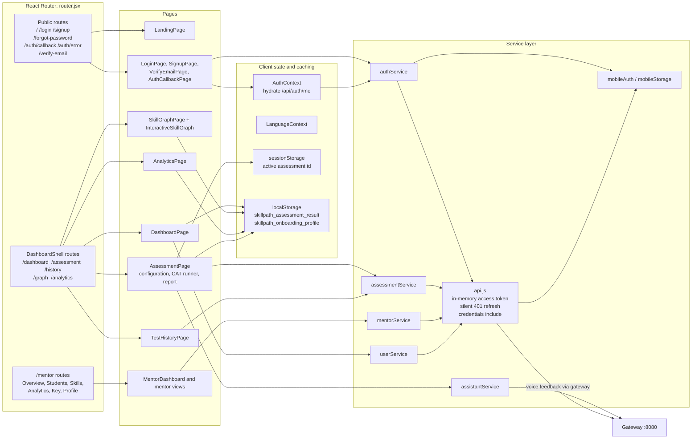

**Client notes**

- `AssessmentPage` drives the entire implemented onboarding-to-assessment flow: track selection, skill pre-selection, CAT execution, and report storage.
- The router maps `/onboarding` to a redirect to `/dashboard`; there is no active onboarding wizard route in the current implementation.
- `DashboardPage`, `SkillGraphPage`, and `AnalyticsPage` read the completed report from `localStorage` key `skillpath_assessment_result`.
- `InteractiveSkillGraph` builds node/edge models from the report's skill list and prerequisite IDs.
- The Android manifest registers the `octobyte://auth` deep-link scheme; the gateway mobile callback URL is configured through `APP_FRONTEND_MOBILE_CALLBACK_URL`. The web callback is `/auth/callback?code=...`.

---

## 6. Authentication and Security

### 6.1 Email registration and OTP verification

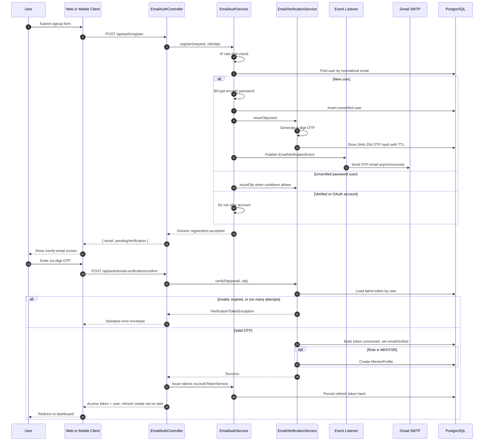

**Implemented security rules**

- OTP is 6 digits, stored only as a SHA-256 hash, maximum 5 failed attempts, and a configurable TTL (`app.auth.verification.ttl-seconds`, default 600 seconds).
- Registration and resend are rate-limited by IP.
- Email is normalized to lowercase before lookup and storage.
- Mentor registration uses the same OTP flow and creates a `MentorProfile` after verification.

### 6.2 Password login and silent refresh rotation

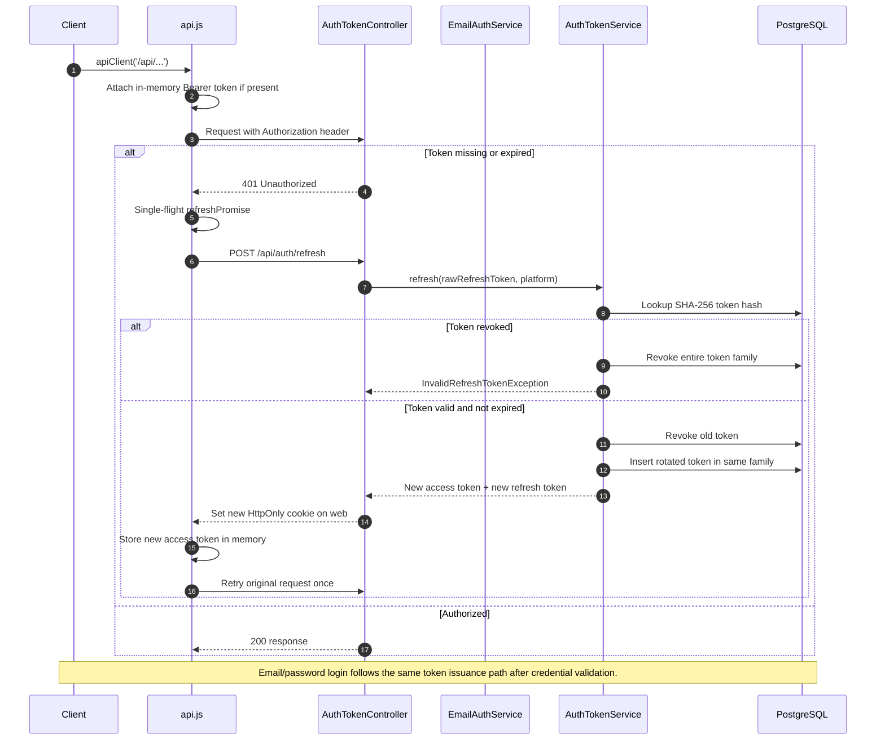

**Implemented token rules**

| Item | Implementation |
|---|---|
| Access token | HMAC-SHA256 JWT, TTL 900 seconds |
| Refresh token | 32-byte random opaque string, stored as SHA-256 hash, TTL 2,592,000 seconds |
| Rotation | Every refresh revokes the old token and inserts a successor in the same family |
| Reuse detection | Presentation of an already-revoked token revokes the whole family |
| Web transport | `HttpOnly` cookie scoped to `/api/auth` |
| Mobile transport | JSON body; refresh token stored in Capacitor Preferences |
| Password hashing | Spring `DelegatingPasswordEncoder` (BCrypt by default) |
| Login rate limiting | Per-IP and per-email failed-attempt tracking with dummy BCrypt comparison for unknown accounts |

### 6.3 OAuth2 login and one-time code exchange

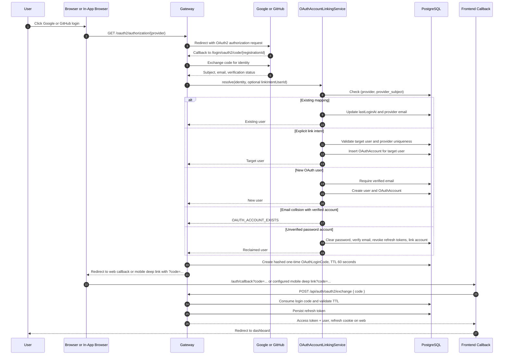

**OAuth error destinations:** `APP_FRONTEND_WEB_ERROR_URL` for web and `APP_FRONTEND_MOBILE_ERROR_URL` for mobile.

### 6.4 Account linking decision flow

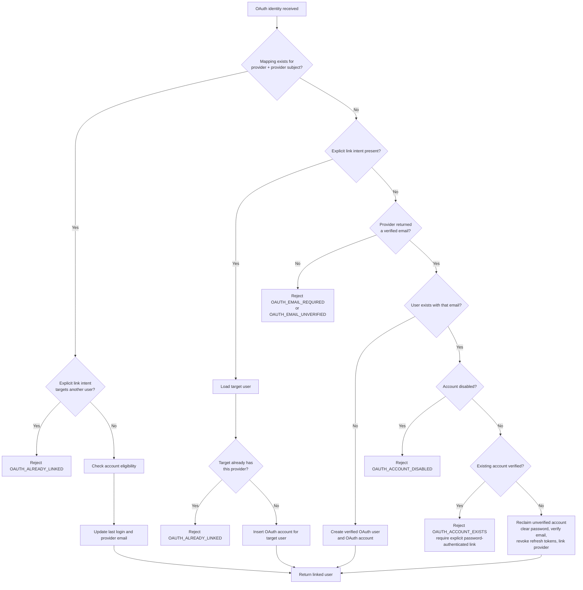

This flow implements the account-takeover invariant: matching email alone never auto-links an existing verified account.

### 6.5 Password reset flow

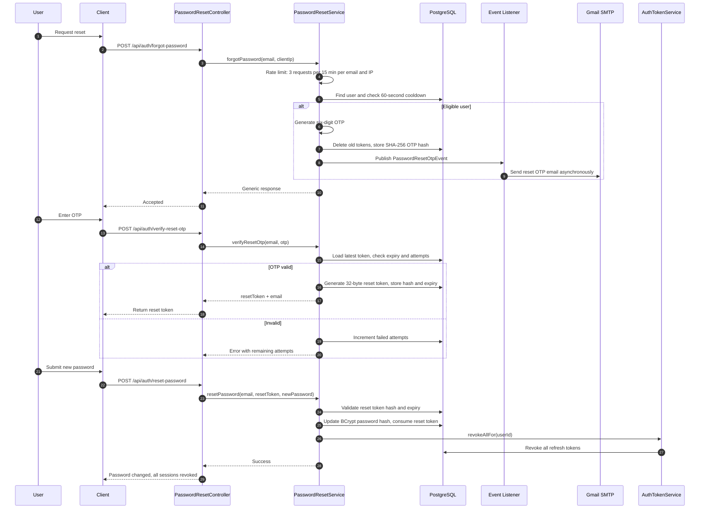

### 6.6 Security filter chain

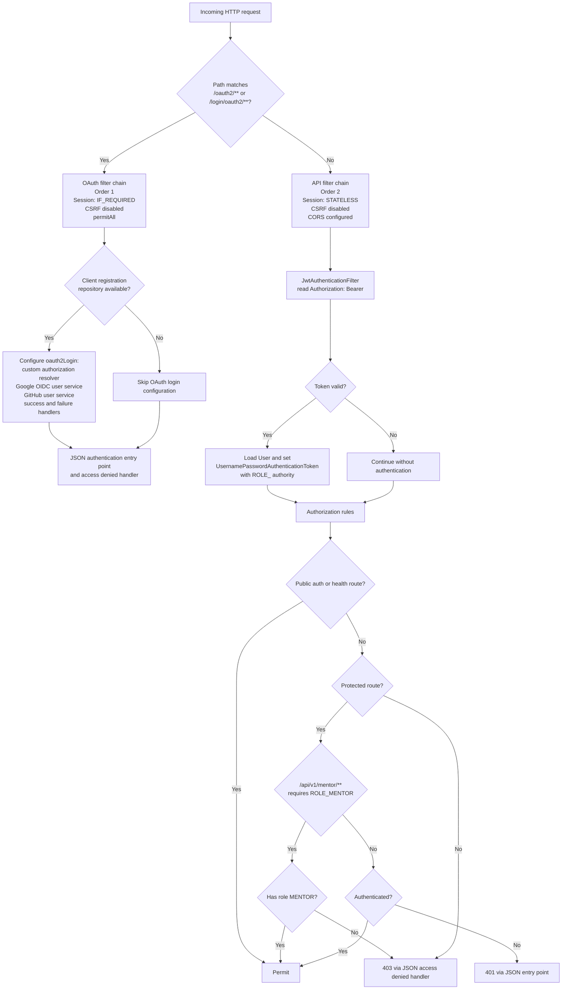

**Public endpoints implemented as public**

- `/api/auth/register`
- `/api/auth/mentor/register`
- `/api/auth/login`
- `/api/auth/email-verification/**`
- `/api/auth/forgot-password`
- `/api/auth/verify-reset-otp`
- `/api/auth/reset-password`
- `/api/auth/refresh`
- `/api/auth/logout`
- `/api/auth/oauth2/exchange`
- `/api/v1/assessments/voice-feedback/audio/**`
- `/oauth2/**`, `/login/oauth2/**`, `/error`, `/health`, `/actuator/health`

All other `/api/**` routes require authentication; `/api/v1/mentor/**` additionally requires `ROLE_MENTOR`.

---

## 7. Assessment Engine: CAT and Skill Graph

### 7.1 Adaptive test lifecycle

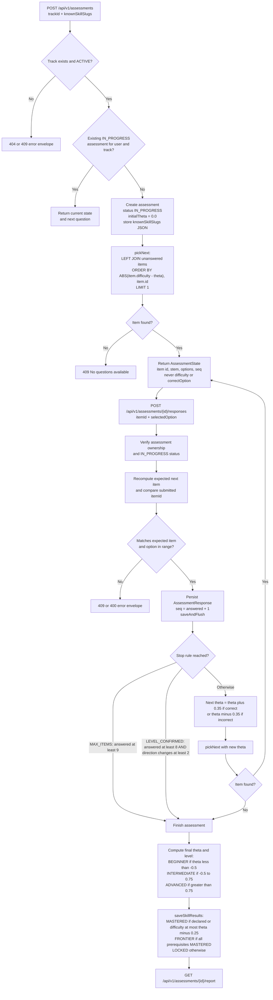

**Implemented constants**

| Constant | Value |
|---|---|
| Start theta | `0.0` |
| Step size | `0.35` logits |
| Minimum items before early stop | `8` |
| Maximum items | `9` |
| Early stop | At least 8 answered and at least 2 answer-direction changes |
| Mastery margin | `0.25` logits |
| Beginner threshold | theta less than `-0.5` |
| Advanced threshold | theta greater than `0.75` |

**Selection query and transactional behavior**

- `AssessmentItemRepository.findNext` uses an indexed anti-join against `assessment_responses`.
- Ordering is by absolute difference between item difficulty and current theta, then item id.
- Submitted answers are persisted with `saveAndFlush`, keeping the next-item query consistent.
- The response DTO exposes the stem and options only; item difficulty and `correctOption` remain server-side during an active test.

### 7.2 CAT interaction sequence with voice feedback

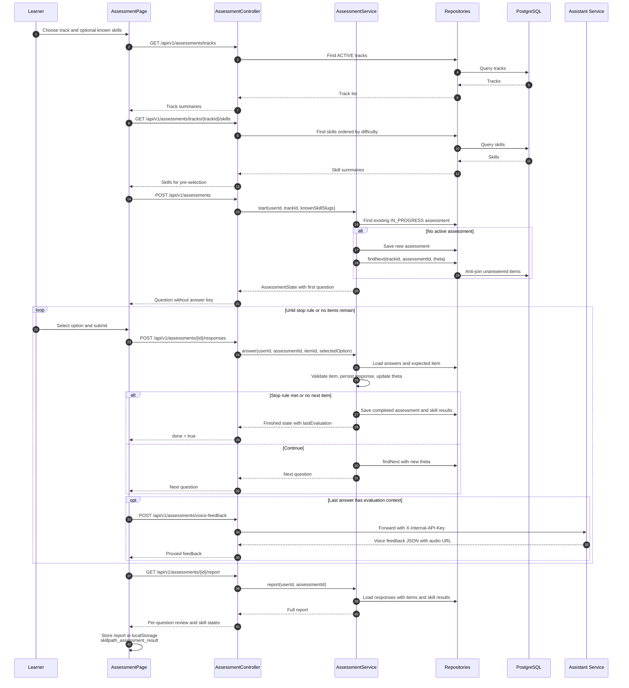

### 7.3 Assessment and skill-state state machines

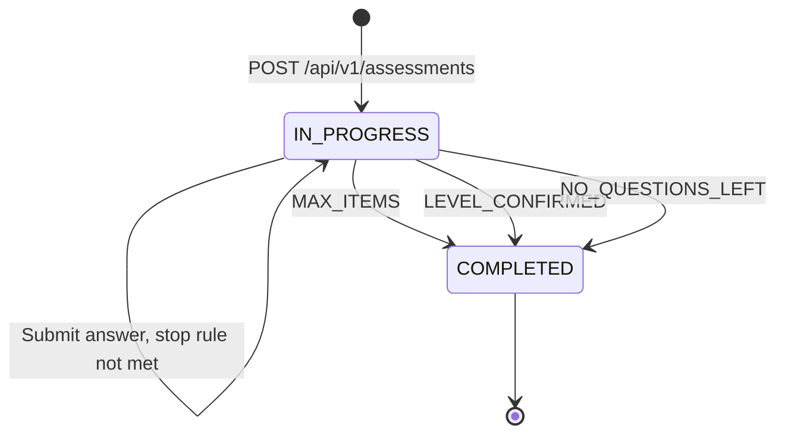

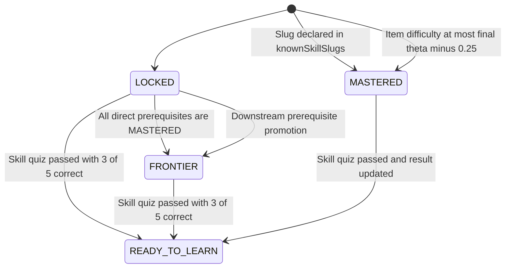

**Classification behavior**

- At assessment completion, skills are classified as `MASTERED`, `FRONTIER`, or `LOCKED`.
- `FRONTIER` means the skill is not mastered, but every direct prerequisite is mastered.
- The node unlock quiz can set a skill to `READY_TO_LEARN`; passing also promotes eligible downstream `LOCKED` skills to `FRONTIER`.
- Skill results are persisted per assessment in `assessment_skill_results`.

### 7.4 Skill-node unlock quiz

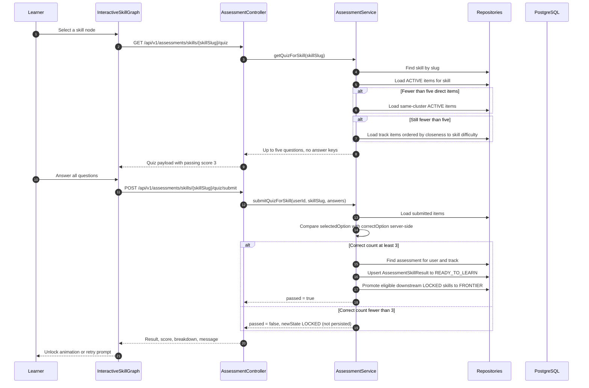

### 7.5 DAG seeding and validation

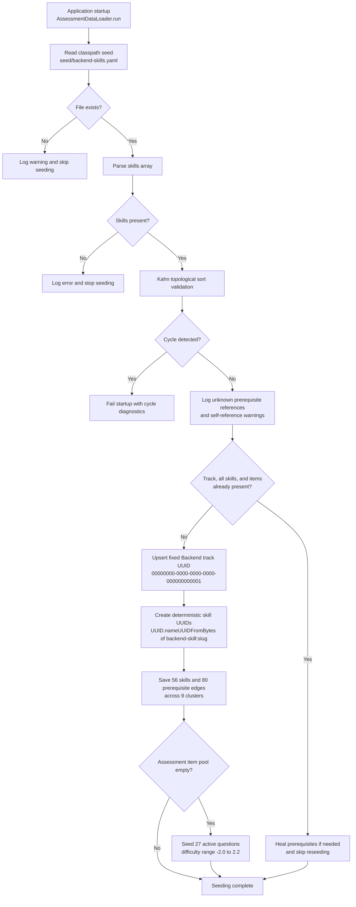

**Seed facts verified from `backend-skills.yaml`**

| Metric | Value |
|---|---|
| Skills | 56 |
| Prerequisite edges | 80 |
| Domain clusters | 9 |
| Fixed Backend Engineering track UUID | `00000000-0000-0000-0000-000000000001` |
| Seeded diagnostic questions | 27 |

---

## 8. Persistence Model

```mermaid
erDiagram
    USERS {
        bigint id PK
        varchar email UK
        varchar username UK
        varchar full_name
        varchar avatar_url
        varchar bio
        varchar password_hash
        boolean email_verified
        timestamp email_verified_at
        varchar role
        varchar status
        timestamp created_at
        timestamp updated_at
    }

    OAUTH_ACCOUNTS {
        bigint id PK
        bigint user_id FK
        varchar provider
        varchar provider_subject
        varchar provider_email
        boolean provider_email_verified
        timestamp created_at
        timestamp last_login_at
    }

    REFRESH_TOKENS {
        bigint id PK
        bigint user_id FK
        varchar token_hash UK
        varchar family_id
        varchar platform
        timestamp created_at
        timestamp expires_at
        timestamp revoked_at
        bigint replaced_by_id
    }

    EMAIL_VERIFICATION_TOKENS {
        bigint id PK
        bigint user_id FK
        varchar token_hash
        int failed_attempts
        timestamp created_at
        timestamp expires_at
        timestamp consumed_at
    }

    PASSWORD_RESET_TOKENS {
        bigint id PK
        bigint user_id FK
        varchar otp_hash
        varchar reset_token_hash
        int failed_attempts
        timestamp created_at
        timestamp otp_expires_at
        timestamp reset_token_expires_at
        timestamp consumed_at
    }

    OAUTH_LOGIN_CODES {
        bigint id PK
        bigint user_id FK
        varchar platform
        varchar code_hash UK
        timestamp created_at
        timestamp expires_at
        timestamp consumed_at
    }

    OAUTH_LINK_INTENTS {
        bigint id PK
        bigint user_id FK
        varchar provider
        varchar intent_hash UK
        timestamp created_at
        timestamp expires_at
        timestamp consumed_at
    }

    TRACKS {
        uuid id PK
        varchar slug UK
        varchar name
        varchar status
    }

    SKILLS {
        uuid id PK
        uuid track_id FK
        varchar slug
        varchar name
        varchar cluster
        double difficulty
    }

    SKILL_PREREQUISITES {
        uuid skill_id FK
        uuid prerequisite_id FK
    }

    ASSESSMENT_ITEMS {
        uuid id PK
        uuid track_id FK
        varchar skill_slug
        double difficulty
        text stem
        text options
        int correct_option
        varchar status
    }

    ASSESSMENTS {
        uuid id PK
        uuid user_id FK
        uuid track_id FK
        varchar status
        double initial_theta
        double theta
        varchar level
        int items_administered
        int correct_count
        varchar stop_reason
        text known_skill_slugs
        timestamp completed_at
    }

    ASSESSMENT_RESPONSES {
        uuid id PK
        uuid assessment_id FK
        int seq
        uuid item_id FK
        int selected_option
        boolean is_correct
        timestamp answered_at
    }

    ASSESSMENT_SKILL_RESULTS {
        uuid id PK
        uuid assessment_id FK
        uuid skill_id FK
        varchar state
    }

    MENTOR_PROFILES {
        bigint user_id PK
        varchar title
        varchar location
        timestamp joined_at
    }

    MENTOR_EXPERTISE {
        bigint mentor_user_id FK
        varchar label
    }

    MENTOR_KEYS {
        uuid id PK
        bigint mentor_user_id FK
        varchar key_value UK
        varchar status
        timestamp created_at
        timestamp revoked_at
        uuid rotated_from_id
    }

    MENTOR_STUDENT_LINKS {
        bigint id PK
        bigint mentor_user_id FK
        bigint student_user_id FK
        uuid key_id FK
        timestamp linked_at
        timestamp unlinked_at
    }

    SKILL_ACHIEVEMENTS {
        uuid id PK
        bigint student_user_id FK
        varchar skill_slug
        varchar skill_name
        varchar category
        varchar proficiency
        int progress
        timestamp verified_at
        uuid source_assessment_id
    }

    USERS ||--o{ OAUTH_ACCOUNTS : "has"
    USERS ||--o{ REFRESH_TOKENS : "owns"
    USERS ||--o{ EMAIL_VERIFICATION_TOKENS : "receives"
    USERS ||--o{ PASSWORD_RESET_TOKENS : "requests"
    USERS ||--o{ OAUTH_LOGIN_CODES : "receives"
    USERS ||--o{ OAUTH_LINK_INTENTS : "creates"
    USERS ||--o{ ASSESSMENTS : "logical UUID mapping"
    USERS ||--o| MENTOR_PROFILES : "mentor profile"
    USERS ||--o{ MENTOR_KEYS : "mentor owns"
    USERS ||--o{ MENTOR_STUDENT_LINKS : "mentor side"
    USERS ||--o{ MENTOR_STUDENT_LINKS : "student side"
    USERS ||--o{ SKILL_ACHIEVEMENTS : "student earns"
    MENTOR_PROFILES ||--o{ MENTOR_EXPERTISE : "lists"
    MENTOR_KEYS ||--o{ MENTOR_STUDENT_LINKS : "redeemed by"
    TRACKS ||--o{ SKILLS : "contains"
    SKILLS ||--o{ SKILL_PREREQUISITES : "target skill"
    SKILLS ||--o{ SKILL_PREREQUISITES : "prerequisite skill"
    TRACKS ||--o{ ASSESSMENT_ITEMS : "provides"
    TRACKS ||--o{ ASSESSMENTS : "evaluates"
    ASSESSMENTS ||--o{ ASSESSMENT_RESPONSES : "records"
    ASSESSMENT_ITEMS ||--o{ ASSESSMENT_RESPONSES : "answered in"
    ASSESSMENTS ||--o{ ASSESSMENT_SKILL_RESULTS : "produces"
    SKILLS ||--o{ ASSESSMENT_SKILL_RESULTS : "evaluated in"
```

**Persistence notes**

- `users.id` is `BIGINT`, while `assessments.user_id` and the mentor link identifiers are `BIGINT` user IDs. Assessment ownership uses a deterministic UUID derived from the numeric user ID (`new UUID(0L, id)`), so the ER relationship is logical rather than a database foreign key.
- `skill_achievements` is currently populated by the demo mentor seed loader. Runtime assessment completion writes `assessment_skill_results`, not `skill_achievements`.
- The mentor demo seed is enabled by default through `app.seed.mentor-demo` unless the property is set to `false`.
- Hibernate schema synchronization is enabled with `spring.jpa.hibernate.ddl-auto=update` in the main application; tests use `create-drop` against H2 in PostgreSQL mode.

---

## 9. Mentor Subsystem

### 9.1 Mentor component architecture

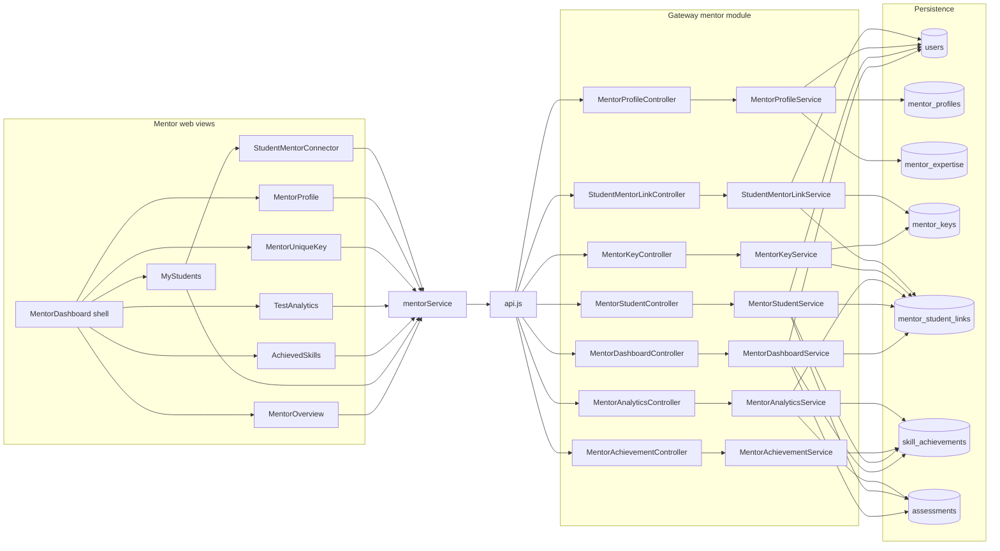

**Mentor endpoint authorization**

- All `/api/v1/mentor/**` endpoints require `ROLE_MENTOR`.
- `/api/v1/students/mentor-link` is available to authenticated students.
- Responses use the shared `ApiResponse<T>` envelope.

### 9.2 Mentor key generation and student linking

```mermaid
sequenceDiagram
    autonumber
    participant M as Mentor
    participant MW as Mentor Web App
    participant MC as MentorKeyController
    participant MS as MentorKeyService
    participant S as Student
    participant SW as Student Web App
    participant LC as StudentMentorLinkController
    participant LS as StudentMentorLinkService
    participant D as PostgreSQL

    M->>MW: Open My Unique Key
    MW->>MC: GET /api/v1/mentor/key
    MC->>MS: getActiveKey(mentorUserId)
    MS->>D: Find ACTIVE mentor key
    MS-->>MC: Existing key or empty
    MC-->>MW: Key response

    M->>MW: Generate or rotate key
    MW->>MC: POST /api/v1/mentor/key { replaceExisting }
    MC->>MS: generateOrReplaceKey(...)
    MS->>MS: Check key rotation rate limit
    alt Active key exists and replaceExisting is false
        MS-->>MC: 409 MentorKeyAlreadyExists
    else No active key or replacement allowed
        opt Replacement requested
            MS->>D: Revoke existing key with revokedAt
        end
        MS->>MS: Generate MENTOR- plus 6 characters
        MS->>D: Insert unique ACTIVE key
        MS-->>MC: New key response
    end
    MC-->>MW: Return key, status, linked student count

    S->>SW: Enter mentor key
    SW->>LC: POST /api/v1/students/mentor-link { key }
    LC->>LS: linkStudentToMentor(studentUserId, rawKey, clientIp)
    LS->>LS: Check redemption rate limit
    LS->>LS: Validate format MENTOR-XXXXXX
    LS->>D: Find ACTIVE key and mentor user
    alt Key invalid or inactive
        LS-->>LC: InvalidMentorKeyException
    else Student already linked to same mentor
        LS-->>LC: Idempotent alreadyLinked = true
    else Student linked to a different mentor
        LS-->>LC: 409 StudentAlreadyLinked
    else Not linked
        LS->>D: Insert mentor_student_link
        LS-->>LC: Link response
    end
    LC-->>SW: Mentor name, linkedAt, alreadyLinked
```

### 9.3 Mentor analytics data flow

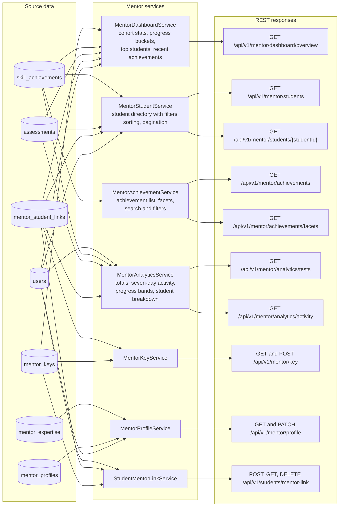

**Analytics semantics**

- Cohort membership is derived from active rows in `mentor_student_links`.
- Tests come from `assessments` for linked students, using the same logical user-ID mapping as the assessment module.
- Progress bands are computed from achievements plus assessment activity, with thresholds `ADVANCED` at 75 or above, `ON_TRACK` at 50 to 74, and `NEEDS_ATTENTION` below 50.
- The current implementation computes a fixed average duration in the analytics response rather than measuring per-test elapsed time.

---

## 10. AI Voice Companion and Assistant Service

### 10.1 Assistant service components

```mermaid
flowchart TB
    subgraph client["Client"]
        AP["AssessmentPage"]
        VW["VoiceCompanionWidget<br/>audio element and fallback UI"]
    end

    subgraph gateway["Spring Boot Gateway"]
        VC["AssessmentController<br/>/api/v1/assessments/voice-feedback"]
        AUD["Audio proxy<br/>/api/v1/assessments/voice-feedback/audio/{audioId}"]
        ASVC["AssessmentService<br/>forwardVoiceFeedback<br/>streamVoiceAudio"]
    end

    subgraph assistant["skillup-assistant :3002"]
        APP["Express app"]
        AUTHMW["internal-auth middleware<br/>x-internal-api-key"]
        RL["rate-limit middleware"]
        CTRL["assessment.controller"]
        FB["feedback.service"]
        OR["openrouter.service"]
        TTS["tts.service"]
        STORE["in-memory audio-store<br/>TTL and max items"]
        CHAT["assistant.controller<br/>Lyzr chat"]
    end

    subgraph external["External providers"]
        OPENROUTER["OpenRouter chat completions"]
        TTSAPI["Google Translate TTS<br/>OpenAI TTS<br/>ElevenLabs"]
        LYZR["Lyzr Agent API"]
    end

    AP -->|"POST voice feedback"| VC
    VC --> ASVC
    ASVC -->|"HTTP with internal key"| RL
    RL --> AUTHMW
    AUTHMW --> CTRL
    CTRL --> FB
    FB --> OR
    OR --> OPENROUTER
    FB --> TTS
    TTS --> TTSAPI
    TTS --> STORE
    CTRL -->|"audio URL"| ASVC
    VW -->|"GET audio with Range"| AUD
    AUD --> ASVC
    ASVC -->|"stream audio bytes"| STORE
    APP --> CHAT
    CHAT --> LYZR
    VW --> AP
```

### 10.2 Voice feedback sequence

```mermaid
sequenceDiagram
    autonumber
    participant W as AssessmentPage
    participant G as Gateway
    participant A as Assistant Service
    participant L as OpenRouter
    participant T as TTS Provider
    participant S as Audio Store
    participant P as Browser Audio

    W->>G: POST /api/v1/assessments/voice-feedback<br/>Authenticated with Bearer JWT
    G->>G: Verify caller authentication
    G->>A: POST /api/assessment/voice-feedback<br/>X-Internal-API-Key
    A->>A: Rate limit check
    A->>A: Validate request schema
    A->>L: Generate reaction, reinforcement, bonus tip
    L-->>A: Structured JSON feedback
    A->>T: Synthesize speech text
    alt TTS succeeds
        T-->>A: MP3 bytes
        A->>S: Save audio with TTL
        S-->>A: audioId and internal URL
    else TTS fails
        A->>A: Degrade gracefully with audio unavailable
    end
    A-->>G: success, feedback, audio availability and URL
    G->>G: Rewrite audio path to gateway path
    G-->>W: Proxied JSON response

    opt Audio available
        W->>G: GET /api/v1/assessments/voice-feedback/audio/{audioId}<br/>Range header when seeking
        G->>A: GET /api/assessment/voice-feedback/audio/{audioId}
        A->>S: Load audio by ID
        S-->>A: Buffer and content type
        A-->>G: 200 or 206 with Content-Range
        G-->>W: Audio bytes
        W->>P: Play audio
    end
```

**Implementation boundaries**

- The gateway keeps the assistant's internal API key private; the browser never calls the voice-feedback endpoint on the assistant directly.
- The audio store is in memory with TTL cleanup and capacity eviction. It is not shared across multiple assistant instances.
- The assistant chat endpoint and Lyzr client exist and are covered by tests, but the current landing-page chatbot uses local scripted question data rather than calling `/api/assistant/chat`.

---

## 11. Implemented API and Frontend Route Map

### 11.1 Gateway REST surface

| Area | Method | Endpoint | Auth |
|---|---|---|---|
| OAuth start | GET | `/oauth2/authorization/{provider}` | Public |
| OAuth code exchange | POST | `/api/auth/oauth2/exchange` | Public |
| Register learner | POST | `/api/auth/register` | Public |
| Register mentor | POST | `/api/auth/mentor/register` | Public |
| Confirm email OTP | POST | `/api/auth/email-verification/confirm` | Public |
| Resend email OTP | POST | `/api/auth/email-verification/resend` | Public |
| Login | POST | `/api/auth/login` | Public |
| Refresh | POST | `/api/auth/refresh` | Cookie or body |
| Logout | POST | `/api/auth/logout` | Cookie or body |
| Current user | GET | `/api/auth/me` | Bearer JWT |
| Forgot password | POST | `/api/auth/forgot-password` | Public |
| Verify reset OTP | POST | `/api/auth/verify-reset-otp` | Public |
| Reset password | POST | `/api/auth/reset-password` | Public |
| Create OAuth link intent | POST | `/api/auth/oauth-links/{provider}/intent` | Bearer JWT |
| Tracks | GET | `/api/v1/assessments/tracks` | Public |
| Track skills | GET | `/api/v1/assessments/tracks/{trackId}/skills` | Public |
| Start or resume assessment | POST | `/api/v1/assessments` | Bearer JWT |
| Assessment history | GET | `/api/v1/assessments/history` | Bearer JWT |
| Assessment state | GET | `/api/v1/assessments/{id}` | Bearer JWT |
| Submit answer | POST | `/api/v1/assessments/{id}/responses` | Bearer JWT |
| Result summary | GET | `/api/v1/assessments/{id}/result` | Bearer JWT |
| Full report | GET | `/api/v1/assessments/{id}/report` | Bearer JWT |
| Skill unlock quiz | GET | `/api/v1/assessments/skills/{skillSlug}/quiz` | Bearer JWT |
| Submit skill quiz | POST | `/api/v1/assessments/skills/{skillSlug}/quiz/submit` | Bearer JWT |
| Voice feedback | POST | `/api/v1/assessments/voice-feedback` | Bearer JWT |
| Stream voice audio | GET | `/api/v1/assessments/voice-feedback/audio/{audioId}` | Public |
| Mentor overview | GET | `/api/v1/mentor/dashboard/overview` | ROLE_MENTOR |
| Mentor students | GET | `/api/v1/mentor/students` | ROLE_MENTOR |
| Mentor student detail | GET | `/api/v1/mentor/students/{studentId}` | ROLE_MENTOR |
| Mentor achievements | GET | `/api/v1/mentor/achievements` | ROLE_MENTOR |
| Mentor achievement facets | GET | `/api/v1/mentor/achievements/facets` | ROLE_MENTOR |
| Mentor test analytics | GET | `/api/v1/mentor/analytics/tests` | ROLE_MENTOR |
| Mentor activity | GET | `/api/v1/mentor/analytics/activity` | ROLE_MENTOR |
| Mentor key | GET, POST | `/api/v1/mentor/key` | ROLE_MENTOR |
| Mentor profile | GET, PATCH | `/api/v1/mentor/profile` | ROLE_MENTOR |
| Student mentor link | POST, GET, DELETE | `/api/v1/students/mentor-link` | Bearer JWT |
| User profile | GET, PUT | `/api/users/profile` | Bearer JWT |
| Health | GET | `/health`, `/actuator/health` | Public |

### 11.2 Frontend route map

```mermaid
flowchart LR
    ROOT["/"] --> LAND["LandingPage"]
    LOGIN["/login"] --> LP["LoginPage"]
    SIGNUP["/signup"] --> SP["SignupPage"]
    FORGOT["/forgot-password"] --> FP["forgotPass"]
    CALLBACK["/auth/callback"] --> CP["AuthCallbackPage"]
    ERROR["/auth/error"] --> EP["AuthErrorPage"]
    VERIFY["/verify-email"] --> VP["VerifyEmailPage"]
    ONB["/onboarding"] --> REDIR["Redirect to /dashboard"]

    subgraph shell["DashboardShell"]
        DASH["/dashboard"] --> DP["DashboardPage"]
        ASSESS["/assessment"] --> AP["AssessmentPage"]
        HIST["/history and /assessment/history"] --> HP["TestHistoryPage"]
        GRAPH["/graph"] --> GP["SkillGraphPage"]
        ANALYTICS["/analytics"] --> ANP["AnalyticsPage"]
    end

    subgraph mentor["MentorDashboard"]
        MROOT["/mentor"] --> MO["MentorOverview"]
        MST["/mentor/students"] --> MS["MyStudents"]
        MSK["/mentor/skills"] --> MA["AchievedSkills"]
        MAN["/mentor/analytics"] --> MT["TestAnalytics"]
        MKEY["/mentor/key"] --> MK["MentorUniqueKey"]
        MPROF["/mentor/profile"] --> MP["MentorProfile"]
    end
```

**Route implementation notes**

- `/roadmap`, `/projects`, and `/career` are routed but render a "Coming Soon" placeholder, so they are excluded from the implemented architecture diagrams.
- `/onboarding` redirects to `/dashboard`; onboarding inputs are collected inside `AssessmentPage`.
- `/history` and `/assessment/history` both render `TestHistoryPage`.
- Protected routes are enforced by client routing and by gateway authentication; mentor pages additionally rely on mentor APIs returning `403` for non-mentor roles.

### 11.3 Assistant service endpoints

| Method | Endpoint | Auth | Purpose |
|---|---|---|---|
| POST | `/api/assessment/voice-feedback` | `x-internal-api-key` | Generate LLM feedback and TTS audio |
| GET | `/api/assessment/voice-feedback/audio/{audioId}` | None | Stream cached audio, supports Range |
| POST | `/api/assistant/chat` | `x-internal-api-key` | Proxy a chat message to the Lyzr agent |
| GET | `/health` | None | Service health |

---

## 12. Deferred Features (Not Diagrammed)

The following features appear in product documentation, navigation, or scaffold directories but are not implemented as working end-to-end flows. They are deliberately excluded from the architecture diagrams above.

| Feature | Current state |
|---|---|
| AI roadmap generation | `/roadmap` renders "Coming Soon"; no roadmap persistence or AI synthesis endpoint |
| Capstone project verification | `/projects` renders "Coming Soon"; no GitHub repository validation pipeline |
| Badge or certificate issuance | No issuing service or certificate entity |
| Career hub and ATS matching | `/career` renders "Coming Soon"; no matching engine |
| AI mock interviews | No interview module |
| `ai-worker` microservice | Only README files exist; no server code |
| BullMQ asynchronous jobs | Redis container exists in Compose, but no Java/Node queue implementation uses it |
| React Native/Flutter mobile app | The implemented mobile path is Capacitor wrapping `web-app/dist` |
| Live landing-page AI chat | `LandingChatbot` uses local `chatbotQuestions` data; the assistant chat endpoint is implemented but not wired into this UI |
| Mentor cohort tenant isolation | Not modeled; current mentor queries scope by linked students only |

---

## 13. Verification Topology

```mermaid
flowchart LR
    subgraph gatewayTests["Gateway tests: mvnw.cmd test"]
        H2[("H2 in-memory database<br/>MODE=PostgreSQL<br/>create-drop")]
        SEC["SecurityAndEndpointIntegrationTest"]
        ASSESS["AssessmentEndpointIntegrationTest"]
        EMAIL["EmailAuthIntegrationTest<br/>EmailVerificationServiceTest"]
        TOKEN["AuthTokenServiceTest"]
        OAUTH["OAuthAccountLinkingServiceTest<br/>GitHubEmailResolverTest"]
        RESET["PasswordResetServiceTest"]
        MAUTH["MentorAuthIntegrationTest"]
        MKEY["MentorKeyIntegrationTest"]
        MSTU["MentorStudentsAndAchievementsIntegrationTest"]
        MAN["MentorAnalyticsIntegrationTest<br/>MentorProfileAndOverviewIntegrationTest"]
        ME2E["MentorFullEndToEndIntegrationTest"]
    end

    subgraph assistantTests["Assistant tests: npm test"]
        VITEST["Vitest + Supertest"]
        AT1["health.test.js"]
        AT2["assessment.test.js"]
        AT3["assistant.test.js"]
        AT4["openrouter.test.js"]
        AT5["tts.test.js"]
        AT6["env.test.js"]
    end

    subgraph frontendChecks["Web checks"]
        LINT["npm run lint"]
        BUILD["npm run build"]
    end

    H2 --> SEC
    H2 --> ASSESS
    H2 --> EMAIL
    H2 --> TOKEN
    H2 --> OAUTH
    H2 --> RESET
    H2 --> MAUTH
    H2 --> MKEY
    H2 --> MSTU
    H2 --> MAN
    H2 --> ME2E

    VITEST --> AT1
    VITEST --> AT2
    VITEST --> AT3
    VITEST --> AT4
    VITEST --> AT5
    VITEST --> AT6
```

**Verification commands**

```powershell
# Gateway
cd gateway\ai-upskilling-platform
.\mvnw.cmd test

# Assistant service
cd skillup-assistant
npm test

# Web app
cd web-app
npm run lint
npm run build
```

---

## Summary of Key Implemented Invariants

| Invariant | Enforced by |
|---|---|
| Access tokens never persisted in browser storage | In-memory token in `web-app/src/services/api.js` |
| Refresh token theft detection | Hash-only storage + family revocation in `AuthTokenServiceImpl` |
| Correct answers never sent during an active test | `AssessmentState` response omits difficulty and `correctOption` |
| Answers evaluated server-side | `AssessmentService.answer` compares against persisted item |
| Item history is preserved | Assessment items carry `ACTIVE` or `RETIRED` status, and responses reference item IDs |
| OAuth email collision is not auto-linked | `OAuthAccountLinkingServiceImpl` rejects `OAUTH_ACCOUNT_EXISTS` |
| Skill graph remains a DAG | `AssessmentDataLoader` Kahn topological validation |
| Uniform API error envelope | `GlobalExceptionHandler` and `ApiResponse` |
| Internal assistant key stays server-side | Gateway proxy with `X-Internal-API-Key` |
| Mentor-only endpoints | `SecurityConfig` rule for `/api/v1/mentor/**` |
