# AI-Powered Upskilling Platform — System Design & Flowchart Specifications

> **Document Version:** 1.0.0  
> **Target Audience:** Solutions Architects, Full-Stack Engineers, AI Specialists, and EPAM CoE Evaluators  
> **Repository:** `LNCT-Unix/AI-Powered-Upskilling-Platform`  
> **Authors:** Team Unix (Lakshmi Narain College of Technology, Bhopal)  
> **Maintainer / Lead:** Dev Sharma  
> **Last Updated:** October 2026  

---

## 📑 Table of Contents

1. [High-Level Design (HLD)](#1-high-level-design-hld)
   - [1.1 End-to-End Architecture & Topology](#11-end-to-end-architecture--topology)
   - [1.2 Dual-Persona Platform Lifecycle (Learner & Mentor)](#12-dual-persona-platform-lifecycle-learner--mentor)
2. [System Design](#2-system-design)
   - [2.1 Network Ingress, Security Boundaries & Protocols](#21-network-ingress-security-boundaries--protocols)
   - [2.2 Authentication, JWT & Refresh Token Anti-Theft State Machine](#22-authentication-jwt--refresh-token-anti-theft-state-machine)
   - [2.3 Relational Persistence Model (PostgreSQL ER Diagram)](#23-relational-persistence-model-postgresql-er-diagram)
   - [2.4 Asynchronous Worker Subsystem & Schema Contract Validation](#24-asynchronous-worker-subsystem--schema-contract-validation)
   - [2.5 Database Query Performance & Direct Anti-Join Mechanics](#25-database-query-performance--direct-anti-join-mechanics)
3. [Low-Level Design (LLD) — All Platform Features](#3-low-level-design-lld--all-platform-features)
   - [3.1 Feature 1: Authentication & Identity Management](#31-feature-1-authentication--identity-management)
   - [3.2 Feature 2: IRT 1-PL Rasch Computerized Adaptive Testing (CAT) Engine](#32-feature-2-irt-1-pl-rasch-computerized-adaptive-testing-cat-engine)
   - [3.3 Feature 3: Topological Skill Graph (DAG) & Dynamic State Transitions](#33-feature-3-topological-skill-graph-dag--dynamic-state-transitions)
   - [3.4 Feature 4: AI Learning Roadmap Generation & Milestone Progression](#34-feature-4-ai-learning-roadmap-generation--milestone-progression)
   - [3.5 Feature 5: Capstone Project Verification Lab (GitHub Audit)](#35-feature-5-capstone-project-verification-lab-github-audit)
   - [3.6 Feature 6: Test History & Deep Psychometric Analytics Engine](#36-feature-6-test-history--deep-psychometric-analytics-engine)
   - [3.7 Feature 7: Mentor Management, Cohort Analytics & Invite Key Linking](#37-feature-7-mentor-management-cohort-analytics--invite-key-linking)
   - [3.8 Feature 8: Career Hub, ATS Optimization & AI Mock Interview Suite](#38-feature-8-career-hub-ats-optimization--ai-mock-interview-suite)
4. [Cross-Cutting Architectural Invariants & Data Flow Matrix](#4-cross-cutting-architectural-invariants--data-flow-matrix)

---

# 1. High-Level Design (HLD)

The High-Level Design establishes the global boundaries, runtime tiers, and communication channels separating client applications, transactional microservices, asynchronous worker nodes, and external AI orchestrators.

### 1.1 End-to-End Architecture & Topology

```mermaid
graph TB
    subgraph ClientTier ["1. Client Tier (Presentation Layer)"]
        direction LR
        WEB["🌐 Web Application<br/>(React 19 / Vite / TailwindCSS)<br/>Port: 5173"]
        MOB["📱 Mobile Client<br/>(Capacitor / Android & iOS)<br/>Scheme: myapp://"]
        MENTOR_UI["👨‍🏫 Mentor Portal UI<br/>(Cohort Analytics & Roster)<br/>Route: /mentor/*"]
    end

    subgraph IngressTier ["2. Ingress & Edge Gateway Tier"]
        direction TB
        CF["🛡️ Cloudflare Edge / Reverse Proxy<br/>SSL/TLS Termination • DDoS Shield"]
        TUNNEL["🚇 Cloudflare Tunnel / Ingress<br/>merit-symbols-tenant-pub.trycloudflare.com"]
        CF --> TUNNEL
    end

    subgraph CoreBackendTier ["3. Backend Core Gateway Tier (Spring Boot 3.2+ / Java 21)"]
        direction TB
        SEC_FILTER["🔒 Spring Security Filter Chain<br/>CORS • CSRF • JWT AuthFilter • RateLimiter"]
        
        subgraph GatewayModules ["Domain Subsystems"]
            AUTH_MOD["🔑 Identity & Auth Module<br/>OAuth2 Client • BCrypt • SMTP OTP"]
            CAT_MOD["🎯 Psychometric IRT CAT Engine<br/>1-PL Rasch Estimator • Item Selector"]
            GRAPH_MOD["🕸️ Skill Graph DAG Traversal<br/>Topological Sorter • Cycle Verifier"]
            ROADMAP_MOD["🗺️ Roadmap Orchestrator<br/>Milestone State Tracker"]
            MENTOR_MOD["👥 Mentor & Cohort Module<br/>Invite Key Generator • Student Linking"]
            ANALYTICS_MOD["📊 Analytics & History Engine<br/>Ability Trajectory Aggregator"]
            TASK_MOD["⚡ Async Task Lifecycle Manager<br/>Task Dispatcher & Callback Receiver"]
        end
        SEC_FILTER --> GatewayModules
    end

    subgraph DataTier ["4. Persistent Storage Tier"]
        direction TB
        POSTGRES[("🐘 PostgreSQL 16 (Neon Cloud / Local)<br/>citext • UUID • HikariCP Pool<br/>Tables: users, assessments, skills, roadmaps")]
    end

    subgraph AsyncTier ["5. Asynchronous AI Worker Tier (Node.js 20+)"]
        direction TB
        WORKER_SVC["⚙️ AI Worker Service (Port 3001)<br/>Internal Shared-Secret Auth (`X-Internal-API-Key`)"]
        QUEUE["📥 Task Queue / BullMQ (Redis)<br/>Job Deduplication & Retry Manager"]
        VALIDATOR["📋 Schema Contract Validator<br/>Draft 7 JSON Schemas (`contracts/`)"]
        WORKER_SVC --> QUEUE --> VALIDATOR
    end

    subgraph ExternalServices ["6. External Service Providers"]
        direction LR
        GOOGLE_AUTH["🔑 Google Identity<br/>(OAuth 2.0 / OIDC)"]
        GITHUB_AUTH["🐙 GitHub Identity<br/>(OAuth 2.0)"]
        GMAIL_SMTP["✉️ Gmail SMTP<br/>(smtp.gmail.com:587)"]
        OPENROUTER["🤖 LLM Providers<br/>(OpenRouter / Gemini / Claude)"]
    end

    %% Ingress Connections
    WEB & MOB & MENTOR_UI -->|HTTPS / REST / JSON| CF
    TUNNEL -->|HTTP / Reverse Proxy| SEC_FILTER

    %% Gateway to Database
    GatewayModules <-->|JDBC Transactions / HikariCP| POSTGRES

    %% Gateway to External Auth / SMTP
    AUTH_MOD <-->|OAuth2 Authorization Code| GOOGLE_AUTH & GITHUB_AUTH
    AUTH_MOD -->|STARTTLS / SMTP| GMAIL_SMTP

    %% Gateway to AI Worker
    TASK_MOD -->|Private HTTP Dispatch / Secret Key| WORKER_SVC
    VALIDATOR -->|Prompt Orchestration| OPENROUTER
    OPENROUTER -->|Raw Generative Stream| VALIDATOR
    VALIDATOR -.->|Validated Callback: POST /internal/tasks/{id}/result| TASK_MOD

    classDef client fill:#e0f2fe,stroke:#0284c7,stroke-width:2px,color:#0369a1;
    classDef edge fill:#f1f5f9,stroke:#64748b,stroke-width:2px,color:#334155;
    classDef gateway fill:#ede9fe,stroke:#7c3aed,stroke-width:2px,color:#5b21b6;
    classDef storage fill:#fef3c7,stroke:#d97706,stroke-width:2px,color:#92400e;
    classDef worker fill:#dcfce7,stroke:#16a34a,stroke-width:2px,color:#166534;
    classDef external fill:#fee2e2,stroke:#dc2626,stroke-width:2px,color:#991b1b;

    class WEB,MOB,MENTOR_UI client;
    class CF,TUNNEL edge;
    class SEC_FILTER,AUTH_MOD,CAT_MOD,GRAPH_MOD,ROADMAP_MOD,MENTOR_MOD,ANALYTICS_MOD,TASK_MOD gateway;
    class POSTGRES storage;
    class WORKER_SVC,QUEUE,VALIDATOR worker;
    class GOOGLE_AUTH,GITHUB_AUTH,GMAIL_SMTP,OPENROUTER external;
```

---

### 1.2 Dual-Persona Platform Lifecycle (Learner & Mentor)

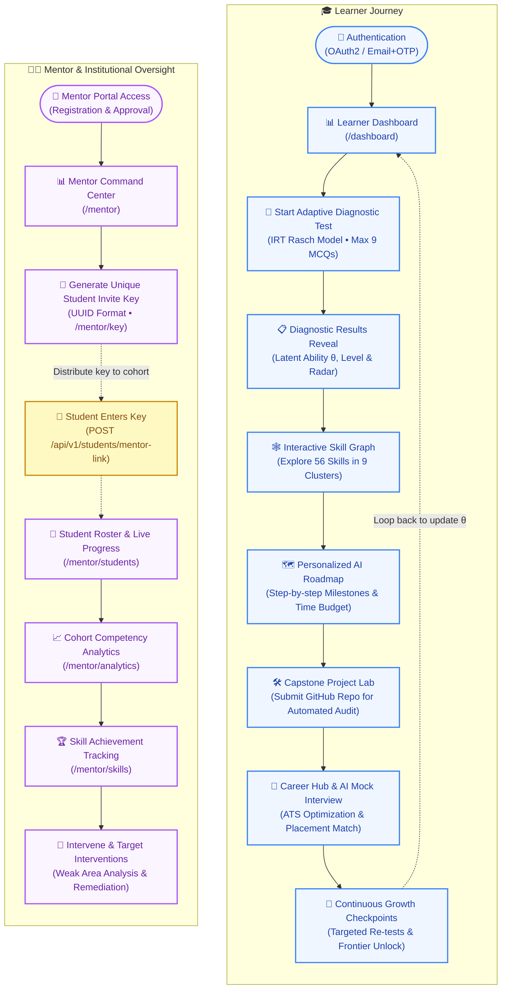

---

# 2. System Design

The System Design specifies technical communication protocols, security mechanics, relational database structure, asynchronous message lifecycles, and deterministic database queries.

### 2.1 Network Ingress, Security Boundaries & Protocols

```mermaid
flowchart LR
    subgraph PublicInternet ["Public Internet"]
        USER["Browser / Mobile Client"]
    end

    subgraph IngressZone ["Ingress & Reverse Proxy"]
        CF["Cloudflare Edge<br/>WAF, DDoS, TLS 1.3"]
        TUNNEL["Cloudflare Tunnel Connector"]
    end

    subgraph DMZ ["Spring Boot Gateway (Port 8080)"]
        CORS["CORS Handler<br/>Allowed Origins List"]
        RATE["Rate Limiter<br/>IP / Route Sliding Window"]
        JWT_FILTER["OncePerRequestFilter<br/>JWT Bearer Token Validator"]
        CONTROLLERS["Spring MVC Controllers<br/>@RestController"]
    end

    subgraph PrivateVPC ["Isolated Private Network"]
        DB[("PostgreSQL 16<br/>Port: 5432<br/>SSL Required")]
        WORKER["Node.js AI Worker<br/>Port: 3001<br/>No Public IP"]
    end

    USER -->|HTTPS / Port 443| CF
    CF --> TUNNEL
    TUNNEL -->|HTTP / Local Forward| CORS
    CORS --> RATE
    RATE --> JWT_FILTER
    JWT_FILTER --> CONTROLLERS
    CONTROLLERS -->|HikariCP / Encrypted JDBC| DB
    CONTROLLERS -->|HTTP POST with X-Internal-API-Key| WORKER

    classDef public fill:#f8fafc,stroke:#94a3b8,stroke-width:1.5px,color:#0f172a;
    classDef ingress fill:#e0f2fe,stroke:#0284c7,stroke-width:2px,color:#0369a1;
    classDef dmz fill:#f3e8ff,stroke:#9333ea,stroke-width:2px,color:#581c87;
    classDef privateNet fill:#dcfce7,stroke:#16a34a,stroke-width:2px,color:#14532d;

    class USER public;
    class CF,TUNNEL ingress;
    class CORS,RATE,JWT_FILTER,CONTROLLERS dmz;
    class DB,WORKER privateNet;
```

---

### 2.2 Authentication, JWT & Refresh Token Anti-Theft State Machine

The platform adheres to an uncompromising security model: **Access Tokens are kept strictly in-memory** to neutralize XSS theft. **Refresh Tokens are stored in HttpOnly cookies**, and the backend detects token theft using cryptographic hash rotation.

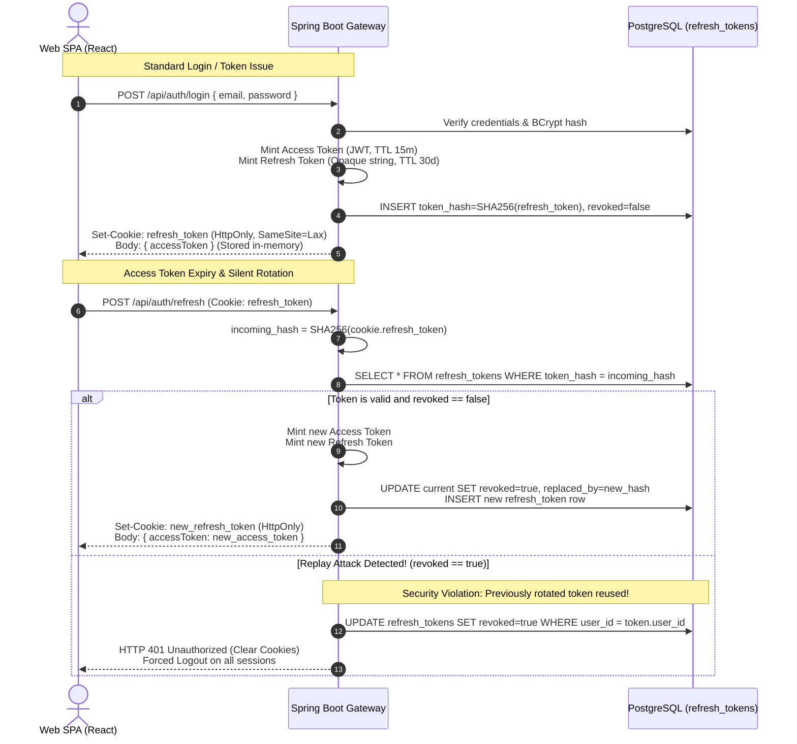

---

### 2.3 Relational Persistence Model (PostgreSQL ER Diagram)

```mermaid
erDiagram
    users ||--o{ oauth_accounts : "maps"
    users ||--o{ refresh_tokens : "owns"
    users ||--o{ email_verification_tokens : "receives"
    users ||--o{ password_reset_tokens : "receives"
    users ||--o{ assessments : "takes"
    users ||--o{ student_mentor_links : "student_links"
    users ||--o| mentor_profiles : "has_profile"
    users ||--o{ mentor_keys : "issues_as_mentor"
    
    tracks ||--o{ skills : "contains"
    tracks ||--o{ assessment_items : "provides"
    tracks ||--o{ assessments : "targets"

    skills ||--o{ skill_prerequisites : "skill_target"
    skills ||--o{ skill_prerequisites : "prerequisite_source"
    skills ||--o{ assessment_skill_results : "evaluated_in"

    assessments ||--o{ assessment_responses : "records"
    assessments ||--o{ assessment_skill_results : "produces"
    assessment_items ||--o{ assessment_responses : "answered_in"

    mentor_keys ||--o{ student_mentor_links : "authorizes"

    users {
        bigint id PK
        varchar email UK "Normalized lowercase"
        varchar password_hash "BCrypt hash"
        varchar full_name
        boolean email_verified
        varchar role "USER, MENTOR, ADMIN"
        varchar status "ACTIVE, SUSPENDED"
        timestamp created_at
    }

    mentor_profiles {
        bigint id PK
        bigint user_id FK,UK
        varchar designation
        varchar organization
        varchar expertise
        text bio
    }

    mentor_keys {
        bigint id PK
        bigint mentor_id FK
        varchar key_code UK "e.g. MENTOR-XXXX-YYYY"
        varchar status "ACTIVE, REVOKED, EXPIRED"
        int max_students
        int current_students
        timestamp expires_at
    }

    student_mentor_links {
        bigint id PK
        bigint student_id FK
        bigint mentor_id FK
        bigint key_id FK
        timestamp linked_at
    }

    tracks {
        uuid id PK
        varchar slug UK "backend-engineering"
        varchar name
        varchar status "ACTIVE, DRAFT"
    }

    skills {
        uuid id PK
        uuid track_id FK
        varchar slug UK "sql-basics"
        varchar name
        varchar cluster "Databases, Security, etc."
        double_precision difficulty "Logit value"
        text description
    }

    skill_prerequisites {
        uuid skill_id PK,FK
        uuid prerequisite_id PK,FK
    }

    assessment_items {
        uuid id PK
        uuid track_id FK
        varchar skill_slug
        double_precision difficulty "b_i logit"
        text stem "Question prompt"
        text options "JSON array of 4 options"
        int correct_option "0-indexed; hidden from client"
        varchar status "ACTIVE, RETIRED"
    }

    assessments {
        uuid id PK
        bigint user_id FK
        uuid track_id FK
        double_precision theta "Estimated ability"
        varchar competency_level "BEGINNER, INTERMEDIATE, ADVANCED"
        int questions_answered
        varchar stop_reason "LEVEL_CONFIRMED, MAX_ITEMS"
        varchar status "IN_PROGRESS, COMPLETED"
        timestamp created_at
        timestamp completed_at
    }

    assessment_responses {
        uuid id PK
        uuid assessment_id FK
        uuid item_id FK
        int selected_option
        boolean is_correct
        double_precision theta_after
        timestamp answered_at
    }
```

---

### 2.4 Asynchronous Worker Subsystem & Schema Contract Validation

To safeguard against generative LLM hallucination and keep public HTTP requests under 200ms, all compute-heavy AI tasks run asynchronously via background jobs:

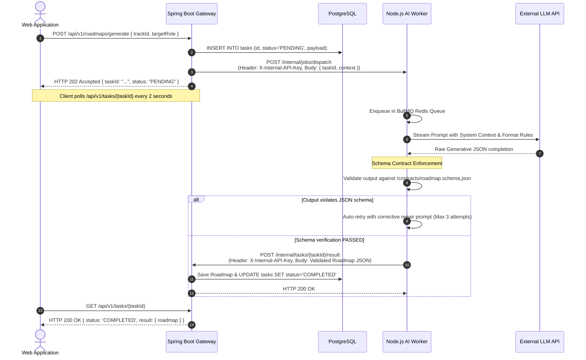

---

### 2.5 Database Query Performance & Direct Anti-Join Mechanics

The Computerized Adaptive Test evaluates millions of question combinations. Rather than loading items into memory or doing slow randomized pagination, the backend executes a **direct indexed anti-join**:

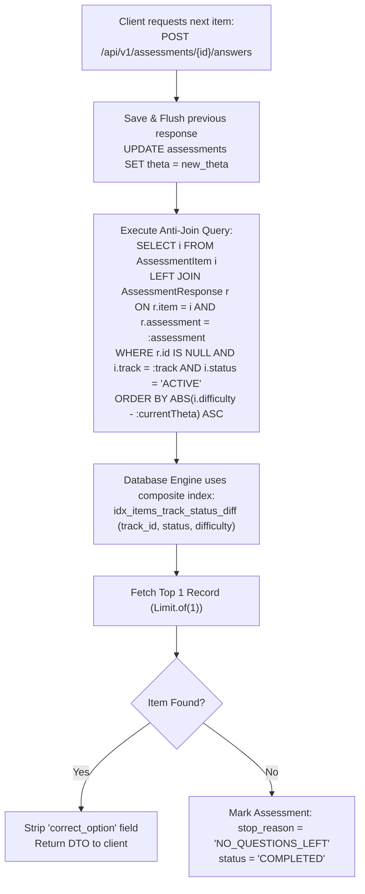

---

# 3. Low-Level Design (LLD) — All Platform Features

The Low-Level Design dissects every component and feature of the platform down to service calls, branch decisions, and state machine transitions.

---

### 3.1 Feature 1: Authentication & Identity Management

Handles User & Mentor signup, BCrypt hashing, Gmail SMTP 6-digit OTP verification, OAuth2 (Google & GitHub) with Account Linking protection, and secure session establishment.

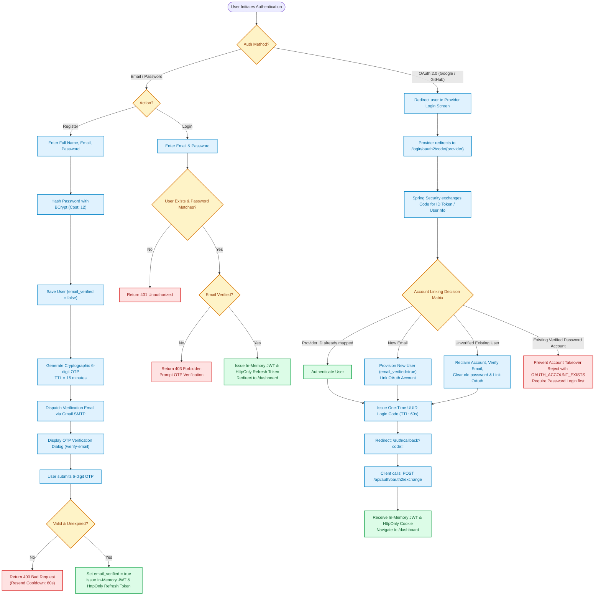

---

### 3.2 Feature 2: IRT 1-PL Rasch Computerized Adaptive Testing (CAT) Engine

Implements the Item Response Theory engine with standard error calculation, ability adjustments, anti-join selection, and stopping criteria.

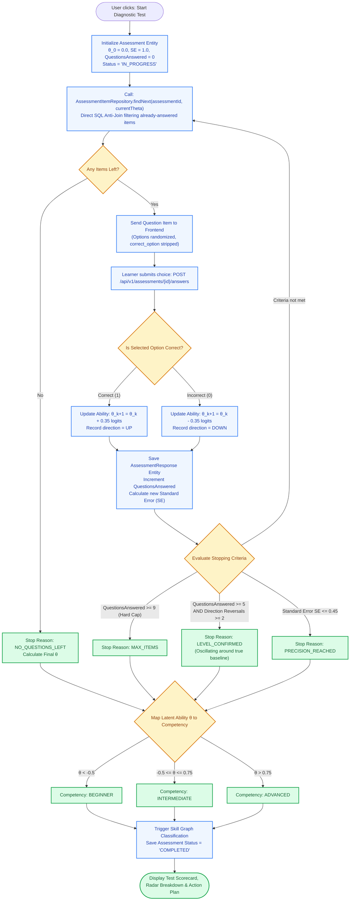

---

### 3.3 Feature 3: Topological Skill Graph (DAG) & Dynamic State Transitions

Maintains 56 atomic skills, prerequisite hierarchies, cycle detection on startup, and dynamic tri-state (`MASTERED`, `FRONTIER`, `LOCKED`) visual classification.

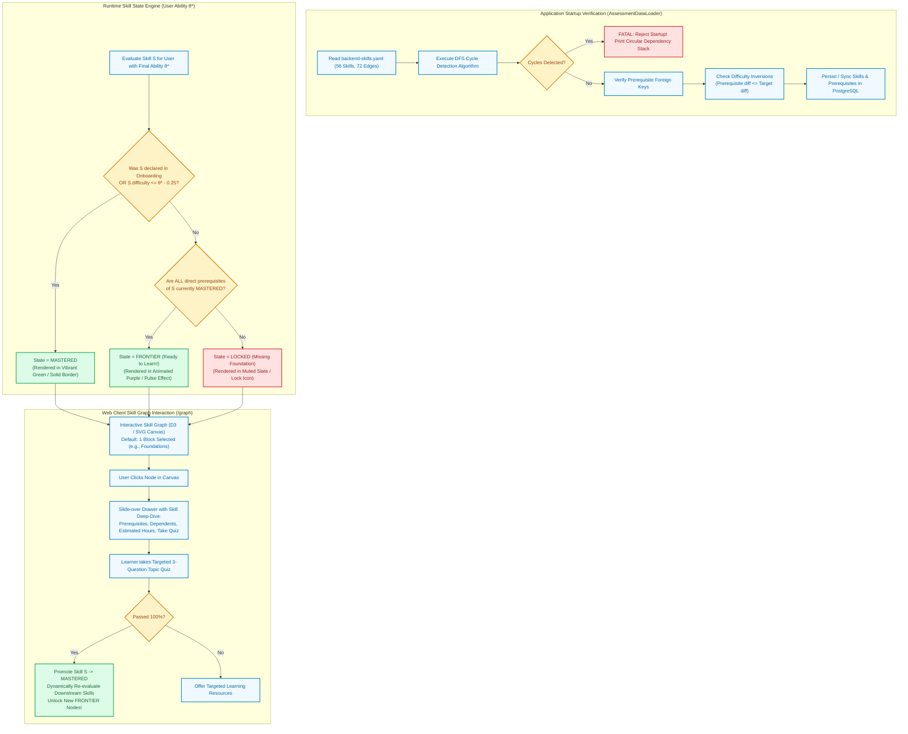

---

### 3.4 Feature 4: AI Learning Roadmap Generation & Milestone Progression

Transforms assessment gaps and user time availability into an ordered, milestone-driven curriculum with weekly pacing.

```mermaid
flowchart TD
    TRIGGER_ROADMAP([Learner requests personalized roadmap]) --> EXTRACT_GAPS["Gateway extracts Learner Profile:<br/>- Target Track (Backend Engineering)<br/>- Calibrated Ability θ<br/>- FRONTIER Skills list<br/>- Weekly Study Hours Budget"]
    EXTRACT_GAPS --> DISPATCH_JOB["Create Task (Status: PENDING)<br/>Dispatch Async Job to Node.js AI Worker"]
    DISPATCH_JOB --> PROMPT_BUILD["AI Worker constructs LLM Payload:<br/>Topological Graph Context + Pedagogical Guidelines"]
    PROMPT_BUILD --> LLM_GEN["Invoke LLM via OpenRouter<br/>(Gemini 2.5 Flash / Claude 3.5 Sonnet)"]
    LLM_GEN --> RAW_PAYLOAD["Receive Raw Milestone JSON"]
    
    RAW_PAYLOAD --> VALIDATE_SCHEMA{"Validate JSON against<br/>contracts/roadmap.schema.json"}
    VALIDATE_SCHEMA -- Fails Schema --> REPAIR_PROMPT["Send Repair Prompt to LLM with validation errors"] --> LLM_GEN
    VALIDATE_SCHEMA -- Passes Schema --> WORKER_CALLBACK["POST /internal/tasks/{id}/result<br/>Gateway saves Roadmap & Milestones"]
    
    WORKER_CALLBACK --> CLIENT_POLL["Web Client Polling detects status = 'COMPLETED'"]
    CLIENT_POLL --> RENDER_ROADMAP["Display Milestone Timeline (/roadmap):<br/>- Phase 1: Core Fundamentals<br/>- Phase 2: High-Yield APIs & Storage<br/>- Phase 3: Distributed Systems"]
    
    RENDER_ROADMAP --> USER_STUDIES["Learner works on active milestone topics"]
    USER_STUDIES --> TOGGLE_ITEM["Learner marks sub-task complete: PUT /api/v1/milestones/{id}"]
    TOGGLE_ITEM --> RECALC_PROGRESS["Update Completion % & Streak Days"]
    RECALC_PROGRESS --> CHECK_PHASE{All milestone tasks complete?}
    CHECK_PHASE -- Yes --> UNLOCK_NEXT_PHASE["Trigger Capstone Challenge for Phase<br/>Unlock Phase Badge"]
    CHECK_PHASE -- No --> USER_STUDIES

    classDef task fill:#f8fafc,stroke:#64748b,stroke-width:2px,color:#1e293b;
    classDef ai fill:#ede9fe,stroke:#7c3aed,stroke-width:2px,color:#4c1d95;
    classDef ui fill:#dcfce7,stroke:#16a34a,stroke-width:2px,color:#14532d;
    classDef decision fill:#fef3c7,stroke:#d97706,stroke-width:2px,color:#92400e;

    class TRIGGER_ROADMAP,EXTRACT_GAPS,DISPATCH_JOB,WORKER_CALLBACK,USER_STUDIES,TOGGLE_ITEM,RECALC_PROGRESS task;
    class PROMPT_BUILD,LLM_GEN,RAW_PAYLOAD,REPAIR_PROMPT ai;
    class CLIENT_POLL,RENDER_ROADMAP,UNLOCK_NEXT_PHASE ui;
    class VALIDATE_SCHEMA,CHECK_PHASE decision;
```

---

### 3.5 Feature 5: Capstone Project Verification Lab (GitHub Audit)

Provides verifiable proof of skill by auditing learner code repositories for production architectural patterns, unit test coverage, and security best practices.

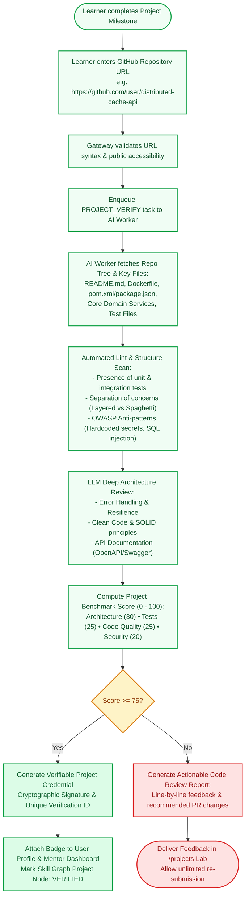

---

### 3.6 Feature 6: Test History & Deep Psychometric Analytics Engine

Aggregates learner ability curves over time, domain cluster mastery, and detailed question-by-question metrics for reflective self-improvement.

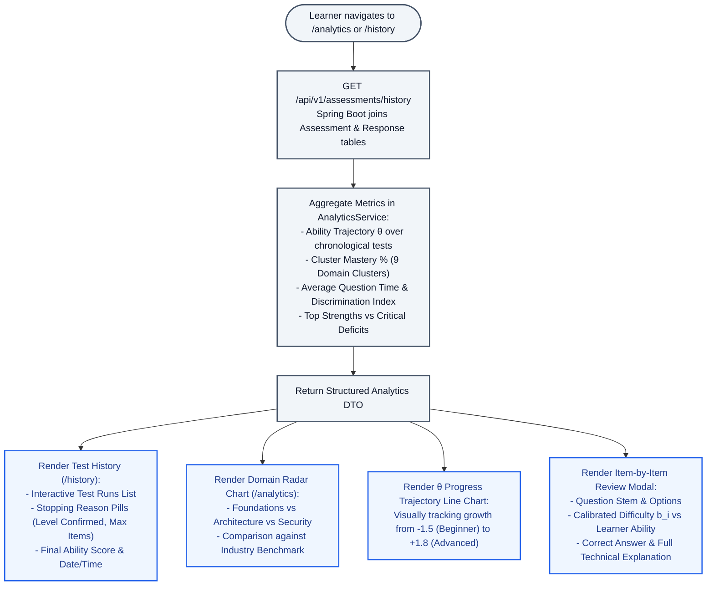

---

### 3.7 Feature 7: Mentor Management, Cohort Analytics & Invite Key Linking

Empowers enterprise educators, college professors, and senior engineering mentors to monitor student cohorts, audit skill gaps, and dispense guidance.

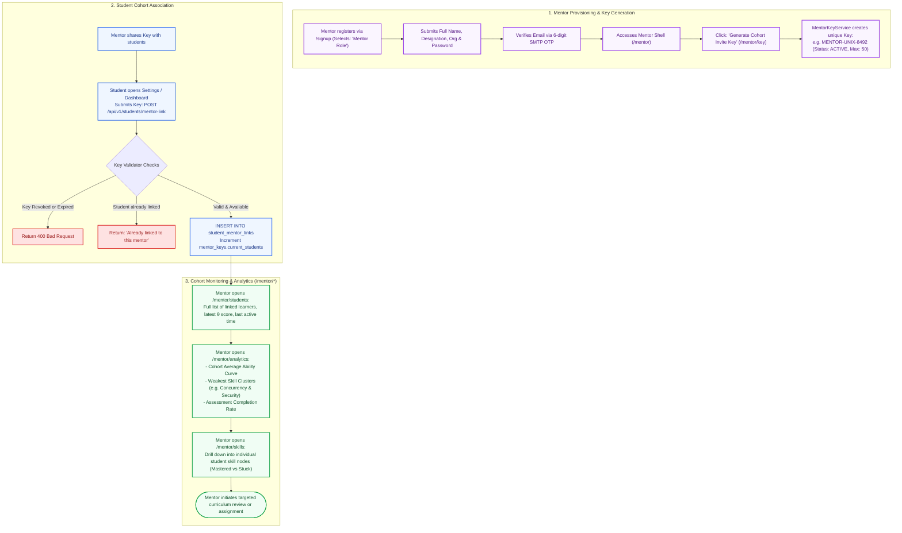

---

### 3.8 Feature 8: Career Hub, ATS Optimization & AI Mock Interview Suite

Closes the employability loop by scoring resumes against target job specs, identifying missing keywords, and executing real-time AI mock interviews.

```mermaid
flowchart TD
    START_CAREER([Learner navigates to /career]) --> CAREER_SELECT["Select Target Career Role<br/>(e.g., Senior Backend Engineer / Microservices Specialist)"]
    
    CAREER_SELECT --> ATS_UPLOAD["Upload Resume (PDF / DOCX / Text)"]
    ATS_UPLOAD --> PARSE_RESUME["Extract Extracted Skills, Experience & Projects"]
    
    PARSE_RESUME --> MATCH_GRAPH["Cross-reference with Verified Skill Graph & Assessments"]
    MATCH_GRAPH --> ATS_SCORING["Compute ATS Match Score (0 - 100%):<br/>- Keywords Present vs Missing<br/>- Verified Skills vs Self-Reported Claims<br/>- High-Impact Action Verb Suggestions"]
    
    ATS_SCORING --> PRESENT_ATS["Render ATS Report (/career):<br/>Missing Keywords, Formatting Warnings, Matched Job Postings"]
    
    PRESENT_ATS --> START_INTERVIEW["Click: 'Start AI Technical Mock Interview'"]
    START_INTERVIEW --> INTERVIEW_SESSION["AI Worker initiates conversational interview session:<br/>Generates questions tailored to learner's FRONTIER skills"]
    
    INTERVIEW_SESSION --> USER_ANSWER["Learner types or speaks response"]
    USER_ANSWER --> AI_RUBRIC["AI evaluates on Standard Rubric:<br/>1. Technical Accuracy<br/>2. Depth of Architectural Reasoning<br/>3. Communication Clarity"]
    
    AI_RUBRIC --> NEXT_Q{Interview finished? (5 Questions)}
    NEXT_Q -- No --> INTERVIEW_SESSION
    NEXT_Q -- Yes --> SCORECARD(["Generate Comprehensive Interview Scorecard<br/>Strengths, Blindspots, Sample Model Answers & Placement Recommendation"])

    classDef cHub fill:#eff6ff,stroke:#3b82f6,stroke-width:2px,color:#1e40af;
    classDef ats fill:#fef3c7,stroke:#d97706,stroke-width:2px,color:#92400e;
    classDef interview fill:#ede9fe,stroke:#7c3aed,stroke-width:2px,color:#4c1d95;
    classDef done fill:#dcfce7,stroke:#16a34a,stroke-width:2px,color:#166534;

    class START_CAREER,CAREER_SELECT cHub;
    class ATS_UPLOAD,PARSE_RESUME,MATCH_GRAPH,ATS_SCORING,PRESENT_ATS ats;
    class START_INTERVIEW,INTERVIEW_SESSION,USER_ANSWER,AI_RUBRIC interview;
    class NEXT_Q,SCORECARD done;
```

---

# 4. Cross-Cutting Architectural Invariants & Data Flow Matrix

To ensure system reliability, enterprise maintainability, and zero regression during rapid development, the platform adheres to this strict Architectural Invariants Matrix:

| Invariant Category | Strict Architectural Rule | Enforcement Mechanism |
| :--- | :--- | :--- |
| **Authentication & Tokens** | Access tokens are strictly **IN-MEMORY** on client. Never in `localStorage` or `sessionStorage`. | Enforced in `api.js` (`let inMemoryToken = null;`). Refresh tokens stored strictly as SHA-256 hashes in database. |
| **Token Anti-Theft** | If a previously rotated refresh token is presented, revoke all active sessions for that user. | Enforced in `AuthTokenServiceImpl.java` (`token.isRevoked()` triggers batch revocation). |
| **Psychometric Integrity** | The CAT engine must produce bit-identical logit results for identical input sequences. | Enforced via pure deterministic Java math in `AssessmentService.java` (no random jitter). |
| **Anti-Join Item Delivery** | Already-answered question items must never be served twice in the same assessment. | Enforced via SQL `LEFT JOIN AssessmentResponse r ON r.item_id = i.id AND r.assessment_id = :id WHERE r.id IS NULL`. |
| **Startup Graph Safety** | The backend must abort boot sequence if the skill DAG has circular dependencies. | Enforced via DFS recursion check in `AssessmentDataLoader.java`. |
| **Worker Isolation** | The AI Worker never accesses the database directly. Only communicates via Gateway callbacks. | Private VPC network; requests authenticated via secret header `X-Internal-API-Key`. |
| **Contract Strictness** | Every generative payload must validate against Draft 7 JSON schemas before ingestion. | Schema validation in worker (`contracts/*.json`) and secondary schema assertion in Gateway. |
| **CORS & Access Control** | Strictly allow approved origins only (`localhost:5173`, `localhost:3000`, `capacitor://localhost`). | Enforced via `SecurityConfig.java` using `app.auth.cors.allowed-origins`. |
| **Database Integrity** | Flyway migrations manage schema evolution; foreign keys enforce referential cascades. | PostgreSQL constraints (`ON DELETE CASCADE` on responses, tokens, and prerequisites). |

---

> Built with precision by **Team Unix** (Lakshmi Narain College of Technology, Bhopal) for the **EPAM Systems CoE Programme**.  
> Lead Maintainer: **Dev Sharma** (`dev47929@gmail.com`)

