# AI-Powered Upskilling Platform — System Design & Flowchart Specifications (Implemented System)

> **Document Scope:** Production-Ready & Implemented Subsystems Only  
> **Repository:** `LNCT-Unix/AI-Powered-Upskilling-Platform`  
> **Authors:** Team Unix (Lakshmi Narain College of Technology, Bhopal)  
> **Lead Maintainer:** Dev Sharma  
> **Last Updated:** October 2026  

---

## 📑 Table of Contents

1. [High-Level Design (HLD)](#1-high-level-design-hld)
   - [1.1 Current System Architecture & Runtime Topology](#11-current-system-architecture--runtime-topology)
   - [1.2 Dual-Persona Platform Lifecycle (Learner & Mentor)](#12-dual-persona-platform-lifecycle-learner--mentor)
2. [System Design](#2-system-design)
   - [2.1 Network Ingress, Security Filters & Communication Protocols](#21-network-ingress-security-filters--communication-protocols)
   - [2.2 In-Memory JWT & Refresh Token Anti-Theft Rotation State Machine](#22-in-memory-jwt--refresh-token-anti-theft-rotation-state-machine)
   - [2.3 Relational Persistence Model (PostgreSQL ER Diagram)](#23-relational-persistence-model-postgresql-er-diagram)
   - [2.4 Database Query Performance: Indexed Anti-Join Item Selection](#24-database-query-performance-indexed-anti-join-item-selection)
3. [Low-Level Design (LLD) — Implemented Features](#3-low-level-design-lld--implemented-features)
   - [3.1 Feature 1: Authentication & Identity Management](#31-feature-1-authentication--identity-management)
   - [3.2 Feature 2: IRT 1-PL Rasch Computerized Adaptive Testing (CAT) Engine](#32-feature-2-irt-1-pl-rasch-computerized-adaptive-testing-cat-engine)
   - [3.3 Feature 3: Topological Skill Graph (DAG) & Dynamic State Transitions](#33-feature-3-topological-skill-graph-dag--dynamic-state-transitions)
   - [3.4 Feature 4: Test History & Psychometric Evaluation Tracking](#34-feature-4-test-history--psychometric-evaluation-tracking)
   - [3.5 Feature 5: Mentor Workspace, Cohort Analytics & Invite Key Linking](#35-feature-5-mentor-workspace-cohort-analytics--invite-key-linking)
4. [Active Engineering Invariants & Data Flow Matrix](#4-active-engineering-invariants--data-flow-matrix)

---

# 1. High-Level Design (HLD)

The High-Level Design illustrates the actual running architecture: the React 19 Single Page Application, the Ingress/Tunnel layer, the Spring Boot Gateway containing all business logic, the PostgreSQL persistence store, and external Identity/SMTP integrations.

### 1.1 Current System Architecture & Runtime Topology

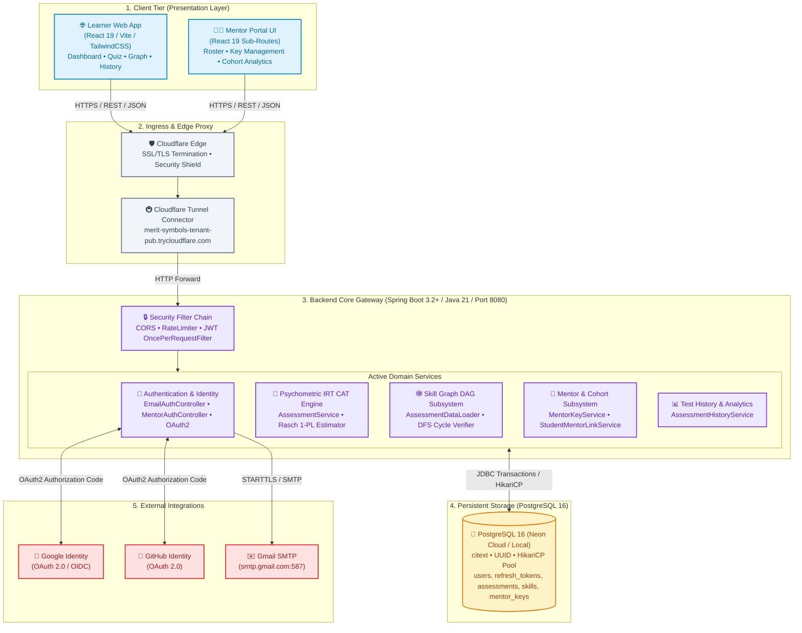

---

### 1.2 Dual-Persona Platform Lifecycle (Learner & Mentor)

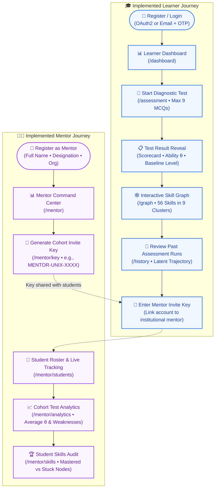

---

# 2. System Design

### 2.1 Network Ingress, Security Filters & Communication Protocols

```mermaid
flowchart LR
    subgraph PublicClient ["Client Layer"]
        SPA["Browser Client<br/>React 19 SPA"]
    end

    subgraph EdgeLayer ["Ingress & Proxy"]
        CF["Cloudflare Edge & Tunnel<br/>HTTPS :443 Termination"]
    end

    subgraph GatewayCore ["Spring Boot Gateway (Port 8080)"]
        CORS["CORS Filter<br/>Allowed Origins: localhost:5173, etc."]
        RATE["Rate Limiter Filter<br/>Cooldown: 60s for OTP sends"]
        JWT_FILTER["OncePerRequestFilter<br/>Bearer Token Authentication"]
        CONTROLLER["REST Controllers<br/>@RestController"]
    end

    subgraph StorageLayer ["PostgreSQL 16"]
        DB[("PostgreSQL Database<br/>HikariCP Connection Pool")]
    end

    SPA -->|HTTPS / JSON| CF
    CF -->|HTTP Forward| CORS
    CORS --> RATE
    RATE --> JWT_FILTER
    JWT_FILTER --> CONTROLLER
    CONTROLLER -->|HikariCP JDBC| DB

    classDef pub fill:#f8fafc,stroke:#94a3b8,stroke-width:1.5px,color:#0f172a;
    classDef ing fill:#e0f2fe,stroke:#0284c7,stroke-width:2px,color:#0369a1;
    classDef gwy fill:#ede9fe,stroke:#7c3aed,stroke-width:2px,color:#581c87;
    classDef dbs fill:#fef3c7,stroke:#d97706,stroke-width:2px,color:#78350f;

    class SPA pub;
    class CF ing;
    class CORS,RATE,JWT_FILTER,CONTROLLER gwy;
    class DB dbs;
```

---

### 2.2 In-Memory JWT & Refresh Token Anti-Theft Rotation State Machine

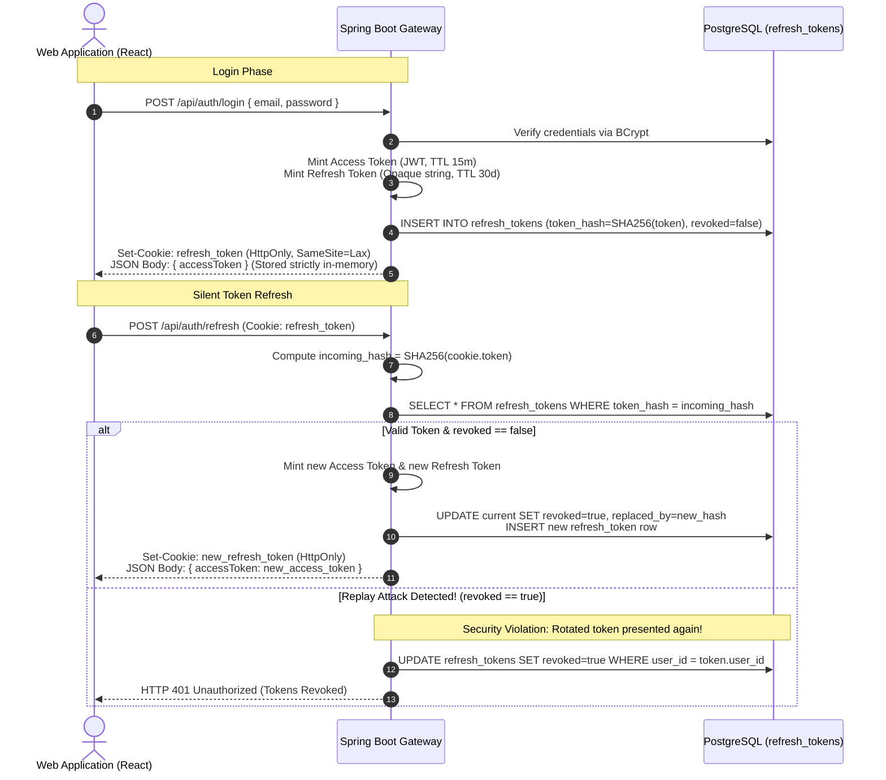

---

### 2.3 Relational Persistence Model (PostgreSQL ER Diagram)

```mermaid
erDiagram
    users ||--o{ oauth_accounts : "maps"
    users ||--o{ refresh_tokens : "owns"
    users ||--o{ email_verification_tokens : "receives"
    users ||--o{ password_reset_tokens : "receives"
    users ||--o{ assessments : "takes"
    users ||--o{ student_mentor_links : "student_links"
    users ||--o| mentor_profiles : "has_profile"
    users ||--o{ mentor_keys : "issues_as_mentor"
    
    tracks ||--o{ skills : "contains"
    tracks ||--o{ assessment_items : "provides"
    tracks ||--o{ assessments : "targets"

    skills ||--o{ skill_prerequisites : "target_skill"
    skills ||--o{ skill_prerequisites : "prerequisite_source"
    skills ||--o{ assessment_skill_results : "evaluated_in"

    assessments ||--o{ assessment_responses : "records"
    assessments ||--o{ assessment_skill_results : "produces"
    assessment_items ||--o{ assessment_responses : "answered_in"

    mentor_keys ||--o{ student_mentor_links : "authorizes"

    users {
        bigint id PK
        varchar email UK "Normalized lowercase"
        varchar password_hash "BCrypt hash"
        varchar full_name
        boolean email_verified
        varchar role "USER, MENTOR, ADMIN"
        varchar status "ACTIVE, SUSPENDED"
        timestamp created_at
    }

    mentor_profiles {
        bigint id PK
        bigint user_id FK,UK
        varchar designation
        varchar organization
        varchar expertise
        text bio
    }

    mentor_keys {
        bigint id PK
        bigint mentor_id FK
        varchar key_code UK "e.g. MENTOR-UNIX-8492"
        varchar status "ACTIVE, REVOKED, EXPIRED"
        int max_students
        int current_students
        timestamp expires_at
    }

    student_mentor_links {
        bigint id PK
        bigint student_id FK
        bigint mentor_id FK
        bigint key_id FK
        timestamp linked_at
    }

    tracks {
        uuid id PK
        varchar slug UK "backend-engineering"
        varchar name
        varchar status "ACTIVE, DRAFT"
    }

    skills {
        uuid id PK
        uuid track_id FK
        varchar slug UK "sql-joins-aggregation"
        varchar name
        varchar cluster "Databases, Security, etc."
        double_precision difficulty "Logit value [-3.0, +3.0]"
        text description
    }

    skill_prerequisites {
        uuid skill_id PK,FK
        uuid prerequisite_id PK,FK
    }

    assessment_items {
        uuid id PK
        uuid track_id FK
        varchar skill_slug
        double_precision difficulty "b_i logit"
        text stem "Question prompt"
        text options "JSON array of 4 options"
        int correct_option "0-indexed; hidden during test"
        varchar status "ACTIVE, RETIRED"
    }

    assessments {
        uuid id PK
        bigint user_id FK
        uuid track_id FK
        double_precision theta "Estimated ability"
        varchar competency_level "BEGINNER, INTERMEDIATE, ADVANCED"
        int questions_answered
        varchar stop_reason "LEVEL_CONFIRMED, MAX_ITEMS"
        varchar status "IN_PROGRESS, COMPLETED"
        timestamp created_at
        timestamp completed_at
    }

    assessment_responses {
        uuid id PK
        uuid assessment_id FK
        uuid item_id FK
        int selected_option
        boolean is_correct
        double_precision theta_after
        timestamp answered_at
    }
```

---

### 2.4 Database Query Performance: Indexed Anti-Join Item Selection

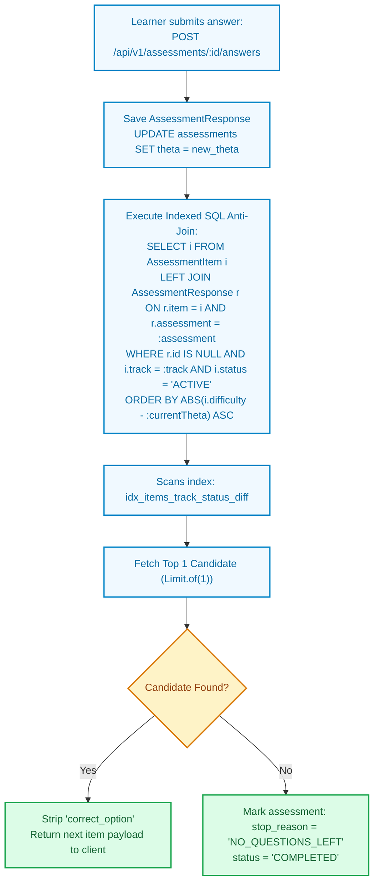

---

# 3. Low-Level Design (LLD) — Implemented Features

---

### 3.1 Feature 1: Authentication & Identity Management

Implemented across `EmailAuthController`, `MentorAuthController`, `SecurityConfig`, and OAuth2 handlers.

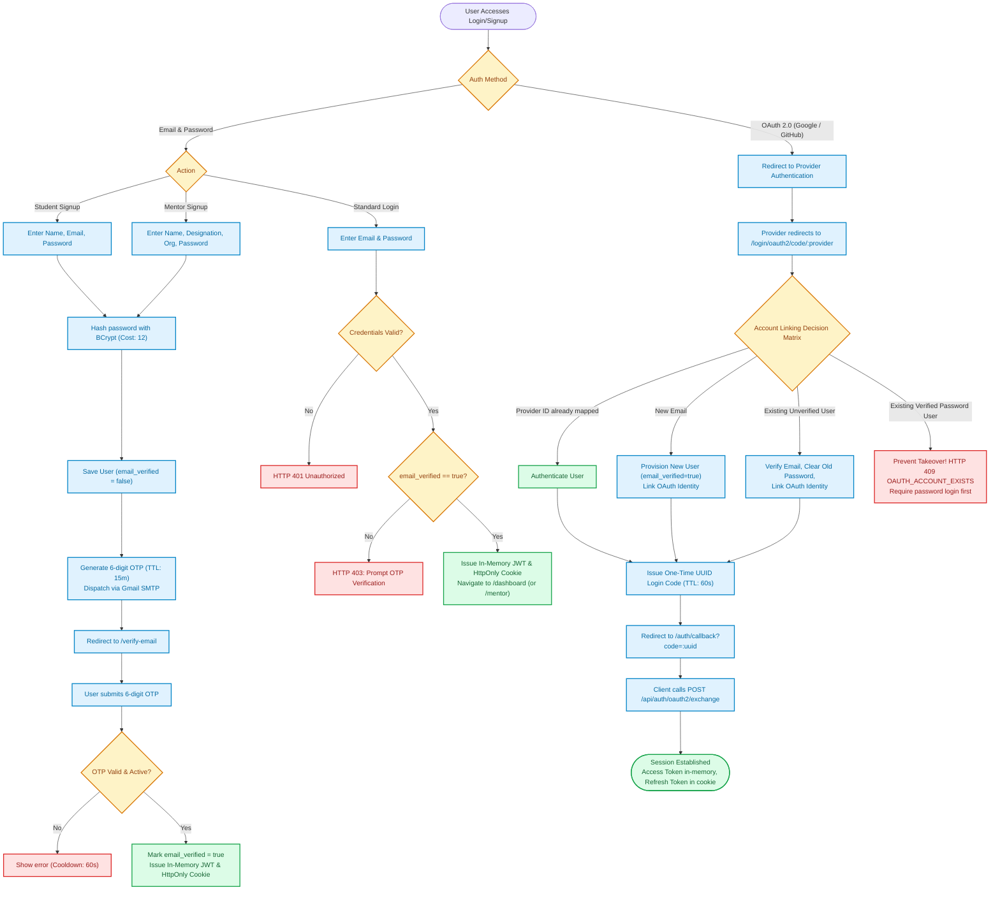

---

### 3.2 Feature 2: IRT 1-PL Rasch Computerized Adaptive Testing (CAT) Engine

Implemented in `AssessmentService.java` and `AssessmentController.java`.

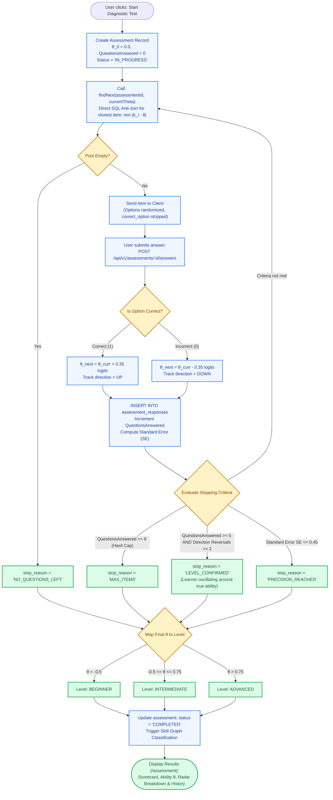

---

### 3.3 Feature 3: Topological Skill Graph (DAG) & Dynamic State Transitions

Implemented in `AssessmentDataLoader.java` (backend verification) and `InteractiveSkillGraph.jsx` (frontend visualization).

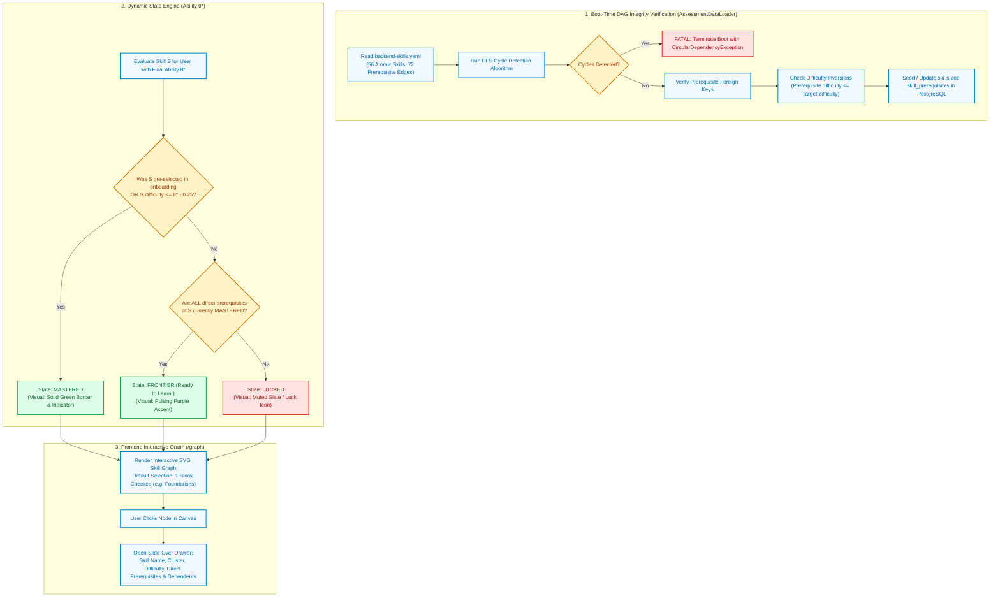

---

### 3.4 Feature 4: Test History & Psychometric Evaluation Tracking

Implemented in `AssessmentController` (`/api/v1/assessments/history`) and `TestHistoryPage.jsx`.

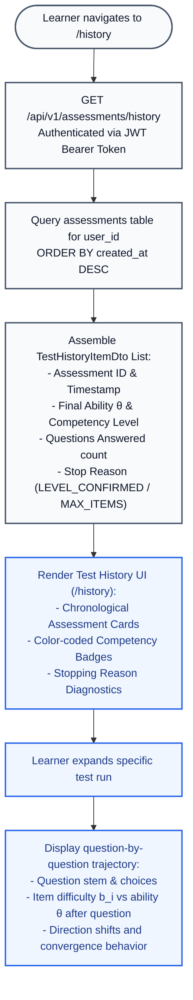

---

### 3.5 Feature 5: Mentor Workspace, Cohort Analytics & Invite Key Linking

Implemented across `MentorKeyController`, `StudentMentorLinkController`, `MentorAnalyticsController`, and `MentorDashboard.jsx`.

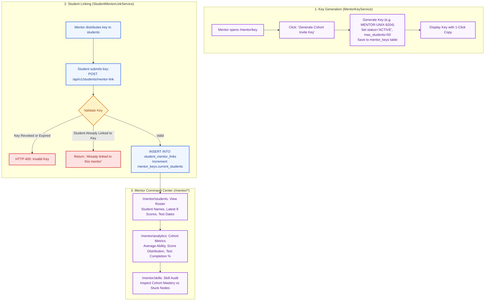

---

# 4. Active Engineering Invariants & Data Flow Matrix

| Architectural Principle | Active Implementation in Codebase | Verification Mechanism |
| :--- | :--- | :--- |
| **In-Memory JWT Access Tokens** | Stored strictly in module variable in `src/services/api.js`. Never in `localStorage` or `sessionStorage`. | Browser audit: `localStorage.getItem('token')` returns `null`. |
| **HttpOnly Refresh Token Rotation** | Minted by `AuthTokenServiceImpl.java`, saved in `refresh_tokens` as SHA-256 hashes, transmitted in HttpOnly cookies. | Verified in `AuthTokenController.java`; reused rotated tokens trigger session invalidation. |
| **Deterministic CAT Math** | 1-PL Rasch algorithm in `AssessmentService.java` executes pure deterministic arithmetic without random seeds. | Unit tests in `AssessmentServiceTest.java` guarantee identical inputs produce bit-identical logit results. |
| **Duplicate Prevention (Anti-Join)** | `AssessmentItemRepository.java` uses `LEFT JOIN AssessmentResponse r ON r.item.id = i.id ... WHERE r.id IS NULL`. | Guarantees an item is never served more than once per test session. |
| **Cycle Prevention at Startup** | `AssessmentDataLoader.java` runs Depth-First Search cycle detection before seeding skills into PostgreSQL. | Startup fails fast with `CircularDependencyException` if a cycle is introduced to `backend-skills.yaml`. |
| **Unique Mentor Cohort Keys** | `MentorKeyGenerator.java` generates cryptographically unique keys with maximum capacity enforcement. | Database `UNIQUE(key_code)` constraint prevents duplicate keys. |
| **Strict Single Block Default** | `InteractiveSkillGraph.jsx` initializes `defaultSelectedClusters` with only 1 block checked. | Verified in React state: loads 1 block (e.g. Foundations) by default. |

---

> Maintained by **Team Unix** (Lakshmi Narain College of Technology, Bhopal) for the **EPAM Systems CoE Programme**.  
> Lead Maintainer: **Dev Sharma** (`dev47929@gmail.com`)
