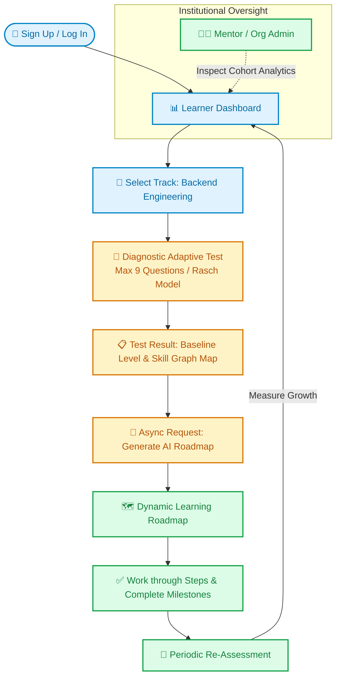
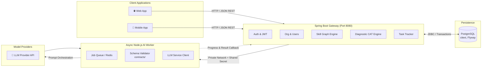
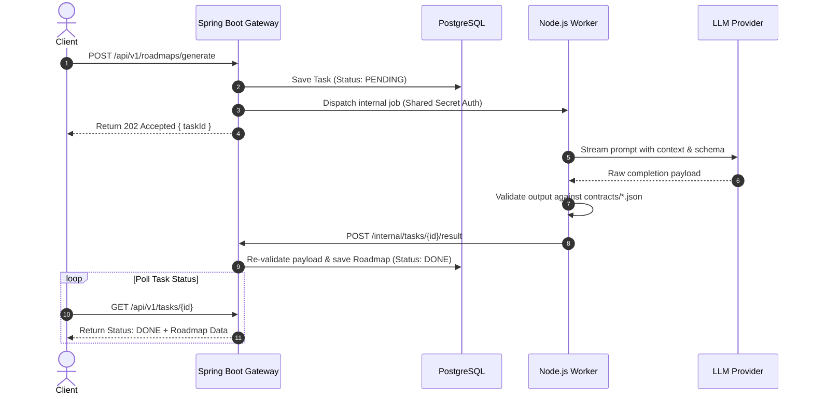

# AI Career & Skill Roadmap Platform

<div align="center">

[](https://spring.io/projects/spring-boot)
[](https://www.oracle.com/java/)
[](https://nodejs.org/)
[](https://www.postgresql.org/)
[](https://www.docker.com/)
[](https://www.epam.com/)

<p align="center">
  <b>An AI-powered upskilling platform that measures true learner baselines, generates tailored skill roadmaps, and benchmarks ongoing mastery.</b>
</p>

<sub>Built with precision by <b>Team Unix</b> (Lakshmi Narain College of Technology, Bhopal) for the <b>EPAM CoE Programme</b>.<br/>Maintainer: <b>Dev Sharma</b></sub>

---

</div>

## 📑 Table of Contents

- [💡 The Idea](#-the-idea)
- [✨ Features and Status](#-features-and-status)
- [🔄 The Learner Journey](#-the-learner-journey)
- [🏛️ Architecture](#️-architecture)
  - [AI Job Lifecycle](#ai-job-lifecycle)
- [🎯 Diagnostic Test (IRT Rasch Model)](#-diagnostic-test-irt-rasch-model)
- [📊 Skill Graph](#-skill-graph)
- [🤖 AI Worker](#-ai-worker)
- [📅 Delivery Plan](#-delivery-plan)
- [📂 Repository Structure](#-repository-structure)
- [🛠️ Tech Stack](#️-tech-stack)
- [🚀 Getting Started](#-getting-started)
- [🔌 API Overview](#-api-overview)
- [🗄️ Database Overview](#️-database-overview)
- [🛡️ Security](#️-security)
- [🧪 Testing](#-testing)
- [📚 Documentation](#-documentation)
- [🤝 Contributing](#-contributing)
- [👥 Team](#-team)

---

## 💡 The Idea

Most learners choose what to study by guesswork: repeating familiar concepts or jumping prematurely into topics they are unequipped for. This platform replaces guesswork with three precise, data-driven phases:

```
┌────────────────────────┐      ┌────────────────────────┐      ┌────────────────────────┐
│     01. 🎯 MEASURE     │ ───► │      02. 🧭 PLAN       │ ───► │      03. 📈 TRACK      │
│  Adaptive test pins    │      │ AI model synthesizes   │      │ Progress marked step-  │
│  actual ability level  │      │ skill graph & gaps     │      │ by-step with re-tests  │
└────────────────────────┘      └────────────────────────┘      └────────────────────────┘
```

1. **Measure**: A short, adaptive diagnostic test finds the learner's true baseline in a chosen track with mathematical rigor.
2. **Plan**: An LLM orchestrator takes the test diagnostics and track graph to generate a structured, ordered learning roadmap.
3. **Track**: The learner works through milestones, updates skill states, and re-evaluates through periodic checkpoints.
4. **Institutional Oversight**: Colleges, enterprises, and teams can group cohorts and grant mentors full visibility into member trajectories.

---

## ✨ Features and Status

| Feature Area | What the User Gets | Status |
| :--- | :--- | :---: |
| **Accounts** | Sign up, log in, session refresh, password reset, profile management | `Designed` |
| **Tracks** | Guided learning tracks (Backend, Frontend, etc.); Backend track built first | `Backend Designed` |
| **Skill Graph** | Directed Acyclic Graph (DAG) with prerequisites rendered as an interactive skill map | `Backend Written (56 Skills)` |
| **Diagnostic Test** | Computerized Adaptive Test (CAT) finding baseline level in under 10 questions | `Engine Built & Simulated` |
| **Question Bank** | Concept-driven multiple-choice questions tagged to atomic skills | `To Be Written` |
| **Dashboard** | Ability metric per track, interactive skill map, assessment history | `Designed` |
| **Admin Authoring** | Manage tracks, skill nodes, prerequisite edges, and question banks | `Designed` |
| **AI Roadmaps** | Personalized, step-by-step roadmap synthesized from assessment gaps | `Planned` |
| **Progress Tracking** | Mark milestones complete, observe live skill state transitions, re-test | `Planned` |
| **Organizations & Mentors** | Tenant workspaces, member invites, role-based mentor dashboards | `Planned` |
| **AI-Assisted Authoring** | LLM generation of draft questions and skill graphs under admin review | `Planned` |
| **Web & Mobile Clients** | Modern unified backend supporting web first, mobile after | `Web First, Mobile Next` |

---

## 🔄 The Learner Journey



---

## 🏛️ Architecture

The platform separates high-throughput transactional responsibilities from slow, asynchronous generative operations:



| Service | Primary Responsibility |
| :--- | :--- |
| **Gateway (Spring Boot 3.2+)** | Authentication, authorization, organizations, CRUD, skill graph traversal, Rasch CAT test engine, roadmap progression, and task lifecycle management. The **only** public-facing entry point and sole database actor. |
| **AI Worker (Node.js)** | Offloads slow, asynchronous generative tasks. Completely stateless, insulated on a private network, and verifies all payload schemas against `contracts/` before returning. |

### AI Job Lifecycle



---

## 🎯 Diagnostic Test (IRT Rasch Model)

The diagnostic module employs **Item Response Theory (1-Parameter Logistic / Rasch Model)**. Implemented in pure Java without external dependencies, it guarantees deterministic, mathematically verifiable ability estimations:

- **Single Latent Scale**: Both item difficulty ($b_i$) and student ability ($\theta$) are placed on a shared logit scale ($\approx -3.0$ to $+3.0$).
- **Dynamic Selection**: After each submitted response, learner ability ($\hat{\theta}$) and Standard Error ($SE$) update instantly. The next item is selected based on maximum Fisher information around $\hat{\theta}$, penalized for cluster over-representation to ensure wide domain coverage.
- **Stopping Criteria**:
  - Minimum questions: `5`
  - Termination threshold: $SE \le 0.45$
  - Hard cap: `9` questions (always completes in under 10 queries)
- **Outcome**: Ability maps to discrete competencies (`Beginner`, `Intermediate`, `Advanced`), dynamically painting the skill graph into `Mastered`, `Ready to Learn`, and `Locked` states.

> [!NOTE]
> ### 1,000 Virtual Learner Simulation Benchmark
> - **Average test length:** 7.5 questions (91.5% stop before question 9)
> - **Accuracy ($r$ vs. true ability):** $0.90$
> - **Test-retest reliability ($r$):** $0.80$
> - **Deterministic replay:** Identical question inputs produce identical logit outputs.

---

## 📊 Skill Graph

The curriculum is modeled as a formal Directed Acyclic Graph (DAG). The primary reference track is **Language-Agnostic Backend Engineering**, evaluating fundamental software engineering competencies rather than syntax trivia.

```
       [Programming Foundations]
                   │
      ┌────────────┴────────────┐
      ▼                         ▼
 [Web Protocols & APIs]    [Data Modeling & SQL]
      │                         │
      ├─────────────────────────┤
      ▼                         ▼
[Application Security]    [Indexing & Caching]
      │                         │
      └────────────┬────────────┘
                   ▼
       [Distributed Architecture]
```

| Metric | Backend Engineering Track |
| :--- | :---: |
| **Total Skills** | `56` |
| **Prerequisite Edges** | `72` |
| **Longest Dependency Chain** | `6 skills` |
| **Domain Clusters (9)** | `Foundations`, `Web APIs`, `Databases`, `Security`, `Architecture`, `Performance`, `Async & Distributed`, `Quality & Observability`, `DevOps` |

> [!TIP]
> The skill graph is managed as a version-controlled YAML specification (`backend-skills.yaml`). On startup, the engine verifies the graph against cycle creation, orphaned prerequisites, and difficulty inversions.

---

## 🤖 AI Worker

The worker operates as a secure, sandboxed background subsystem handling heavy language model invocations.

| Task Type | Context / Input | Output Specification |
| :--- | :--- | :--- |
| `ROADMAP_GENERATE` | Track ID, estimated level, skill mastery states, target goals | Milestone roadmap JSON: ordered phases, recommended resources, estimated hours |
| `RESULT_EXPLAIN` | Completed diagnostic assessment answers & scores | Executive diagnostic evaluation, strength highlights, critical learning gaps |
| `ITEM_DRAFT` | Target track, target skill, requested batch count | Draft diagnostic MCQs with rationale (held for administrator moderation) |
| `SKILL_GRAPH_DRAFT` | Domain / track title | Draft YAML skill graph nodes with prerequisite edges for admin approval |

**Operational Safeguards:**
- **Strict Idempotency:** Jobs are identified and tracked by unique `taskId` keys.
- **Resilience:** Automatic exponential backoff with a default ceiling of 3 retries.
- **Contract Enforcement:** All generative completions are validated against canonical JSON schemas located in `/contracts`.

---

## 📅 Delivery Plan

The roadmap targets a 4-sprint MVP structure.

| Sprint | Core Objective | Acceptance Criteria |
| :---: | :--- | :--- |
| `Sprint 1` | Skill Graph & IRT CAT Engine for Backend Track, Auth Core | Engine calculates learner logit in $<10$ questions with $SE \le 0.45$; secure JWT auth |
| `Sprint 2` | Question Bank integration & Dynamic Skill Map Visualizer | Full 90-item question coverage; dynamic mastery rendering on dashboard |
| `Sprint 3` | AI Worker integration & Personalized Roadmap Synthesis | End-to-end async job pipeline generating validated JSON learning roadmaps |
| `Sprint 4` | Organizations, Mentor Dashboards & Multi-tenant analytics | Cohort management, tenant isolation, and mentor progress audits |

---

## 📂 Repository Structure

```plaintext
AI-Powered-Upskilling-Platform/
├── README.md                          # Project documentation
├── docker-compose.yml                 # Gateway, AI worker, PostgreSQL, Redis orchestration
├── .env.example                       # Reference environment variables
│
├── contracts/                         # Shared JSON Schemas for LLM outputs
│   ├── roadmap.schema.json
│   └── assessment-item.schema.json
│
├── docs/                              # Architectural schematics, flowcharts & API references
│   └── sprint1-flowchart.md
│
├── gateway/                           # Primary Spring Boot 3.2+ Application
│   └── src/main/java/com/platform/
│       ├── auth/                      # JWT, security filters, user credentials
│       ├── org/                       # Multi-tenant organization boundaries
│       ├── assessment/                # IRT Rasch CAT engine, skill loader, test sessions
│       ├── tasks/                     # Async AI task lifecycle management
│       ├── worker/                    # Internal HTTP client for AI Worker communication
│       └── common/                    # Shared exceptions, utilities, response envelopes
│   └── src/main/resources/
│       ├── application.yml            # Gateway configuration & test thresholds
│       ├── db/migration/              # Flyway migration scripts
│       └── seed/                      # backend-skills.yaml & baseline questions
│
├── ai-worker/                         # Sandboxed Node.js Generative Worker
│   └── src/
│       ├── server.js                  # Private endpoints
│       ├── queue/                     # Task execution & Redis workers
│       ├── llm/                       # Provider drivers & prompt templates
│       └── validation/                # AJV schema validators against /contracts
│
├── web-app/                           # Web presentation layer
└── mobile-app/                        # Mobile client application
```

---

## 🛠️ Tech Stack

```
+───────────────────+───────────────────────────────────────────────────────+
| Layer             | Technology Selection                                  |
+───────────────────+───────────────────────────────────────────────────────+
| API Gateway       | Java 17+, Spring Boot 3.2+, Spring Security, JWT     |
| Data Persistence  | PostgreSQL 16+ (citext extension), Flyway Migrations |
| AI Microservice   | Node.js 20+, BullMQ / Redis                           |
| Test Engine       | Item Response Theory (1-PL Rasch Model in pure Java)   |
| Containerization  | Docker, Docker Compose                                 |
+───────────────────+───────────────────────────────────────────────────────+
```

---

## 🚀 Getting Started

### Prerequisites
- **Java Development Kit (JDK):** Version 17 or higher
- **Node.js:** Version 20 or higher
- **Docker & Docker Compose:** Latest stable release

### Installation & Run

1. **Clone the repository:**
   ```bash
   git clone https://github.com/LNCT-Unix/AI-Powered-Upskilling-Platform.git
   cd AI-Powered-Upskilling-Platform
   ```

2. **Start the web application (from its directory):**
   ```bash
   cd web-app
   npm install
   copy .env.example .env
   npm run dev
   ```
   Open [http://localhost:5173](http://localhost:5173). The frontend is configured for mock authentication by default, so it can run without the backend.

3. **Start the gateway (optional, in a second terminal):**
   ```bash
   cd gateway\ai-upskilling-platform
   .\mvnw.cmd spring-boot:run
   ```
   To use the gateway from the frontend, set `VITE_USE_MOCK_AUTH=false` in `web-app/.env`. The gateway's PostgreSQL container can be started with `docker compose up -d` from `gateway/ai-upskilling-platform`.

### Core Environment Configuration

| Variable | Target Service | Purpose |
| :--- | :--- | :--- |
| `DB_URL` | Gateway | PostgreSQL JDBC Connection String |
| `DB_USER` / `DB_PASSWORD` | Gateway | PostgreSQL credentials |
| `JWT_SECRET` | Gateway | HMAC-SHA secret for access token signing |
| `INTERNAL_API_KEY` | Gateway & Worker | Mutual token for private inter-service communication |
| `WORKER_BASE_URL` | Gateway | Internal network URL for AI Worker |
| `REDIS_URL` | AI Worker | Connection string for async job queue |
| `LLM_API_KEY` | AI Worker | Model provider authorization credentials |

### Diagnostic Test Configuration (`application.yml`)

```yaml
assessment:
  min-questions: 5
  max-questions: 9
  se-limit: 0.45
```

---

## 🔌 API Overview

Public REST endpoints are prefixed with `/api/v1`.

### Core Endpoints

| Domain | Method | Endpoint | Description | Status |
| :--- | :---: | :--- | :--- | :---: |
| **Auth** | `POST` | `/api/v1/auth/signup` | Register a new user | `Designed` |
| | `POST` | `/api/v1/auth/login` | Authenticate and obtain JWT access & refresh tokens | `Designed` |
| | `POST` | `/api/v1/auth/refresh` | Rotate refresh token and issue new access token | `Designed` |
| **Tracks** | `GET` | `/api/v1/tracks` | List all available learning domains | `Designed` |
| | `GET` | `/api/v1/tracks/{id}/graph` | Retrieve DAG structure for a track | `Designed` |
| **Diagnostic** | `POST` | `/api/v1/assessments` | Start a new adaptive diagnostic session | `Drafted` |
| | `GET` | `/api/v1/assessments/{id}` | Fetch current test session state & next question | `Drafted` |
| | `POST` | `/api/v1/assessments/{id}/responses` | Submit answer; triggers IRT re-estimation | `Drafted` |
| | `GET` | `/api/v1/assessments/{id}/result` | Calculate final ability logit and skill mapping | `Drafted` |
| **Dashboard** | `GET` | `/api/v1/dashboard` | Aggregated user metrics, level, and track status | `Designed` |
| **Tasks (AI)** | `POST` | `/api/v1/tasks` | Dispatch asynchronous LLM operation | `Planned` |
| | `GET` | `/api/v1/tasks/{id}` | Check task status (`PENDING`, `RUNNING`, `DONE`) | `Planned` |
| **Roadmaps** | `POST` | `/api/v1/roadmaps/generate` | Request AI roadmap from assessment results | `Planned` |
| | `GET` | `/api/v1/roadmaps/{id}` | Fetch generated milestone sequence | `Planned` |
| | `PATCH` | `/api/v1/roadmaps/{id}/steps/{sId}` | Update milestone progression state | `Planned` |

> [!NOTE]
> The AI Worker does not accept external web traffic. It exposes private `/internal/*` routes solely accessible by the Spring Boot gateway using the shared `INTERNAL_API_KEY`.

---

## 🗄️ Database Overview

Engineered for relational integrity on PostgreSQL with strict schema migration controls:

```
┌─────────────────────────────────┐       ┌─────────────────────────────────┐
│              USERS              │       │          ORGANIZATIONS          │
│  users, refresh_tokens,         │       │  organizations, members,        │
│  password_reset_tokens          │       │  invites                        │
└─────────────────────────────────┘       └─────────────────────────────────┘
                 │                                         │
                 ▼                                         ▼
┌─────────────────────────────────┐       ┌─────────────────────────────────┐
│           SKILL GRAPH           │       │          QUESTION BANK          │
│  tracks, skills,                │──────►│  assessment_items,              │
│  skill_prerequisites            │       │  item_skills                    │
└─────────────────────────────────┘       └─────────────────────────────────┘
                 │                                         │
                 ▼                                         ▼
┌─────────────────────────────────┐       ┌─────────────────────────────────┐
│           ASSESSMENTS           │       │        ROADMAPS & PROGRESS      │
│  assessments, responses,        │──────►│  roadmaps, roadmap_steps,       │
│  assessment_skill_results       │       │  user_skill_progress, ai_tasks  │
└─────────────────────────────────┘       └─────────────────────────────────┘
```

---

## 🛡️ Security

- **Cryptographic Hashing:** Passwords secured with salted `BCrypt`. Refresh tokens are stored strictly as irreversible cryptographic hashes and rotated on every single use.
- **Stateless Authentication:** Short-lived access JWT tokens with automatic rate-limiting and lockout protection against brute-force attacks.
- **Isolated AI Perimeter:** The AI worker resides strictly in a private Docker bridge network, requires bearer shared-secret headers, and has zero direct database credentials.
- **Exam Integrity:** Assessment payloads delivered to clients never expose question difficulty parameters, discrimination indices, or correct answer identifiers.
- **Dual Contract Verification:** Generative payloads are validated against rigid schemas via AJV in the Node worker and re-validated upon arrival at the Spring Boot gateway prior to storage.
- **Authorization Scopes:** Administrative routes require the `PLATFORM_ADMIN` authority, while institutional data access is bounded by organization membership roles.

---

## 🧪 Testing

```
  ✓ Diagnostic Engine Verification (Deterministic mock tests with fixed response sequences)
  ✓ 1,000 Virtual Learner Monte Carlo CAT simulation (Validates SE cutoff & logit precision)
  ✓ Graph Integrity Validation (Ensures 0 cycles, 0 dangling prerequisites, difficulty hierarchy)
  ✓ Schema Contract Verification (Automated AJV checks for web, mobile, and worker payload sync)
  ✓ End-to-End Auth & Test Session Flow Validation
```

---

## 📚 Documentation

| Document | Description |
| :--- | :--- |
| **[Sprint 1 Flowchart (PDF)](./Sprint-1%20docs/sprint1-flowchart.pdf)** | Comprehensive diagrams detailing user journey, adaptive item selection, and token refresh loops |
| **[API & Database Reference (PDF)](./Sprint-1%20docs/sprint-api-and-database-reference.pdf)** | Exhaustive endpoint documentation, request/response bodies, database schemas, and column constraints |
| **`backend-skills.yaml`** | Canonical specification defining the Backend Engineering DAG with all prerequisite links |
| **`gateway-assessment.md`** | Detailed walkthrough of the IRT Rasch assessment algorithm, mathematical formulations, and simulation suites |

---

## 🤝 Contributing

1. Create a dedicated feature branch from `main`:
   ```bash
   git checkout -b feature/your-feature-name
   ```
2. Keep pull requests focused on a single responsibility.
3. Include unit and simulation tests for engine or validation modifications.
4. **Important:** Do not modify shared schemas in `/contracts` without prior consensus across Gateway, Worker, and Client teams.
5. **Question Immutability:** Never alter an active assessment question in place. Retire the question and create a new version to preserve historic psychometric fidelity.
6. Open a pull request targeting `main` and obtain at least one peer review.

---

## 👥 Team

Proudly developed by **Team Unix** at **Lakshmi Narain College of Technology, Bhopal** under the guidance of **EPAM Systems CoE Mentors**.

| Member | Focus Area |
| :--- | :--- |
| **Dev Sharma** *(Lead)* | System Architecture, Gateway Backend, IRT Diagnostic Engine, Database Design |
| *Team Unix Member* | Front-End Web Application |
| *Team Unix Member* | Mobile Application |
| *Team Unix Member* | AI Worker & LLM Orchestration |
| *Team Unix Member* | Psychometric Question Authoring & Curation |

---

<div align="center">
  <sub>Built with ❤️ by Team Unix • Lakshmi Narain College of Technology, Bhopal</sub>
</div>
