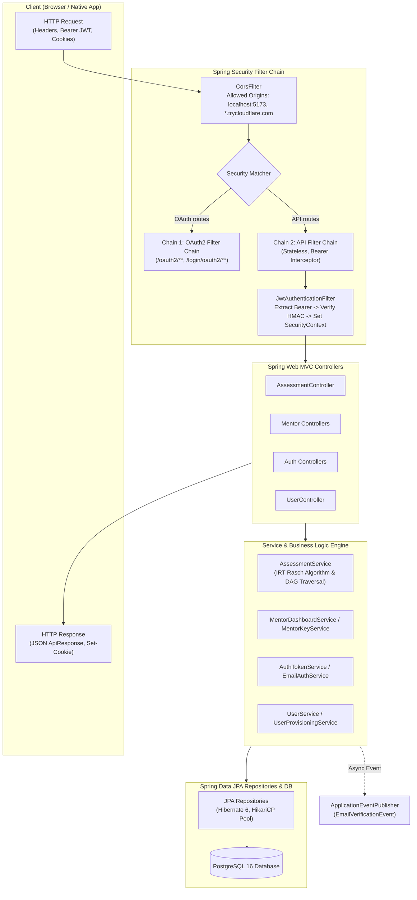
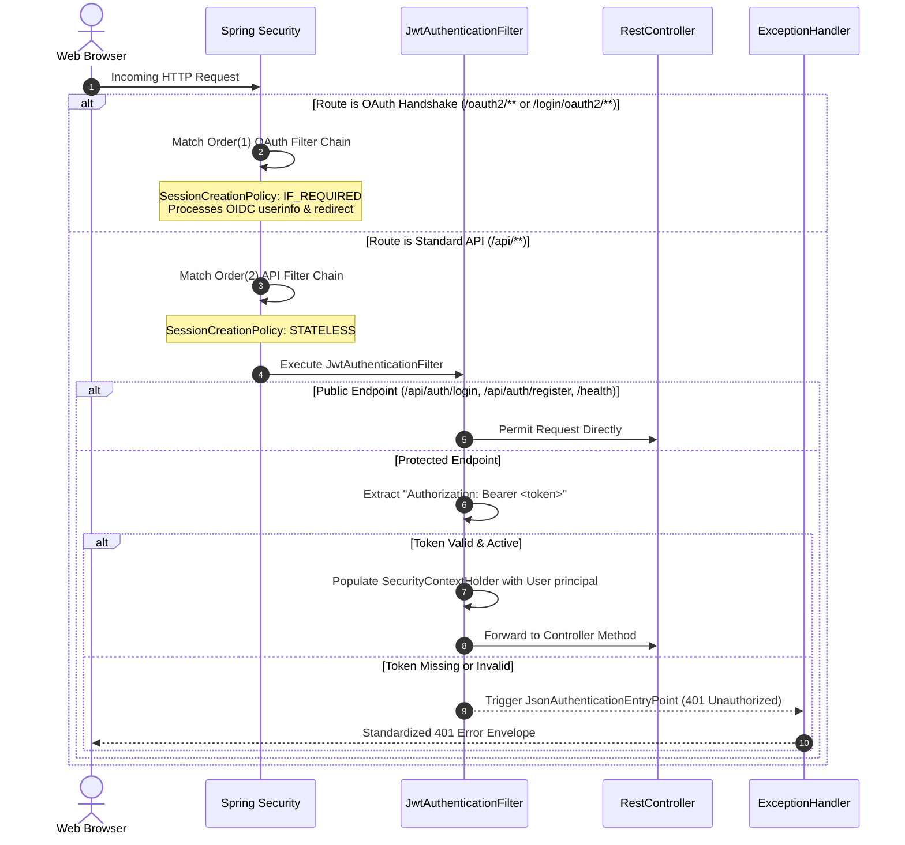
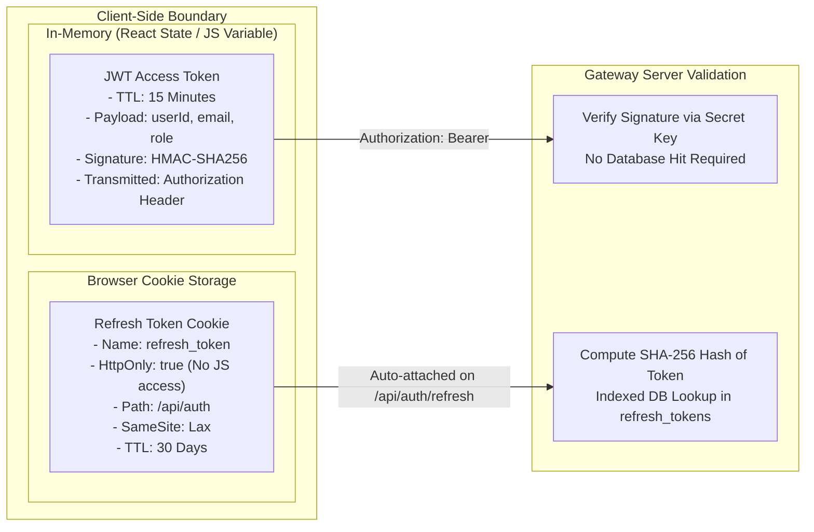
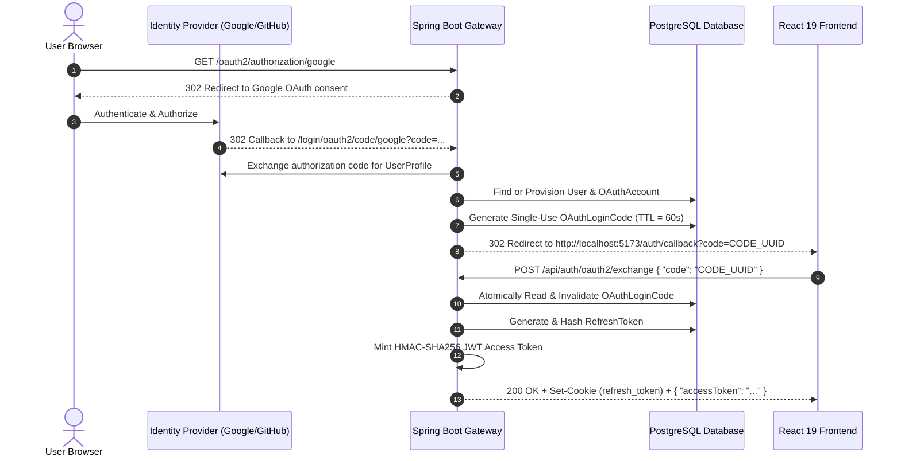
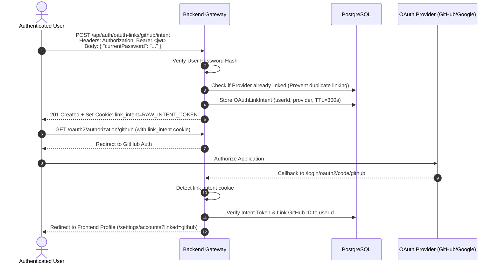

# 01. System & Security Architecture

> **Service:** `gateway/ai-upskilling-platform`  
> **Framework:** Spring Boot 3.2.x / Spring Security 6 / Java 21  
> **Database:** PostgreSQL 16 (HikariCP Connection Pool)  

---

## 1. Gateway Subsystem & Layered Anatomy

The Gateway is structured around Domain-Driven Design (DDD) principles with clear separation of responsibilities across controllers, service interfaces, data repositories, and persistent entities:

### 1.1 Layer Responsibilities

1. **Interception & Security Layer:**
   - Evaluates incoming request origin against whitelist.
   - Enforces transport security and CORS permissions (`allowCredentials=true`).
   - Extracts and validates access tokens from the `Authorization: Bearer <token>` header.
   - Converts valid claims into a Spring Security `UsernamePasswordAuthenticationToken` containing the domain `User` entity as the principal.

2. **Controller Layer:**
   - Validates request payloads using Jakarta Bean Validation (`@Valid`, `@NotNull`, `@NotBlank`, `@Email`).
   - Decouples HTTP semantics (status codes, headers, cookie flags) from core business logic.
   - Wraps successful outcomes into the standard `ApiResponse<T>` envelope.

3. **Service Layer:**
   - Implements atomic domain operations with `@Transactional` boundaries.
   - Encapsulates mathematical calculations (IRT Rasch theta calculations), key generation, token lifecycle, and account eligibility.
   - Publishes asynchronous Spring `ApplicationEvent` objects for background tasks (email dispatch).

4. **Persistence Layer:**
   - Utilizes Spring Data JPA with PostgreSQL-optimized queries (e.g., indexed anti-joins, dynamic pagination).
   - Manages connection pooling via HikariCP (`minimum-idle=2`, `maximum-pool-size=10`).

---

## 2. Spring Security Architecture

The backend implements two distinct, ordered `SecurityFilterChain` beans to satisfy both interactive third-party OAuth2 handshakes and high-throughput stateless REST traffic.

### 2.1 Filter Chain 1: OAuth2 Filter Chain (`@Order(1)`)
- **Route Matcher:** `/oauth2/**`, `/login/oauth2/**`.
- **Session Policy:** `SessionCreationPolicy.IF_REQUIRED` (required to maintain the OAuth2 state parameter across browser redirects).
- **Resolver:** `CustomOAuth2AuthorizationRequestResolver` dynamically captures frontend redirect targets (`web` vs. `mobile`).
- **User Services:**
  - `GoogleOidcUserService`: Validates Google ID tokens and extracts verified email and profile claims.
  - `GitHubOAuth2UserService`: Queries GitHub user profile and the `/user/emails` API to resolve primary verified emails.
- **Success Handler:** `OAuth2LoginSuccessHandler` provisions or locates the user, generates a single-use login code, and issues a 302 redirect back to the client application.
- **Failure Handler:** `OAuth2LoginFailureHandler` captures exceptions (such as account conflicts) and redirects to the configured frontend error screen with an encoded error message.

### 2.2 Filter Chain 2: API Filter Chain (`@Order(2)`)
- **Route Matcher:** Default fallback for all remaining endpoints (`/api/**`, `/health`, `/actuator/**`).
- **Session Policy:** `SessionCreationPolicy.STATELESS` (zero server-side sessions created).
- **CSRF Protection:** Explicitly disabled (`AbstractHttpConfigurer::disable`) as the REST API is protected against Cross-Site Request Forgery via Bearer JWTs and strict `SameSite=Lax` cookie flags.
- **Access Entry Point:** `JsonAuthenticationEntryPoint` intercepts unauthenticated attempts and emits a standard `401 Unauthorized` JSON envelope.
- **Access Denied Handler:** `JsonAccessDeniedHandler` intercepts forbidden role attempts (e.g. non-mentor accessing `/api/v1/mentor/**`) and emits a `403 Forbidden` JSON envelope.

---

## 3. Dual-Token Authentication & Storage Lifecycle

The platform enforces the **Dual-Token Storage Paradigm** to balance performance, security, and defense-in-depth against Cross-Site Scripting (XSS) and Cross-Site Request Forgery (CSRF).

### 3.1 Token Specifications

| Parameter | Access Token | Refresh Token |
| :--- | :--- | :--- |
| **Format** | Signed JWT (HMAC-SHA256) | Cryptographically Random 64-char Hex String |
| **Storage (Client)** | In-Memory (JavaScript variable / Zustand) | `HttpOnly`, `SameSite=Lax` Cookie |
| **Storage (Server)** | Stateless (validated via signature key) | SHA-256 Hashed in `refresh_tokens` table |
| **Time to Live (TTL)**| 900 seconds (15 minutes) | 2,592,000 seconds (30 days) |
| **Transmission** | Header: `Authorization: Bearer <jwt>` | Automatic Cookie or JSON body for native apps |
| **Risk Mitigated** | Mitigates token exfiltration via XSS | Eliminates malicious client-side token reads |

### 3.2 Token Hashing & Database Security
Plaintext refresh tokens and OTP tokens are **never stored in the database**:
1. When a token is generated:
   $$\text{Raw Token} = \text{SecureRandom}(32 \text{ bytes}) \xrightarrow{\text{Hex Encoded}} 64 \text{ chars}$$
2. The raw token is returned to the client as an `HttpOnly` cookie or response body.
3. The server computes the cryptographic hash:
   $$\text{Token Hash} = \text{SHA-256}(\text{Raw Token})$$
4. Only the hash is persisted in the database table with an indexed column. If the persistence tier is compromised, attackers cannot hijack active user sessions without the corresponding plaintext tokens.

### 3.3 Token Rotation & Replay Attack Defense
When `/api/auth/refresh` is triggered:
1. The server hashes the presented raw refresh token and queries the `refresh_tokens` table.
2. If the token is expired or marked `revoked = true`:
   > [!CAUTION]
   > A revoked token presentation indicates a potential token reuse or replay attack. The server rejects the request (`401 Unauthorized`) and invalidates the session.
3. If valid, the current refresh token is marked `revoked = true`, and an entirely new refresh token is minted, hashed, and returned alongside a fresh JWT.

---

## 4. OAuth2 Social Login: Single-Use Code Exchange

To prevent sensitive authentication tokens from being exposed in browser address bars, history logs, or HTTP `Referer` headers, the gateway implements a **Single-Use Code Exchange Protocol**:

### 4.1 Exchange Protocol Details
1. **TTL:** The exchange code is valid for exactly 60 seconds (`app.auth.jwt.login-code-ttl-seconds=60`).
2. **Atomicity:** When redeemed, the code is immediately deleted or marked used. Multiple attempts with the same code will fail with `401 Unauthorized`.
3. **Platform Adaptability:** Supports both web clients (callback via browser URL) and mobile native applications (callback via custom scheme `myapp://auth/callback`).

---

## 5. Account Linking Architecture (`OAuthLinkIntent`)

The platform allows an existing user (who registered via email/password) to securely link their Google or GitHub accounts without creating duplicate identities:

---

## 6. Rate Limiting & Abuse Prevention

To defend sensitive authentication endpoints against brute-force attacks and email spamming, the gateway integrates `RateLimiterService`:

| Protected Action | Limit Window | Max Requests | Identified By | HTTP Error |
| :--- | :---: | :---: | :--- | :---: |
| **Email OTP Resend** | 60 minutes | 3 attempts | User Email | `429 Too Many Requests` |
| **Password Reset Request** | 60 minutes | 5 attempts | User Email + Client IP | `429 Too Many Requests` |
| **Mentor Key Association** | 15 minutes | 5 attempts | Student User ID + Client IP | `429 Too Many Requests` |
| **Login Attempts** | 15 minutes | 10 attempts | Email Address + Client IP | `429 Too Many Requests` |

The rate limiter tracks attempts using an in-memory sliding token bucket with automated bucket eviction, logging client IP addresses extracted safely through `X-Forwarded-For` reverse proxy headers.

