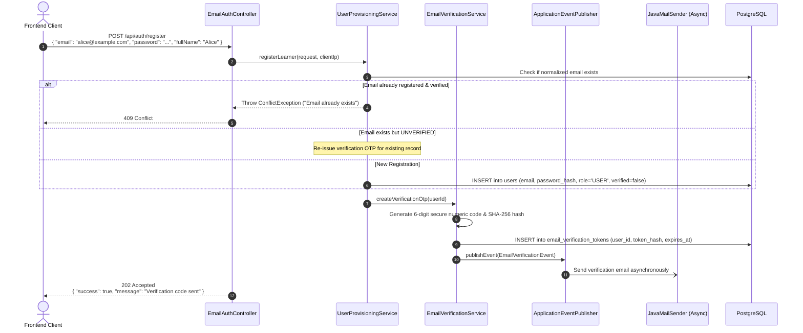
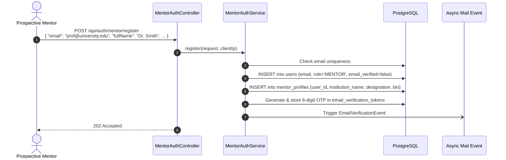
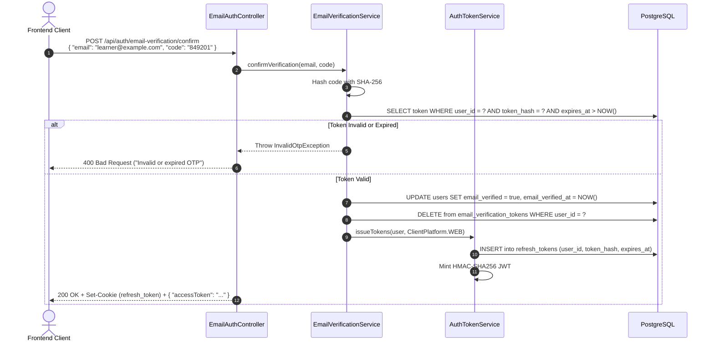
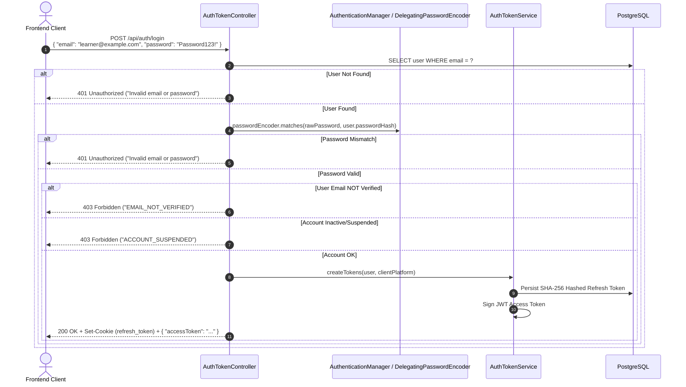
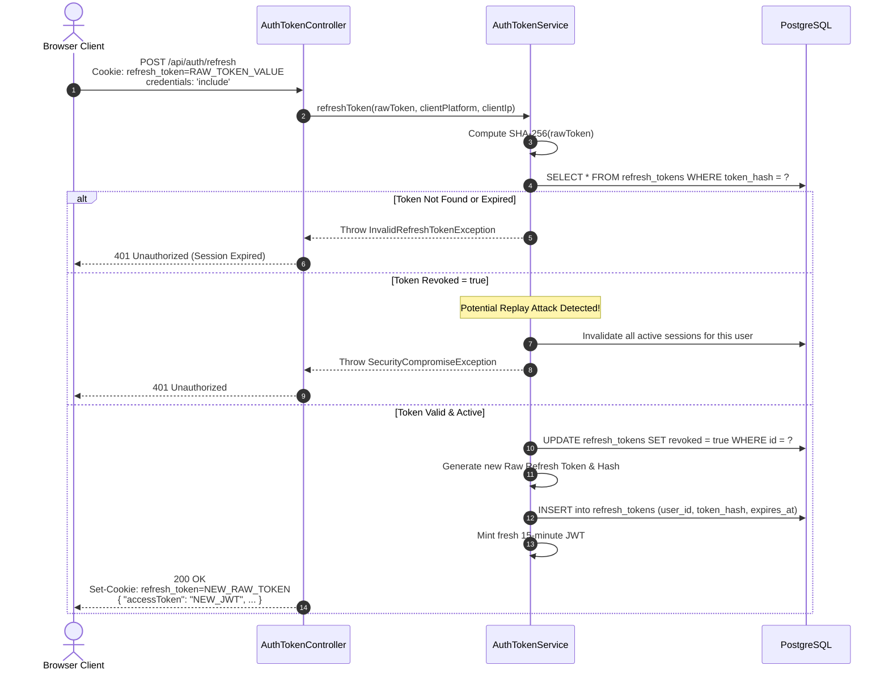
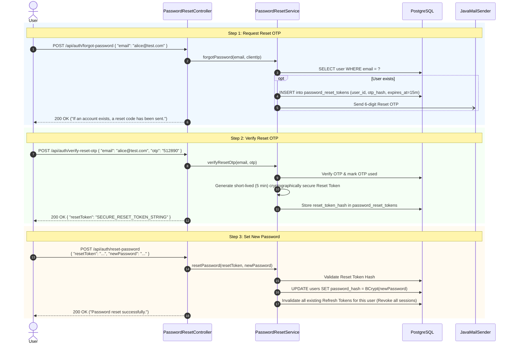

# 02. Authentication & Identity API Flows

> **Module:** `com.unix.aiupskilling.authentication` & `com.unix.aiupskilling.user`  
> **Controllers:** `EmailAuthController`, `MentorAuthController`, `AuthTokenController`, `PasswordResetController`, `AuthLinkController`, `UserController`  

---

## 1. User & Mentor Registration Flows

The platform supports two distinct registration workflows: one for standard learners (`Role.USER`) and one for mentors/instructors (`Role.MENTOR`). Both trigger an asynchronous 6-digit verification OTP delivered via SMTP.

### 1.1 Learner Registration (`POST /api/auth/register`)



#### Request Specification
- **Method / URI:** `POST /api/auth/register`
- **Headers:** `Content-Type: application/json`
- **Payload:**
```json
{
  "email": "learner@example.com",
  "password": "Password123!",
  "fullName": "Learner One",
  "username": "learner_one"
}
```

#### Response Specifications
- **Success (`202 Accepted`):**
```json
{
  "success": true,
  "message": "If the email is eligible, a 6-digit verification code has been sent.",
  "data": {
    "email": "learner@example.com",
    "expiresInSeconds": 900
  },
  "timestamp": "2026-10-30T10:15:30.123456"
}
```
- **Error (`409 Conflict`):**
```json
{
  "success": false,
  "message": "An account with this email already exists.",
  "data": {
    "code": "EMAIL_ALREADY_EXISTS"
  },
  "timestamp": "2026-10-30T10:15:30.456789"
}
```

---

### 1.2 Mentor Registration (`POST /api/auth/mentor/register`)

The mentor registration flow provisions a user with `role = Role.MENTOR` and captures institution details.



#### Request Specification
- **Method / URI:** `POST /api/auth/mentor/register`
- **Payload:**
```json
{
  "email": "mentor@lnct.ac.in",
  "password": "SecurePassword99!",
  "fullName": "Prof. Alan Turing",
  "institutionName": "Lakshmi Narain College of Technology",
  "department": "Computer Science & Engineering",
  "designation": "Head of Department",
  "bio": "Mentoring algorithms and distributed systems."
}
```

---

## 2. Email Verification & OTP Confirmation (`POST /api/auth/email-verification/confirm`)

Confirms the 6-digit code, marks the user's account as verified, and immediately logs the user in by generating both an Access Token and Refresh Token.



#### Request Specification
- **Method / URI:** `POST /api/auth/email-verification/confirm`
- **Aliases:** Also mapped to `/api/auth/email-verification/verify-otp` for backwards compatibility.
- **Payload:**
```json
{
  "email": "learner@example.com",
  "code": "849201"
}
```

#### Response Specification (`200 OK`)
- **Headers:** `Set-Cookie: refresh_token=RAW_REFRESH_TOKEN; Path=/api/auth; HttpOnly; SameSite=Lax; Max-Age=2592000`
- **Body:**
```json
{
  "success": true,
  "message": "Email verified successfully.",
  "data": {
    "accessToken": "eyJhbGciOiJIUzI1NiIsInR5cCI6IkpXVCJ9...",
    "tokenType": "Bearer",
    "expiresIn": 900,
    "user": {
      "id": "1",
      "email": "learner@example.com",
      "fullName": "Learner One",
      "username": "learner_one",
      "role": "USER",
      "emailVerified": true
    }
  },
  "timestamp": "2026-10-30T10:16:00.000000"
}
```

---

## 3. Credential Login Flow (`POST /api/auth/login`)

Authenticates an existing user using email/password credentials.



#### Request Specification
- **Method / URI:** `POST /api/auth/login`
- **Payload:**
```json
{
  "email": "learner@example.com",
  "password": "Password123!"
}
```

---

## 4. Token Refresh & Rotation Flow (`POST /api/auth/refresh`)

Enables continuous, frictionless user sessions without storing the high-privilege refresh token in client JavaScript.



#### Request Specification
- **Method / URI:** `POST /api/auth/refresh`
- **Headers:** `Content-Type: application/json`
- **Credentials:** `credentials: 'include'` (automatically transmits the `refresh_token` cookie)
- **Optional Payload (Mobile Only):** If running on a native platform where cookies are disabled:
```json
{
  "refreshToken": "64_character_hex_token_string"
}
```

---

## 5. Logout Flow (`POST /api/auth/logout`)

Terminates user sessions, invalidates the database token, and expires the client cookie.

```mermaid
sequenceDiagram
    autonumber
    actor Client as Frontend Client
    participant Controller as AuthTokenController
    participant TokenService as AuthTokenService
    participant DB as PostgreSQL

    Client->>Controller: POST /api/auth/logout<br/>Cookie: refresh_token=RAW_TOKEN
    Controller->>TokenService: revokeToken(rawToken)
    TokenService->>DB: UPDATE refresh_tokens SET revoked = true WHERE token_hash = SHA256(rawToken)
    Controller->>Controller: Build expired Set-Cookie (Max-Age=0)
    Controller-->>Client: 200 OK + Set-Cookie: refresh_token=; Max-Age=0
```

---

## 6. Password Reset Lifecycle

A 3-step security protocol designed to prevent account enumeration, brute-force attacks, and session leakage.



---

## 7. Authenticated User Profile APIs

### 7.1 Verify Session & Get Self (`GET /api/auth/me`)
- **Method / URI:** `GET /api/auth/me`
- **Headers:** `Authorization: Bearer <jwt_access_token>`
- **Internal Execution:**
  1. `JwtAuthenticationFilter` validates signature and loads `User` from PostgreSQL.
  2. Controller returns the loaded `User` mapped to `UserResponse`.
- **Response (`200 OK`):**
```json
{
  "success": true,
  "message": "User retrieved",
  "data": {
    "id": 1,
    "email": "learner@example.com",
    "fullName": "Learner One",
    "username": "learner_one",
    "avatarUrl": "https://images.unsplash.com/photo-...",
    "bio": "Full-stack enthusiast",
    "role": "USER",
    "emailVerified": true,
    "createdAt": "2026-10-25T14:00:00"
  },
  "timestamp": "2026-10-30T10:20:00.000000"
}
```

### 7.2 Update User Profile (`PUT /api/users/profile`)
- **Method / URI:** `PUT /api/users/profile`
- **Headers:** `Authorization: Bearer <jwt_access_token>`, `Content-Type: application/json`
- **Payload:**
```json
{
  "fullName": "Learner One Updated",
  "bio": "Architecting resilient distributed systems",
  "avatarUrl": "https://avatar.example.com/learner.png"
}
```
- **Response (`200 OK`):** Returns updated `UserResponse`.

