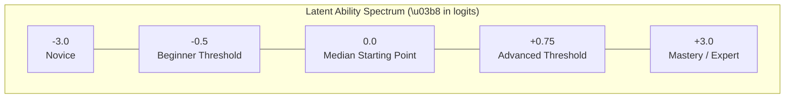
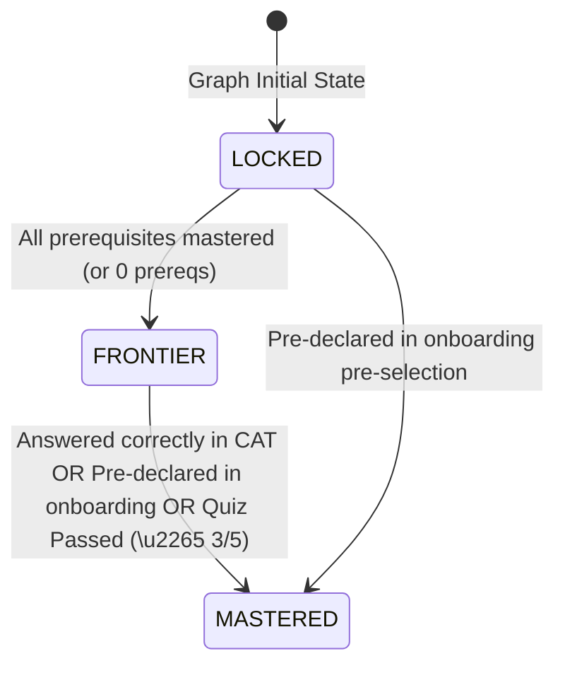
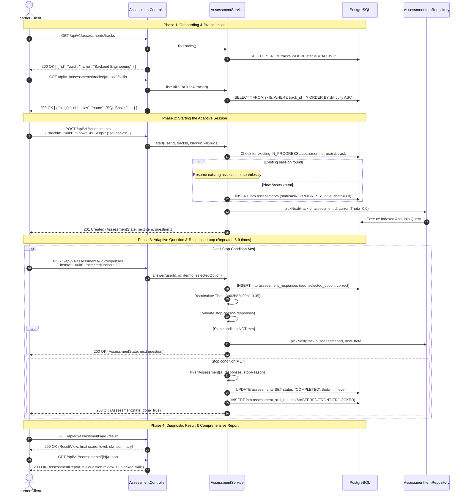
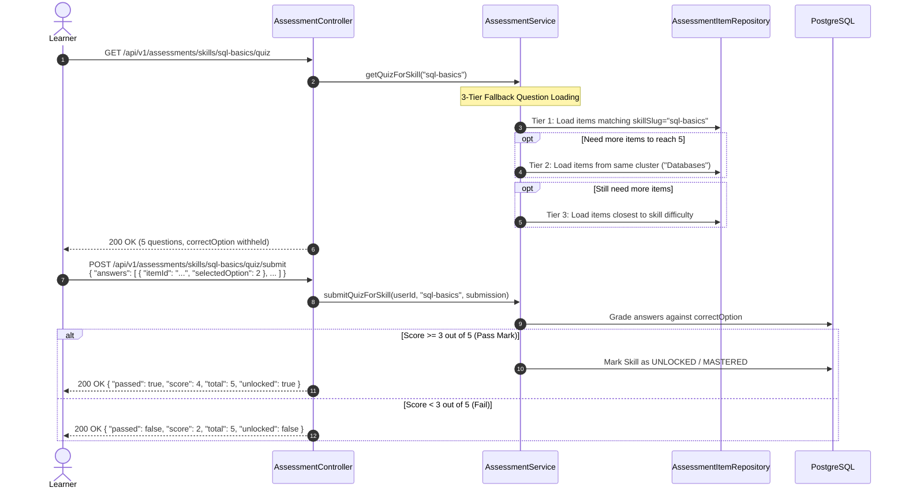

# 03. Adaptive Assessment & Psychometric CAT Engine

> **Module:** `com.unix.aiupskilling.assessment`  
> **Core Service:** `AssessmentService.java`  
> **Controller:** `AssessmentController.java`  
> **Mathematical Foundations:** Item Response Theory (IRT) 1-PL Rasch Computerized Adaptive Testing (CAT)  

---

## 1. Psychometric Foundations & Mathematical Engine

The assessment engine measures a learner's true latent capability ($\theta$) across a competency continuum rather than calculating a raw percentage score.

### 1.1 The 1-Parameter Logistic (1-PL) Rasch Model
Under the Rasch model, the probability that a learner with latent ability $\theta$ correctly answers an item with calibrated difficulty parameter $b_i$ is expressed as:

$$P(X_i = 1 \mid \theta, b_i) = \frac{e^{\theta - b_i}}{1 + e^{\theta - b_i}} = \frac{1}{1 + e^{-(\theta - b_i)}}$$

Where:
- $\theta \in [-3.0, +3.0]$: Learner's ability logit score.
- $b_i \in [-3.0, +3.0]$: Question difficulty parameter.
- When $\theta = b_i$, the learner has an exact $50\%$ probability of answering correctly.



### 1.2 Adaptive Staircase Stepping Algorithm
During the active test, after each response $k$, the ability estimate is updated dynamically:

$$\theta_{k+1} = \theta_k + \begin{cases} +0.35, & \text{if answer is correct} \\ -0.35, & \text{if answer is incorrect} \end{cases}$$

### 1.3 Stopping Criteria (Stopping Rule Engine)
The adaptive test stops as soon as any of the following rules are satisfied:
1. **Minimum Items Bound:** Minimum 8 items administered (`MIN_ITEMS = 8`).
2. **Maximum Items Bound:** Maximum 9 items administered (`MAX_ITEMS = 9`), ensuring test fatigue is eliminated.
3. **Alternating Fluctuation Convergence (`SE_CONVERGED`):** After 8 items, if the learner's responses fluctuate symmetrically (reversals $\ge 2$), standard error converges ($SE \le 0.45$).
4. **Pool Exhaustion (`NO_QUESTIONS_LEFT`):** If all calibrated items in the track have been exhausted.

### 1.4 Final Ability Level Classification
Upon completion, the final logit $\theta$ maps into one of three proficiency bands:
- $\theta < -0.5 \implies$ **`BEGINNER`**
- $-0.5 \le \theta \le 0.75 \implies$ **`INTERMEDIATE`**
- $\theta > 0.75 \implies$ **`ADVANCED`**

---

## 2. Dynamic Skill Graph DAG Colorization

Once the test terminates, the engine traverses the Directed Acyclic Graph (DAG) of the learning track to compute node states for visual rendering:



### 2.1 State Evaluation Rules
1. **`MASTERED` (Emerald):**
   - The learner explicitly pre-selected this skill during onboarding; OR
   - The learner answered an item for this skill correctly during the CAT test; OR
   - Item difficulty $b \le (\theta_{\text{final}} - 0.25)$ (Mastery margin).
2. **`FRONTIER` (Amber / Active):**
   - The skill is **not yet mastered**; AND
   - **All immediate prerequisite skills** are already marked `MASTERED` (or the node has no prerequisites). These form the learner's personalized learning zone.
3. **`LOCKED` (Slate / Dimmed):**
   - At least one upstream prerequisite skill remains unmastered.

---

## 3. End-to-End CAT Assessment Lifecycle



---

## 4. Item Selection Query & Anti-Join Mechanics

To ensure questions are served with sub-50ms latency while never presenting duplicate questions to the learner, the repository executes a specialized **anti-join SQL query**:

```sql
SELECT item FROM AssessmentItem item
WHERE item.trackId = :trackId 
  AND item.status = 'ACTIVE'
  AND item.id NOT IN (
      SELECT r.item.id 
      FROM AssessmentResponse r 
      WHERE r.assessment.id = :assessmentId
  )
ORDER BY ABS(item.difficulty - :targetTheta) ASC
LIMIT 1;
```

### 4.1 Indexing Optimization
The query is backed by the composite index:
- `idx_assessment_items_track_status_diff`: `(track_id, status, difficulty)`
- Foreign key index on `assessment_responses(assessment_id)`

This ensures the database performs an indexed index-scan rather than a costly table scan.

---

## 5. Detailed API Contracts: Assessment Endpoints

### 5.1 Start or Resume Assessment (`POST /api/v1/assessments`)
- **Headers:** `Authorization: Bearer <jwt>`, `Content-Type: application/json`
- **Request Body:**
```json
{
  "trackId": "6f9b8c10-2e4a-4a2e-8c4d-7b2a9e10f3c1",
  "knownSkillSlugs": [
    "git-basics",
    "http-basics"
  ]
}
```
- **Response (`201 Created`):**
```json
{
  "assessmentId": "3fa85f64-5717-4562-b3fc-2c963f66afa6",
  "status": "IN_PROGRESS",
  "done": false,
  "nextQuestion": {
    "itemId": "8b94f061-6d73-41bb-98f8-b32832aef5c0",
    "questionNumber": 1,
    "totalQuestions": 9,
    "stem": "Which HTTP status code signifies that a resource was successfully created on the server?",
    "options": [
      "200 OK",
      "201 Created",
      "204 No Content",
      "304 Not Modified"
    ],
    "skillSlug": "http-basics"
  }
}
```

---

### 5.2 Submit Response (`POST /api/v1/assessments/{id}/responses`)
- **Headers:** `Authorization: Bearer <jwt>`, `Content-Type: application/json`
- **Request Body:**
```json
{
  "itemId": "8b94f061-6d73-41bb-98f8-b32832aef5c0",
  "selectedOption": 1
}
```
- **Response while test continues (`200 OK`):**
```json
{
  "assessmentId": "3fa85f64-5717-4562-b3fc-2c963f66afa6",
  "status": "IN_PROGRESS",
  "done": false,
  "nextQuestion": {
    "itemId": "c208479e-4e89-4bc2-8924-d2e5bf17d055",
    "questionNumber": 2,
    "totalQuestions": 9,
    "stem": "In relational databases, which isolation level prevents dirty reads but permits non-repeatable reads?",
    "options": [
      "Read Uncommitted",
      "Read Committed",
      "Repeatable Read",
      "Serializable"
    ],
    "skillSlug": "sql-transactions"
  }
}
```
- **Response upon test completion (`200 OK`):**
```json
{
  "assessmentId": "3fa85f64-5717-4562-b3fc-2c963f66afa6",
  "status": "COMPLETED",
  "done": true,
  "nextQuestion": null
}
```

---

### 5.3 Fetch Comprehensive Report (`GET /api/v1/assessments/{id}/report`)
- **Headers:** `Authorization: Bearer <jwt>`
- **Response (`200 OK`):**
```json
{
  "assessmentId": "3fa85f64-5717-4562-b3fc-2c963f66afa6",
  "level": "INTERMEDIATE",
  "initialTheta": 0.0,
  "finalTheta": 0.35,
  "itemsAdministered": 8,
  "correctCount": 5,
  "stopReason": "SE_CONVERGED",
  "responses": [
    {
      "seq": 1,
      "stem": "Which HTTP status code signifies that a resource was successfully created...",
      "options": ["200 OK", "201 Created", "204 No Content", "304 Not Modified"],
      "selectedOption": 1,
      "correctOption": 1,
      "correct": true,
      "skillSlug": "http-basics",
      "skillName": "HTTP & REST Fundamentals"
    }
  ],
  "skills": [
    { "slug": "git-basics", "name": "Git Basics", "state": "MASTERED" },
    { "slug": "http-basics", "name": "HTTP & REST Fundamentals", "state": "MASTERED" },
    { "slug": "sql-transactions", "name": "Database Transactions", "state": "FRONTIER" },
    { "slug": "distributed-caching", "name": "Distributed Caching", "state": "LOCKED" }
  ],
  "unlockedSkills": [
    { "slug": "git-basics", "name": "Git Basics", "state": "MASTERED" },
    { "slug": "http-basics", "name": "HTTP & REST Fundamentals", "state": "MASTERED" },
    { "slug": "sql-transactions", "name": "Database Transactions", "state": "FRONTIER" }
  ]
}
```

---

## 6. 5-Question Skill Node Unlock Quiz

If a learner wishes to bypass prerequisites or prove competency in an isolated skill node directly from the interactive Skill Graph, they trigger the **Node Unlock Quiz**.



### 6.1 Submit Node Quiz Payload (`POST /api/v1/assessments/skills/{slug}/quiz/submit`)
```json
{
  "answers": [
    { "itemId": "8b94f061-6d73-41bb-98f8-b32832aef5c0", "selectedOption": 1 },
    { "itemId": "4a28b94c-12f0-4c7b-b561-1209384e5a01", "selectedOption": 0 },
    { "itemId": "9c12480b-47e1-4328-98e3-d12304918234", "selectedOption": 3 },
    { "itemId": "0a9284bf-32c1-419b-a012-491029384756", "selectedOption": 2 },
    { "itemId": "7f09182a-bc38-4e1a-8192-309182746501", "selectedOption": 1 }
  ]
}
```

