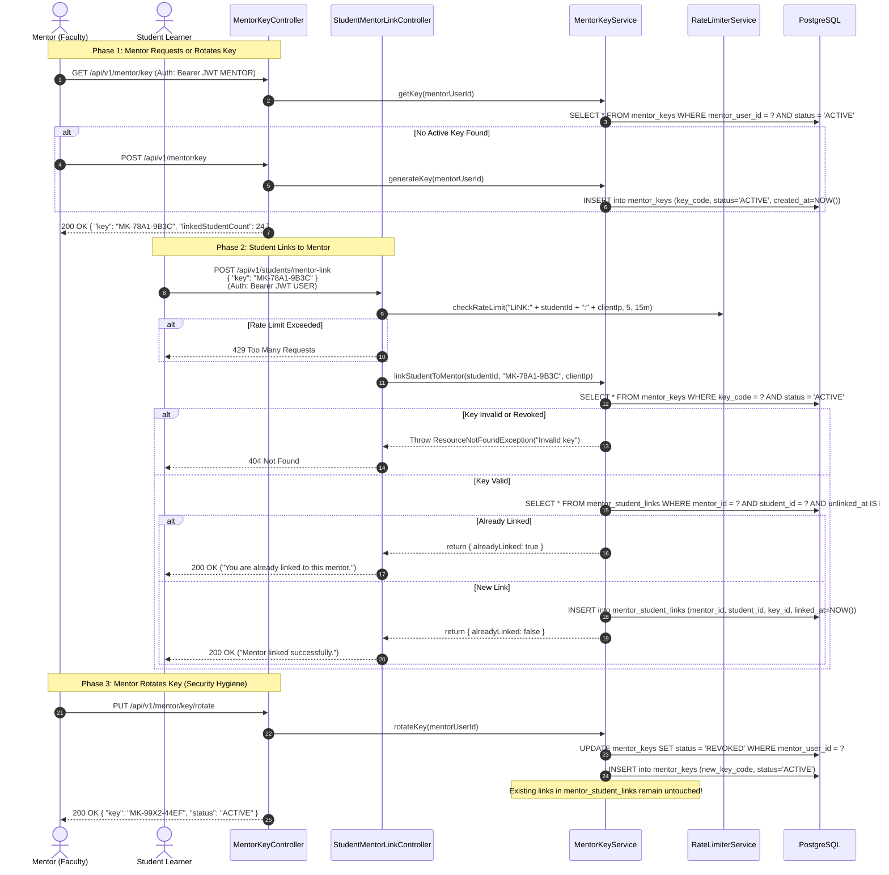

# 04. Mentor & Cohort Management Platform Flows

> **Module:** `com.unix.aiupskilling.mentor`  
> **Controllers:** `MentorDashboardController`, `MentorKeyController`, `MentorStudentController`, `MentorAchievementController`, `MentorProfileController`, `StudentMentorLinkController`  
> **Security Requirement:** `ROLE_MENTOR` on all `/api/v1/mentor/**` routes; Bearer JWT on `/api/v1/students/mentor-link`  

---

## 1. Mentor Platform Ecosystem Overview

The Mentor Platform empowers faculty members, corporate trainers, and institute mentors to oversee cohorts of learners, audit diagnostic test results, analyze skill achievement trends, and securely invite students via cryptographic keys.

```mermaid
flowchart TD
    subgraph MentorAdmin["Mentor Management Portal"]
        MK["Mentor Key Management\n(Generation & Key Rotation)"]
        DASH["Cohort Dashboard Analytics\n(Distribution Bands & KPIs)"]
        ROSTER["Student Directory\n(Search, Filter & Detail Drill)"]
        ACHIEVE["Cohort Achievements\n(Faceted Skill Filtering)"]
    end

    subgraph StudentPortal["Learner Portal"]
        LINK_REQ["Student Submits Key\nPOST /api/v1/students/mentor-link"]
    end

    subgraph BackendGateway["Spring Boot Gateway Engine"]
        SEC_CHECK{"Role Check\nhasRole('MENTOR')"}
        KEY_SVC["MentorKeyService\n(Idempotent Linking & Expiry)"]
        RATE["RateLimiterService\n(5 attempts / 15 min per IP)"]
        DASH_SVC["MentorDashboardService\n(Aggregates Cohort Metrics)"]
    end

    subgraph Database[("PostgreSQL 16 Tables")]
        T_KEYS[("mentor_keys")]
        T_LINKS[("mentor_student_links")]
        T_USERS[("users")]
        T_ACHIEVE[("skill_achievements")]
    end

    MK & DASH & ROSTER & ACHIEVE --> SEC_CHECK
    SEC_CHECK --> KEY_SVC & DASH_SVC
    LINK_REQ --> RATE --> KEY_SVC
    KEY_SVC --> T_KEYS & T_LINKS
    DASH_SVC --> T_LINKS & T_USERS & T_ACHIEVE
```

---

## 2. Mentor Key Lifecycle & Student Association Flow

To guarantee frictionless onboarding without requiring mentors to manually enter hundreds of student email addresses, mentors distribute an **Invite Key Code** (format: `MK-XXXX-YYYY` or UUID string).



---

## 3. Cohort Analytics & Dashboard Overview

### 3.1 Overview Endpoint (`GET /api/v1/mentor/dashboard/overview`)
Aggregates cohort-level key performance indicators, progress distribution bands, top learners, and recent achievements in a single round-trip.

- **Headers:** `Authorization: Bearer <mentor_jwt>`
- **Internal Execution:**
  1. Resolves `mentorUserId` from `Authentication.getPrincipal()`.
  2. Counts active students from `mentor_student_links` joined with `users`.
  3. Queries assessment attempts and average proficiency scores.
  4. Categorizes students into three distinct progress bands:
     - `NEEDS_HELP`: Score $< 40\%$ or dormant $> 14$ days.
     - `ON_TRACK`: Score $40\% - 75\%$.
     - `EXCELLING`: Score $> 75\%$.
  5. Retrieves the top 5 highest-performing learners for the leaderboard.
- **Response Specification (`200 OK`):**
```json
{
  "success": true,
  "message": "Mentor overview retrieved",
  "data": {
    "mentor": {
      "id": "12",
      "fullName": "Prof. Alan Turing",
      "avatarUrl": "https://avatar.example.com/mentor.jpg"
    },
    "stats": {
      "totalStudents": 48,
      "testsTaken": 112,
      "skillsAchieved": 340,
      "activeStudents": 42,
      "averageProgress": 68,
      "averageScore": 74
    },
    "progressBuckets": [
      { "band": "NEEDS_HELP", "label": "Needs Guidance (<40%)", "count": 6 },
      { "band": "ON_TRACK", "label": "On Track (40%-75%)", "count": 28 },
      { "band": "EXCELLING", "label": "Excelling (>75%)", "count": 14 }
    ],
    "topStudents": [
      {
        "id": "104",
        "name": "Bob Dylan",
        "username": "bob_dylan",
        "avatarUrl": "https://avatar.example.com/u104.png",
        "progress": 92,
        "progressLabel": "Advanced Backend"
      }
    ],
    "recentAchievements": [
      {
        "id": "ach-501",
        "studentId": "104",
        "studentName": "Bob Dylan",
        "skill": "Database Indexing & Query Plans",
        "skillKey": "sql-indexing",
        "category": "Databases",
        "proficiency": "ADVANCED",
        "date": "2026-10-30T09:45:00Z"
      }
    ],
    "mentorKey": "MK-78A1-9B3C"
  },
  "timestamp": "2026-10-30T10:35:00.000000"
}
```

---

## 4. Cohort Student Directory & Drilldown

### 4.1 Search & Filter Students (`GET /api/v1/mentor/students`)
Supports real-time search, progress band filtering, and pagination.

- **Query Parameters:**
  - `q`: Case-insensitive search string across student full name, username, and email.
  - `progressBand`: Filter by `NEEDS_HELP`, `ON_TRACK`, or `EXCELLING`.
  - `sort`: `name`, `progress_desc`, `progress_asc`, `date_desc` (default: `name`).
  - `page`: Page index, 0-indexed (default: `0`).
  - `size`: Page size (default: `20`).
- **Response Specification (`200 OK`):**
```json
{
  "success": true,
  "message": "Students retrieved",
  "data": {
    "content": [
      {
        "id": 104,
        "name": "Bob Dylan",
        "username": "bob_dylan",
        "email": "bob@example.com",
        "avatarUrl": "https://avatar.example.com/u104.png",
        "progress": 92,
        "progressBand": "EXCELLING",
        "currentLevel": "ADVANCED",
        "activeTrack": "Backend Engineering",
        "skillsMastered": 14,
        "lastActiveAt": "2026-10-30T08:12:00Z"
      }
    ],
    "page": 0,
    "size": 20,
    "totalElements": 48,
    "totalPages": 3,
    "last": false
  },
  "timestamp": "2026-10-30T10:35:10.000000"
}
```

---

### 4.2 Individual Student Deep-Dive (`GET /api/v1/mentor/students/{studentId}`)
Provides detailed diagnostic breakdown for an individual student linked to the authenticated mentor.

- **Authorization Check:** Enforces that `mentor_student_links` has an active link between the calling mentor and the requested `studentId`. If not linked, returns `404 Not Found` or `403 Forbidden`.
- **Response Specification (`200 OK`):**
```json
{
  "success": true,
  "message": "Student detail retrieved",
  "data": {
    "id": 104,
    "name": "Bob Dylan",
    "email": "bob@example.com",
    "avatarUrl": "https://avatar.example.com/u104.png",
    "linkedAt": "2026-10-24T12:00:00Z",
    "track": {
      "id": "6f9b8c10-2e4a-4a2e-8c4d-7b2a9e10f3c1",
      "name": "Backend Engineering"
    },
    "assessmentStats": {
      "testsTaken": 2,
      "latestTheta": 1.25,
      "latestLevel": "ADVANCED",
      "lastCompletedAt": "2026-10-29T16:20:00Z"
    },
    "masteredSkills": [
      { "slug": "sql-basics", "name": "SQL Basics", "masteredAt": "2026-10-25T11:00:00Z" },
      { "slug": "sql-indexing", "name": "Database Indexing", "masteredAt": "2026-10-29T16:20:00Z" }
    ],
    "weakAreas": [
      { "slug": "distributed-consensus", "name": "Raft Consensus", "accuracyRate": 0.25 }
    ]
  },
  "timestamp": "2026-10-30T10:35:20.000000"
}
```

---

## 5. Cohort Skill Achievements & Facets

Mentors can monitor the skill verification pipeline across their entire cohort.

### 5.1 Fetch Filtered Achievements (`GET /api/v1/mentor/achievements`)
- **Query Parameters:** `q`, `category`, `proficiency`, `studentId`, `sort`, `page`, `size`.
- **Response (`200 OK`):** Returns `PagedResponse<AchievementRowDto>`.

### 5.2 Fetch Filter Facets (`GET /api/v1/mentor/achievements/facets`)
Returns counts grouped by category and proficiency level to populate dynamic filter chips on the mentor web dashboard.
- **Response Specification (`200 OK`):**
```json
{
  "success": true,
  "message": "Achievement facets retrieved",
  "data": {
    "categories": [
      { "name": "Databases", "count": 142 },
      { "name": "APIs & Networking", "count": 118 },
      { "name": "Architecture & Security", "count": 80 }
    ],
    "proficiencies": [
      { "level": "BEGINNER", "count": 150 },
      { "level": "INTERMEDIATE", "count": 135 },
      { "level": "ADVANCED", "count": 55 }
    ]
  },
  "timestamp": "2026-10-30T10:35:30.000000"
}
```

---

## 6. Mentor Profile Management

Mentors manage institutional credentials via `/api/v1/mentor/profile`.

### 6.1 Update Mentor Profile (`PUT /api/v1/mentor/profile`)
- **Headers:** `Authorization: Bearer <mentor_jwt>`, `Content-Type: application/json`
- **Payload:**
```json
{
  "institutionName": "Lakshmi Narain College of Technology (LNCT)",
  "department": "Computer Science & Engineering",
  "designation": "Professor & Head of CoE",
  "bio": "Researching adaptive psychometrics and high-throughput gateways.",
  "contactPhone": "+91-9876543210"
}
```
- **Response (`200 OK`):**
```json
{
  "success": true,
  "message": "Mentor profile updated",
  "data": {
    "userId": 12,
    "institutionName": "Lakshmi Narain College of Technology (LNCT)",
    "department": "Computer Science & Engineering",
    "designation": "Professor & Head of CoE",
    "bio": "Researching adaptive psychometrics and high-throughput gateways.",
    "contactPhone": "+91-9876543210",
    "updatedAt": "2026-10-30T10:35:40.123456Z"
  },
  "timestamp": "2026-10-30T10:35:40.123456"
}
```

