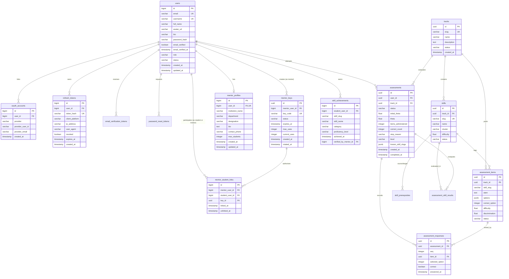

# 05. Backend Data Models & Database Schemas

> **Database:** PostgreSQL 16  
> **ORM Layer:** Spring Data JPA / Hibernate 6  
> **Dialect:** `org.hibernate.dialect.PostgreSQLDialect`  
> **Connection Pool:** HikariCP  

---

## 1. Master Entity-Relationship Diagram (ERD)

---

## 2. Table Data Dictionaries & Constraints

### 2.1 Identity & Security Tables

#### Table: `users`
The core identity record for both learners and mentors.
- `id` (`BIGINT`, `PRIMARY KEY`, `AUTO_INCREMENT`): Primary user identifier.
- `email` (`VARCHAR(255)`, `NOT NULL`, `UNIQUE`): Lowercased, trimmed canonical email address.
- `username` (`VARCHAR(24)`, `UNIQUE`): Handle used for public leaderboards and mentor rosters.
- `password_hash` (`VARCHAR(255)`, `NULL`): BCrypt/DelegatingPasswordEncoder hash. Nullable for pure OAuth2 users.
- `email_verified` (`BOOLEAN`, `DEFAULT FALSE`): True if 6-digit OTP or OAuth confirmation completed.
- `role` (`VARCHAR(32)`, `NOT NULL`, `DEFAULT 'USER'`): `USER`, `MENTOR`, `ADMIN`, `PLATFORM_ADMIN`.
- `status` (`VARCHAR(32)`, `NOT NULL`, `DEFAULT 'ACTIVE'`): `ACTIVE`, `SUSPENDED`, `DEACTIVATED`.

#### Table: `refresh_tokens`
Stores long-lived session tokens securely via cryptographic SHA-256 hashes.
- `token_hash` (`VARCHAR(64)`, `NOT NULL`, `UNIQUE`): `SHA-256(raw_token)`.
- `user_id` (`BIGINT`, `NOT NULL`, `INDEXED`): Foreign key referencing `users(id)`.
- `revoked` (`BOOLEAN`, `NOT NULL`, `DEFAULT FALSE`): Flagged true upon rotation or logout.
- `client_platform` (`VARCHAR(16)`): `WEB`, `MOBILE`.
- `expires_at` (`TIMESTAMP`, `NOT NULL`): Expired when `NOW() > expires_at`.

#### Table: `oauth_accounts`
Maintains third-party social identities linked to user profiles.
- `user_id` (`BIGINT`, `NOT NULL`): Foreign key referencing `users(id)`.
- `provider` (`VARCHAR(32)`, `NOT NULL`): `GOOGLE`, `GITHUB`.
- `provider_user_id` (`VARCHAR(255)`, `NOT NULL`): Sub claim from OIDC or ID from GitHub.
- Unique Constraint: `(provider, provider_user_id)` ensures one social account cannot link to multiple users.

---

### 2.2 Assessment & CAT Psychometric Tables

#### Table: `tracks`
Top-level learning curriculum domains (e.g. Backend Engineering).
- `id` (`UUID`, `PRIMARY KEY`): Generated track UUID.
- `slug` (`VARCHAR(64)`, `NOT NULL`, `UNIQUE`): E.g., `backend-engineering`.
- `name` (`VARCHAR(255)`, `NOT NULL`): Display title.
- `status` (`VARCHAR(32)`, `DEFAULT 'ACTIVE'`): `ACTIVE`, `DRAFT`, `ARCHIVED`.

#### Table: `skills`
Individual competency nodes in the learning DAG.
- `id` (`UUID`, `PRIMARY KEY`): Skill identifier.
- `track_id` (`UUID`, `NOT NULL`): References `tracks(id)`.
- `slug` (`VARCHAR(64)`, `NOT NULL`, `UNIQUE`): E.g., `sql-basics`, `git-basics`.
- `cluster` (`VARCHAR(64)`): Domain grouping (e.g., `Databases`, `Networking`, `Architecture`).
- `difficulty` (`FLOAT`, `NOT NULL`): Calibrated difficulty parameter in logits $[-3.0, +3.0]$.

#### Table: `assessment_items`
The calibrated question bank for Computerized Adaptive Testing.
- `id` (`UUID`, `PRIMARY KEY`): Item identifier.
- `track_id` (`UUID`, `NOT NULL`, `INDEXED`): References `tracks(id)`.
- `skill_slug` (`VARCHAR(64)`, `NOT NULL`, `INDEXED`): Primary skill evaluated.
- `stem` (`TEXT`, `NOT NULL`): The full question prompt.
- `options` (`JSONB`, `NOT NULL`): Array of 4 answer options `["A", "B", "C", "D"]`.
- `correct_option` (`INTEGER`, `NOT NULL`): Zero-indexed pointer ($0..3$) to the correct answer.
- `difficulty` (`FLOAT`, `NOT NULL`, `INDEXED`): Item difficulty parameter $b_i$.
- `status` (`VARCHAR(32)`, `DEFAULT 'ACTIVE'`): `ACTIVE`, `RETIRED`.

#### Table: `assessments`
Tracks the active or completed psychometric session.
- `id` (`UUID`, `PRIMARY KEY`): Unique session ID.
- `user_id` (`UUID`, `NOT NULL`, `INDEXED`): Foreign key to the learner.
- `track_id` (`UUID`, `NOT NULL`): Target track assessed.
- `status` (`VARCHAR(32)`, `NOT NULL`): `IN_PROGRESS`, `COMPLETED`, `ABANDONED`.
- `initial_theta` (`FLOAT`, `DEFAULT 0.0`): Starting ability level.
- `theta` (`FLOAT`): Final or current estimated ability score $\theta$.
- `items_administered` (`INTEGER`, `DEFAULT 0`): Count of questions answered ($8..9$).
- `correct_count` (`INTEGER`, `DEFAULT 0`): Count of correct answers.
- `stop_reason` (`VARCHAR(64)`): E.g. `SE_CONVERGED`, `MAX_ITEMS_REACHED`.
- `level` (`VARCHAR(32)`): `BEGINNER`, `INTERMEDIATE`, `ADVANCED`.

#### Table: `assessment_responses`
Per-question audit log capturing learner choices.
- `id` (`UUID`, `PRIMARY KEY`): Response ID.
- `assessment_id` (`UUID`, `NOT NULL`, `INDEXED`): References `assessments(id)`.
- `seq` (`INTEGER`, `NOT NULL`): Question order ($1..9$).
- `item_id` (`UUID`, `NOT NULL`, `INDEXED`): References `assessment_items(id)`.
- `selected_option` (`INTEGER`, `NOT NULL`): Selected option index.
- `correct` (`BOOLEAN`, `NOT NULL`): Instantaneous correctness evaluation.
- `answered_at` (`TIMESTAMP`, `DEFAULT NOW()`): Response timestamp.

---

### 2.3 Mentor & Institution Tables

#### Table: `mentor_profiles`
Institutional profile and metadata for users with `ROLE_MENTOR`.
- `id` (`BIGINT`, `PRIMARY KEY`, `AUTO_INCREMENT`): Profile identifier.
- `user_id` (`BIGINT`, `NOT NULL`, `UNIQUE`): References `users(id)`.
- `institution_name` (`VARCHAR(255)`): E.g. `LNCT Bhopal`.
- `department` (`VARCHAR(128)`): Department or division.
- `designation` (`VARCHAR(128)`): Official title.
- `max_students` (`INTEGER`, `DEFAULT 100`): Maximum permitted cohort size.

#### Table: `mentor_keys`
Cryptographic access keys shared by mentors with prospective students.
- `id` (`UUID`, `PRIMARY KEY`): Key identifier.
- `mentor_user_id` (`BIGINT`, `NOT NULL`, `INDEXED`): References `users(id)`.
- `key_code` (`VARCHAR(32)`, `NOT NULL`, `UNIQUE`): Human-shareable key string (e.g., `MK-78A1-9B3C`).
- `status` (`VARCHAR(32)`, `NOT NULL`): `ACTIVE`, `REVOKED`, `EXPIRED`.
- `current_uses` (`INTEGER`, `DEFAULT 0`): Running tally of linked students.

#### Table: `mentor_student_links`
Associates learners with mentors while retaining historical audit logs.
- `id` (`BIGINT`, `PRIMARY KEY`, `AUTO_INCREMENT`): Link identifier.
- `mentor_user_id` (`BIGINT`, `NOT NULL`, `INDEXED`): References `users(id)`.
- `student_user_id` (`BIGINT`, `NOT NULL`, `INDEXED`): References `users(id)`.
- `key_id` (`UUID`, `NULL`): The mentor key used during initial connection.
- `linked_at` (`TIMESTAMP`, `NOT NULL`): Connection timestamp.
- `unlinked_at` (`TIMESTAMP`, `NULL`): Null if link is active; populated if severed.

---

## 3. Database Performance & Indexing Strategies

| Table | Index Name | Indexed Columns | Justification / Query Covered |
| :--- | :--- | :--- | :--- |
| `refresh_tokens` | `idx_refresh_tokens_hash` | `(token_hash)` | Fast $O(1)$ token rotation and validation |
| `assessment_items` | `idx_assessment_items_pool` | `(track_id, status, difficulty)` | High-throughput CAT item anti-join queries |
| `assessment_responses` | `idx_responses_assessment_seq` | `(assessment_id, seq)` | Reconstructing active test progression history |
| `mentor_student_links` | `idx_links_active` | `(student_user_id, unlinked_at)` | Verifying existing link status in under 1ms |
| `mentor_student_links` | `idx_links_mentor` | `(mentor_user_id, unlinked_at)` | Fast cohort aggregation and student directory listing |
| `users` | `idx_users_email` | `(email)` | Uniqueness enforcement and rapid login lookups |

