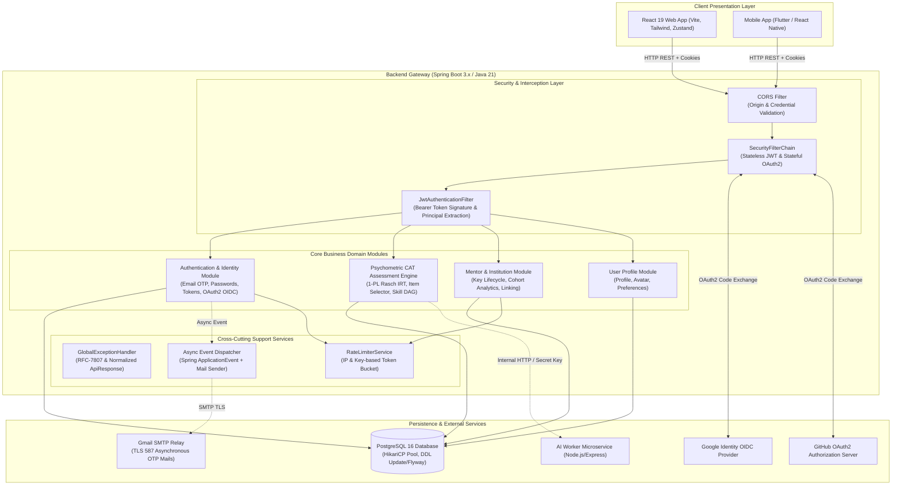

# Backend Technical API Calls Architecture & Internal Working

> **Sprint 1 Production Documentation**  
> **Service:** `gateway/ai-upskilling-platform` (Spring Boot 3.2.x, Java 21, PostgreSQL 16)  
> **Status:** Production-Ready Baseline Specification & Implemented Architecture  
> **Target Audience:** Backend Engineers, Frontend Developers, QA Specialists, and System Architects  

---

## 1. Executive Summary & Architectural Overview

The **AI-Powered Upskilling Platform Gateway** serves as the central orchestration and business logic hub of the entire platform. Built with **Spring Boot 3.2+**, it provides stateless, highly-resilient, secure REST APIs powering the React 19 web application, Flutter mobile clients, and asynchronous background worker pipelines.



---

## 2. Directory Navigation Guide

This documentation suite provides an exhaustive, end-to-end breakdown of every backend subsystem, its technical API flows, sequence diagrams, and internal algorithmic mechanics:

| Document | Focus & Content Summary |
| :--- | :--- |
| **[`01-architecture-and-security.md`](./01-architecture-and-security.md)** | Layered system anatomy, Spring Security 6 filter chains, dual-token JWT/HttpOnly cookie lifecycle, SHA-256 token hashing, OAuth2 state machines, and rate limiting. |
| **[`02-authentication-api-flows.md`](./02-authentication-api-flows.md)** | Step-by-step sequence diagrams and internal logic for User/Mentor registration, OTP verification, login, token refresh, logout, password resets, and OAuth2 account linking. |
| **[`03-adaptive-assessment-cat-flows.md`](./03-adaptive-assessment-cat-flows.md)** | Computerized Adaptive Testing (CAT) under 1-PL Rasch IRT, item selection with anti-join SQL queries, early stop rules, DAG coloring, and 5-question skill node quizzes. |
| **[`04-mentor-platform-flows.md`](./04-mentor-platform-flows.md)** | Mentor key lifecycle, student-to-mentor association with IP audits, cohort performance dashboards, student detail drills, and achievement facet filtering. |
| **[`05-backend-data-models-and-tables.md`](./05-backend-data-models-and-tables.md)** | Master PostgreSQL Entity-Relationship diagram, table definitions, foreign keys, index structures, data dictionaries, and JPA entity constraints. |

---

## 3. Global API Contracts & Response Standards

All REST endpoints in the gateway follow strict protocol standards.

### 3.1 Standard Success Envelope (`ApiResponse<T>`)
Every endpoint under `/api/auth`, `/api/users`, `/api/v1/mentor`, and shared endpoints returns a unified response structure:

```json
{
  "success": true,
  "message": "Human-readable summary of operation outcome",
  "data": { ... },
  "timestamp": "2026-10-30T10:30:00.123456"
}
```

### 3.2 Standard Error Envelope
Whenever an exception occurs (validation failure, unauthorized access, domain business conflict), the `GlobalExceptionHandler` intercepts the error and outputs:

```json
{
  "success": false,
  "message": "Human-readable error description",
  "data": {
    "code": "ERROR_CODE_STRING",
    "fieldErrors": [
      {
        "field": "email",
        "message": "Invalid email address format"
      }
    ]
  },
  "timestamp": "2026-10-30T10:30:00.123456"
}
```

### 3.3 HTTP Status Code Semantics
- `200 OK`: Request succeeded; data envelope populated.
- `201 CREATED`: Resource created (e.g., assessment session started, link intent issued).
- `202 ACCEPTED`: Request accepted for asynchronous processing (e.g., OTP dispatch).
- `400 BAD REQUEST`: Malformed payload, invalid option, or validation constraint failed.
- `401 UNAUTHORIZED`: Missing, expired, or invalid JWT access token / session cookie.
- `403 FORBIDDEN`: Valid token, but user lacks necessary role (e.g., non-mentor calling mentor endpoints).
- `404 NOT FOUND`: Target entity (track, skill, user, assessment) does not exist.
- `409 CONFLICT`: Business invariant violated (e.g., username/email already taken, test already finished).
- `429 TOO MANY REQUESTS`: Rate limit exceeded on sensitive endpoints (OTP resend, mentor linking).
- `500 INTERNAL SERVER ERROR`: Unhandled runtime exception.

---

## 4. Master REST API Catalog (Sprint 1)

| Area | HTTP Method | Endpoint URI | Auth Level | Purpose |
| :--- | :---: | :--- | :---: | :--- |
| **Health** | `GET` | `/health`, `/actuator/health` | Public | Liveness probe and health status |
| **Auth** | `POST` | `/api/auth/register` | Public | Register standard learner; triggers 6-digit OTP |
| **Auth** | `POST` | `/api/auth/mentor/register` | Public | Register mentor account; triggers 6-digit OTP |
| **Auth** | `POST` | `/api/auth/email-verification/confirm` | Public | Verify 6-digit OTP; returns access token + sets cookie |
| **Auth** | `POST` | `/api/auth/email-verification/resend` | Public | Rate-limited OTP resend |
| **Auth** | `POST` | `/api/auth/login` | Public | Password login; returns access token + sets cookie |
| **Auth** | `POST` | `/api/auth/refresh` | Cookie / Body | Rotates refresh token and issues fresh JWT access token |
| **Auth** | `POST` | `/api/auth/logout` | Cookie / Body | Revokes refresh token in database & clears cookie |
| **Auth** | `POST` | `/api/auth/forgot-password` | Public | Sends password reset OTP to user email |
| **Auth** | `POST` | `/api/auth/verify-reset-otp` | Public | Validates reset OTP; returns short-lived reset token |
| **Auth** | `POST` | `/api/auth/reset-password` | Public | Sets new password using reset token |
| **Auth** | `GET` | `/api/auth/me` | Bearer JWT | Verifies session & returns user profile + roles |
| **OAuth2** | `GET` | `/oauth2/authorization/{google\|github}` | Public | Initiates OAuth2 authorization flow |
| **OAuth2** | `POST` | `/api/auth/oauth2/exchange` | Public | Exchanges single-use code from redirect for tokens |
| **OAuth2** | `POST` | `/api/auth/oauth-links/{provider}/intent` | Bearer JWT | Creates signed intent cookie to link social account |
| **User** | `GET` | `/api/users/profile` | Bearer JWT | Retrieves user profile data |
| **User** | `PUT` | `/api/users/profile` | Bearer JWT | Updates user profile details (name, bio, avatar) |
| **CAT Test** | `GET` | `/api/v1/assessments/tracks` | Public / Bearer | Lists available learning tracks (e.g. Backend) |
| **CAT Test** | `GET` | `/api/v1/assessments/tracks/{id}/skills` | Public / Bearer | Lists skills for onboarding pre-selection |
| **CAT Test** | `POST` | `/api/v1/assessments` | Bearer JWT | Starts new CAT test or resumes active session |
| **CAT Test** | `GET` | `/api/v1/assessments/{id}` | Bearer JWT | Gets current test state (next item or completed) |
| **CAT Test** | `POST` | `/api/v1/assessments/{id}/responses` | Bearer JWT | Submits answer; computes new $\theta$; returns next item |
| **CAT Test** | `GET` | `/api/v1/assessments/{id}/result` | Bearer JWT | Gets summary result: score, level, skill states |
| **CAT Test** | `GET` | `/api/v1/assessments/{id}/report` | Bearer JWT | Comprehensive post-assessment diagnostic report |
| **CAT Test** | `GET` | `/api/v1/assessments/history` | Bearer JWT | User's past assessment test history |
| **Quiz** | `GET` | `/api/v1/assessments/skills/{slug}/quiz` | Public / Bearer | Returns 5-question competency quiz for a skill node |
| **Quiz** | `POST` | `/api/v1/assessments/skills/{slug}/quiz/submit` | Bearer JWT | Submits quiz answers; unlocks node if score $\ge 3/5$ |
| **Mentor** | `GET` | `/api/v1/mentor/dashboard/overview` | `ROLE_MENTOR` | High-level cohort analytics, distribution & rankings |
| **Mentor** | `GET` | `/api/v1/mentor/key` | `ROLE_MENTOR` | Fetches active mentor key and student count |
| **Mentor** | `POST` | `/api/v1/mentor/key` | `ROLE_MENTOR` | Generates initial unique mentor key |
| **Mentor** | `PUT` | `/api/v1/mentor/key/rotate` | `ROLE_MENTOR` | Rotates existing key; preserves existing links |
| **Mentor** | `GET` | `/api/v1/mentor/students` | `ROLE_MENTOR` | Paginated, searchable cohort student directory |
| **Mentor** | `GET` | `/api/v1/mentor/students/{id}` | `ROLE_MENTOR` | Individual student deep dive with skill progress |
| **Mentor** | `GET` | `/api/v1/mentor/achievements` | `ROLE_MENTOR` | Paginated skill achievements across cohort |
| **Mentor** | `GET` | `/api/v1/mentor/achievements/facets` | `ROLE_MENTOR` | Filter counts for categories and proficiencies |
| **Mentor** | `GET` | `/api/v1/mentor/profile` | `ROLE_MENTOR` | Mentor organization & profile details |
| **Mentor** | `PUT` | `/api/v1/mentor/profile` | `ROLE_MENTOR` | Updates mentor profile and institution information |
| **Student** | `POST` | `/api/v1/students/mentor-link` | Bearer JWT | Links learner to mentor using active key code |

