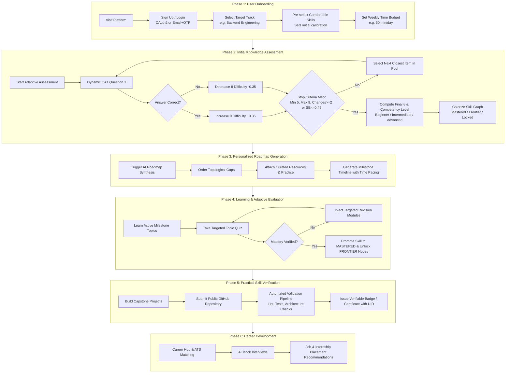
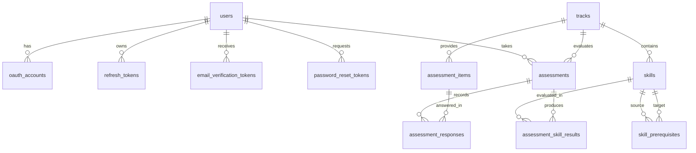

# System Context & Knowledge Base — AI-Powered Upskilling Platform

> **Target Audience:** Autonomous AI Agents, LLM Code Assistants, and Engineering Contributors  
> **Repository:** `LNCT-Unix/AI-Powered-Upskilling-Platform`  
> **Authors & Maintainers:** Team Unix (Lakshmi Narain College of Technology, Bhopal) for the **EPAM Systems CoE Programme**  
> **Maintainer / Lead:** Dev Sharma  
> **Last Updated:** October 2026 (Sprint 1 Active / Sprint 2 In-Progress)  
> **Status:** Production-Ready Baseline Specifications & Implemented Codebase

---

## 📑 Quick Navigation

1. [Executive Overview & Core Value Proposition](#1-executive-overview--core-value-proposition)
2. [End-to-End Learner Journey (The 6-Phase Lifecycle)](#2-end-to-end-learner-journey-the-6-phase-lifecycle)
3. [System Architecture & Subsystems](#3-system-architecture--subsystems)
4. [Psychometric Engine: IRT 1-PL Rasch Computerized Adaptive Testing (CAT)](#4-psychometric-engine-irt-1-pl-rasch-computerized-adaptive-testing-cat)
5. [Skill Graph Engine & Topological DAG](#5-skill-graph-engine--topological-dag)
6. [Security & Authentication Architecture](#6-security--authentication-architecture)
7. [Database Schema & Persistence Models (PostgreSQL)](#7-database-schema--persistence-models-postgresql)
8. [Comprehensive REST API Reference & Data Contracts](#8-comprehensive-rest-api-reference--data-contracts)
9. [Frontend Application Architecture (`web-app/`)](#9-frontend-application-architecture-web-app)
10. [Backend Gateway Architecture (`gateway/ai-upskilling-platform/`)](#10-backend-gateway-architecture-gatewayai-upskilling-platform)
11. [AI Worker Microservice Architecture (`ai-worker/`)](#11-ai-worker-microservice-architecture-ai-worker)
12. [Environment Variables & Configuration Matrix](#12-environment-variables--configuration-matrix)
13. [Local Development, Build & Testing Workflows](#13-local-development-build--testing-workflows)
14. [Strict Engineering Invariants for AI Agents](#14-strict-engineering-invariants-for-ai-agents)
15. [Repository File Map & Key Artifacts](#15-repository-file-map--key-artifacts)

---

## 1. Executive Overview & Core Value Proposition

### 1.1 The Problem
Traditional online learning suffers from five systemic dysfunctions:
1. **Wrong Starting Points:** Learners guess what to study based on unverified, self-reported skills, repeating basics or leaping into advanced topics without foundational competence.
2. **Low AI Trust:** Generative chatbots produce hallucinated, non-deterministic, and ungrounded learning recommendations without psychometric backing.
3. **Lost Momentum & Drop-offs:** Linear roadmaps trapped in chat histories fail to track daily consistency, habits, or verifiable milestone completions.
4. **Rigid, Non-Adaptive Curricula:** Existing platforms treat all learners identically, ignoring individualized learning velocity and skill deficits.
5. **The "Skills ≠ Job-Ready" Divide:** Course certificates lack employer credibility; they do not verify code quality, architectural understanding, or interview preparedness.

### 1.2 The Solution
The **AI-Powered Upskilling Platform** is an adaptive, career-focused learning and evaluation ecosystem built upon three mathematically verified pillars:
- **01. Measure:** A computerized adaptive test (CAT) based on **Item Response Theory (1-PL Rasch Model)** pins the learner's true latent ability level ($\theta$) in under 10 questions with mathematical precision.
- **02. Plan:** An asynchronous AI orchestrator maps diagnostic results against a formal **Directed Acyclic Graph (DAG)** of competencies to synthesize a personalized, milestone-driven learning roadmap.
- **03. Track & Verify:** Learners advance through bite-sized modules, dynamically unlock skill graph nodes, submit practical GitHub repositories for automated capstone verification, and prepare for placement with AI-driven interview and career hubs.

### 1.3 Target Personas
- **Career Seekers:** Transitioning into tech; require rigorous baseline tests, structured roadmaps, GitHub project auditing, and interview readiness.
- **Working Professionals:** Reskilling with strict time budgets; require micro-learning, smart calendar scheduling, and targeted weak-area re-tests.
- **College Students:** Building industry skills beyond university curricula; require prerequisite graphs, commit tracking, and verifiable credential badges.
- **Curious / Hobbyist Learners:** Low-pressure, self-paced exploration with free-resource filtering.
- **Institutes & Enterprise Mentors:** Cohort management, tenant isolation, weak-area batch analytics, and progress auditing.

---

## 2. End-to-End Learner Journey (The 6-Phase Lifecycle)

The system enforces a strict 6-phase progression:



---

## 3. System Architecture & Subsystems

The platform adopts a decoupled microservice architecture separating synchronous transactional persistence from asynchronous, compute-intensive AI operations:

```
                            ┌────────────────────────────────────────┐
                            │         Web Application (React 19)     │
                            │       Vite • Tailwind v4 • Lucide      │
                            │          Runs on: localhost:5173       │
                            └────────────────────┬───────────────────┘
                                                 │
                                 HTTP REST / JSON │ OAuth2 Redirects
                       Authorization: Bearer <JWT>│ HttpOnly Cookies
                                                 ▼
                            ┌────────────────────────────────────────┐
                            │    Spring Boot Gateway (Port 8080)     │
                            │  Java 21 • Spring Security • JPA Data  │
                            │  Rasch CAT Engine • Graph Validator    │
                            └────────────┬───────────────────┬───────┘
                                         │                   │
                        JDBC Connections │                   │ Internal HTTP
                    PostgreSQL 16 (Neon) │                   │ X-Internal-API-Key
                                         ▼                   ▼
                     ┌───────────────────────┐   ┌───────────────────────────┐
                     │  Neon Cloud PostgreSQL │   │   Node.js AI Worker       │
                     │  citext, UUID, Flyway │   │   Port: 3001 (Internal)   │
                     │  Users, Auth, Graph,  │   │   Stateless LLM Engine    │
                     │  Assessments, History │   │   OpenRouter / BullMQ     │
                     └───────────────────────┘   └─────────────┬─────────────┘
                                                               │
                                                               ▼
                                                 ┌───────────────────────────┐
                                                 │   External LLM Providers  │
                                                 │   Anthropic / OpenAI /    │
                                                 │   Google Gemini           │
                                                 └───────────────────────────┘
```

### 3.1 Subsystem Responsibilities

| Subsystem | Tech Stack | Responsibilities | Security Boundary |
|---|---|---|---|
| **`gateway/ai-upskilling-platform`** | Java 21, Spring Boot 3.x / 4.x, Spring Security, Hibernate / JPA, PostgreSQL | Single public API entry point. Manages user registration, email OTP verification, OAuth2 (Google/GitHub), JWT access/refresh token rotation, IRT CAT assessment engine, DAG graph loading, transactional persistence. | Public API; enforces JWT Bearer tokens and HttpOnly cookie checks. |
| **`web-app/`** | React 19, Vite, Tailwind CSS v4, React Router 6, D3 / SVG graph models | Single-page application (SPA). Implements landing page, animated mascot, login/signup modals, onboarding wizard, adaptive quiz runner, interactive SVG skill graph, roadmap explorer, project verification lab, and career hub. | Client-side in-memory token storage (XSS prevention); mock auth fallback. |
| **`ai-worker/`** | Node.js 20+, Express, OpenRouter API client, BullMQ / Redis | Asynchronous, stateless generative subsystem. Generates candidate diagnostic questions, roadmaps, code evaluation feedback. | Private network only; authenticated via `X-Internal-API-Key`. Never accesses DB directly. |
| **`contracts/`** | JSON Schema (Draft 7) | Canonical JSON schemas enforcing strict structural validity on all generative LLM payloads before returning to Gateway. | Shared contract repository. |
| **`mobile-app/`** | React Native / Flutter (Planned) | Native mobile client consuming Gateway REST endpoints with mobile platform headers (`X-Client-Platform: mobile`). | Deep-link auth callbacks (`myapp://auth/callback`). |

---

## 4. Psychometric Engine: IRT 1-PL Rasch Computerized Adaptive Testing (CAT)

### 4.1 Mathematical Foundations
The assessment module avoids arbitrary percentage scores. Instead, it measures student ability using the **1-Parameter Logistic (1-PL) Rasch Model**:

$$P_i(\theta) = \frac{e^{(\theta - b_i)}}{1 + e^{(\theta - b_i)}} = \frac{1}{1 + e^{-(\theta - b_i)}}$$

Where:
- $\theta \in [-3.0, +3.0]$: The latent trait representing the learner's true ability (in logits).
- $b_i \in [-3.0, +3.0]$: The calibrated difficulty parameter of question item $i$ (in logits).
- $P_i(\theta)$: The probability that a learner of ability $\theta$ answers item $i$ correctly.

When $\theta = b_i$, $P_i(\theta) = 0.5$ (50% chance of correct response). When $\theta > b_i$, $P_i(\theta) > 0.5$.

### 4.2 Adaptive Staircase Algorithm
Implemented deterministically in `AssessmentService.java`:
1. **Starting Point:** Every assessment starts at $\theta_0 = 0.0$.
2. **Item Selection (`nextItem`):** The engine queries the unused pool of `ACTIVE` questions for the track and selects the item whose difficulty $b_i$ is closest to the current estimate $\hat{\theta}$:
   $$\arg\min_{i \in \text{Unused}} |b_i - \hat{\theta}|$$
3. **Step Function:**
   - Correct answer: $\hat{\theta}_{k+1} = \hat{\theta}_k + \Delta$, where $\Delta = 0.35$ logits.
   - Incorrect answer: $\hat{\theta}_{k+1} = \hat{\theta}_k - \Delta$, where $\Delta = 0.35$ logits.
4. **Stopping Rules (`stopReason`):**
   - **Hard Cap:** Test terminates immediately if questions answered $\ge 9$ (`MAX_ITEMS`).
   - **Convergence / Level Confirmed:** If questions answered $\ge 5$ (`MIN_ITEMS`) **and** the learner has changed answer direction $\ge 2$ times (demonstrating oscillation around true ability threshold), the test finishes early (`LEVEL_CONFIRMED`).
   - **Exhaustion:** If no questions remain in the pool, test terminates (`NO_QUESTIONS_LEFT`).

### 4.3 Competency Level Mapping
$$\text{Level}(\theta) = \begin{cases} 
\text{BEGINNER} & \text{if } \theta < -0.5 \\
\text{INTERMEDIATE} & \text{if } -0.5 \le \theta \le 0.75 \\
\text{ADVANCED} & \text{if } \theta > 0.75 
\end{cases}$$

### 4.4 Simulation Benchmarks (1,000 Virtual Learners)
- **Average Questions Administered:** 7.37 questions.
- **Early Stop Ratio:** 79.4% stop before question 9.
- **Accuracy ($r$ vs. True Ability):** $0.909$.
- **Test-Retest Reliability:** $0.828$.
- **Determinism:** Identical input responses produce bit-identical logit results.

---

## 5. Skill Graph Engine & Topological DAG

### 5.1 Graph Topology
The primary curriculum is modeled as a formal Directed Acyclic Graph (DAG) defined in `gateway/.../seed/backend-skills.yaml`:
- **Total Skills:** 56 atomic competencies.
- **Prerequisite Edges:** 72 directed dependencies.
- **Longest Dependency Chain:** 6 levels.
- **9 Domain Clusters:**
  1. `Foundations` (`programming-basics`, `git-basics`, `linux-cli-basics`, `core-data-structures`, `error-handling`, `oop-modular-design`, `unit-testing`).
  2. `Web APIs` (`networking-basics`, `http-basics`, `json-serialization`, `rest-api-design`, `input-validation-errors`, `api-docs-openapi`, `pagination-versioning`, `realtime-communication`).
  3. `Databases` (`sql-basics`, `sql-joins-aggregation`, `relational-modeling`, `orm-data-access`, `nosql-basics`, `schema-migrations`, `indexing-query-performance`, `transactions-acid`, `isolation-concurrency`, `replication-sharding`).
  4. `Security` (`password-hashing`, `sessions-cookies`, `jwt-auth`, `authorization-rbac`, `secrets-management`, `web-security-owasp`, `rate-limiting`, `oauth2-oidc`).
  5. `Architecture` (`layered-architecture`, `dependency-injection`, `solid-principles`, `design-patterns`, `monolith-vs-microservices`, `system-design-scalability`).
  6. `Performance` (`caching-basics`, `redis-in-memory`, `load-balancing`).
  7. `Async & Distributed` (`concurrency-basics`, `async-programming`, `background-jobs`, `message-queues`, `idempotency-retries`, `distributed-consistency`).
  8. `Quality & Observability` (`test-doubles`, `api-integration-testing`, `logging-monitoring`, `observability-tracing`).
  9. `DevOps` (`docker-basics`, `ci-cd-basics`, `cloud-deployment`, `container-orchestration`).

### 5.2 Dynamic Skill State Classification
Following an assessment with final ability $\theta^*$, skills are classified into one of three states:
1. **`MASTERED`**:
   - The user declared proficiency during onboarding: $\text{slug} \in \text{KnownSkillSlugs}$, **OR**
   - The skill difficulty sits safely below the estimated ability: $\text{difficulty} \le \theta^* - 0.25$ (`MASTERY_MARGIN`).
2. **`FRONTIER`**:
   - The skill is **not** mastered, **BUT** 100% of its direct prerequisite skills are `MASTERED`.
   - This represents the exact boundary of what the learner is ready to tackle next.
3. **`LOCKED`**:
   - One or more prerequisite skills remain unmastered.

### 5.3 Graph Integrity Verification
On application startup (`AssessmentDataLoader.java`), the DAG is formally verified:
- **Cycle Detection:** Depth-First Search (DFS) with visited/recursion tracking.
- **Orphan Check:** Every prerequisite identifier must resolve to an active skill within the track.
- **Difficulty Inversion Check:** Warns if a prerequisite node has higher calibrated difficulty than a dependent child node.

---

## 6. Security & Authentication Architecture

### 6.1 Authentication Methods
1. **OAuth2 / OpenID Connect:**
   - **Google OIDC:** Scopes `openid, profile, email`.
   - **GitHub OAuth2:** Scopes `read:user, user:email` (with fallback to `/user/emails` for private primary verified addresses).
2. **Email & Password Authentication:**
   - Registration with BCrypt password hashing.
   - 6-digit email verification OTP dispatched via Gmail SMTP (TTL: 15 minutes).
   - Rate limiting on email sends and login attempts.

### 6.2 Token Management & Invariant Principles
- **Access Tokens:** Signed HMAC-SHA256 JWTs (`APP_AUTH_JWT_SECRET`), TTL = 15 minutes (`900s`).
  - **Critical Rule:** Stored strictly **IN-MEMORY** in client JavaScript state (`api.js`). Never stored in `localStorage` or `sessionStorage` (neutralizing token extraction via XSS).
- **Refresh Tokens:** High-entropy opaque tokens, TTL = 30 days (`2592000s`).
  - Delivered to web clients inside an `HttpOnly`, `SameSite=Lax`, `Path=/api/auth` cookie.
  - Stored in the database strictly as **SHA-256 cryptographic hashes** (`TokenHashUtil.sha256Hex`).
  - **Rotation:** Rotated on every use (`POST /api/auth/refresh`). If a previously rotated token is reused, the entire token family is immediately revoked (anti-theft detection).
- **One-Time Login Code Exchange:**
  - After OAuth callback, Gateway issues a cryptographically random UUID login code (`OAuthLoginCode`) with a 60-second TTL.
  - Gateway redirects the browser to `http://localhost:5173/auth/callback?code=<uuid>`.
  - Frontend exchanges this code via `POST /api/auth/oauth2/exchange`.
  - Prevents access tokens from ever appearing in browser history, logs, or URL parameters.

### 6.3 Account Linking Decision Matrix
To prevent account takeover, the backend enforces:
1. **Existing Mapping:** If `(provider, provider_subject)` exists, authenticate immediately.
2. **Missing / Unverified Email:** Reject with `OAUTH_EMAIL_REQUIRED` or `OAUTH_EMAIL_UNVERIFIED`.
3. **New User:** If email does not exist, provision new verified user and link OAuth identity.
4. **Existing Verified Password User:** **Do not auto-link by email.** Reject with `OAUTH_ACCOUNT_EXISTS`. User must log in with password first and perform explicit linking via `POST /api/auth/oauth-links/{provider}/intent`.
5. **Existing Unverified User (Reclaim):** If existing account was never verified via email OTP, reclaim it, verify email, clear old password, and link OAuth identity.

---

## 7. Database Schema & Persistence Models (PostgreSQL)

Configured for PostgreSQL 16+ on **Neon Cloud** (`neondb`):



### 7.1 Table Definitions & Column Constraints

#### `users`
| Column | Type | Constraints | Description |
|---|---|---|---|
| `id` | `BIGINT` | `PK`, `AUTO_INCREMENT` | Unique internal user ID |
| `email` | `VARCHAR(255)` | `NOT NULL`, `UNIQUE` | Normalized lowercase email address |
| `full_name` | `VARCHAR(255)` | `NULLABLE` | User display name |
| `password_hash` | `VARCHAR(255)` | `NULLABLE` | BCrypt salted hash (null for OAuth-only users) |
| `email_verified` | `BOOLEAN` | `DEFAULT FALSE` | True if verified via OTP or OAuth |
| `email_verified_at`| `TIMESTAMP` | `NULLABLE` | Verification timestamp |
| `role` | `VARCHAR(50)` | `DEFAULT 'USER'` | `USER`, `ADMIN`, `MENTOR`, `PLATFORM_ADMIN` |
| `status` | `VARCHAR(50)` | `DEFAULT 'ACTIVE'` | `ACTIVE`, `SUSPENDED`, `DELETED` |
| `created_at` / `updated_at` | `TIMESTAMP` | `NOT NULL` | Audit timestamps |

#### `oauth_accounts`
| Column | Type | Constraints | Description |
|---|---|---|---|
| `id` | `BIGINT` | `PK`, `AUTO_INCREMENT` | Primary key |
| `user_id` | `BIGINT` | `FK -> users.id`, `NOT NULL` | Owning user |
| `provider` | `VARCHAR(50)` | `NOT NULL` | `GOOGLE` or `GITHUB` |
| `provider_subject`| `VARCHAR(255)` | `NOT NULL` | External provider user ID |
| `provider_email` | `VARCHAR(255)` | `NOT NULL` | External email provided |
| `created_at` / `last_login_at` | `TIMESTAMP` | `NOT NULL` | Audit timestamps |
| *Constraint* | `UNIQUE(provider, provider_subject)` | Prevents duplicate provider mappings |

#### `refresh_tokens`
| Column | Type | Constraints | Description |
|---|---|---|---|
| `id` | `BIGINT` | `PK`, `AUTO_INCREMENT` | Primary key |
| `user_id` | `BIGINT` | `FK -> users.id`, `NOT NULL` | Owning user |
| `token_hash` | `VARCHAR(64)` | `NOT NULL`, `UNIQUE` | SHA-256 hash of opaque token string |
| `expires_at` | `TIMESTAMP` | `NOT NULL` | Expiry threshold (30 days) |
| `revoked` | `BOOLEAN` | `DEFAULT FALSE` | Revocation status flag |
| `replaced_by` | `VARCHAR(64)` | `NULLABLE` | Hash of rotated successor token |
| `client_platform` | `VARCHAR(20)` | `DEFAULT 'WEB'` | `WEB` or `MOBILE` |

#### `tracks`
| Column | Type | Constraints | Description |
|---|---|---|---|
| `id` | `UUID` | `PK` | Fixed UUID (Backend: `00000000-0000-0000-0000-000000000001`) |
| `slug` | `VARCHAR(100)` | `NOT NULL`, `UNIQUE` | Canonical track slug (e.g. `backend-engineering`) |
| `name` | `VARCHAR(255)` | `NOT NULL` | Track title |
| `status` | `VARCHAR(50)` | `DEFAULT 'ACTIVE'` | `ACTIVE`, `DRAFT`, `ARCHIVED` |

#### `skills`
| Column | Type | Constraints | Description |
|---|---|---|---|
| `id` | `UUID` | `PK` | Deterministic UUID generated from slug |
| `track_id` | `UUID` | `FK -> tracks.id`, `NOT NULL` | Owning track |
| `slug` | `VARCHAR(100)` | `NOT NULL`, `UNIQUE` | Unique slug (e.g. `sql-joins-aggregation`) |
| `name` | `VARCHAR(255)` | `NOT NULL` | Human-readable name |
| `cluster` | `VARCHAR(100)` | `NOT NULL` | One of the 9 domain clusters |
| `difficulty` | `DOUBLE PRECISION` | `NOT NULL` | Calibrated logit difficulty $[-3.0, +3.0]$ |
| `description` | `TEXT` | `NULLABLE` | Competency summary |

#### `skill_prerequisites`
| Column | Type | Constraints | Description |
|---|---|---|---|
| `skill_id` | `UUID` | `FK -> skills.id` | Target skill |
| `prerequisite_id` | `UUID` | `FK -> skills.id` | Required precursor skill |
| *Composite PK* | `(skill_id, prerequisite_id)` | Topological DAG edges |

#### `assessment_items`
| Column | Type | Constraints | Description |
|---|---|---|---|
| `id` | `UUID` | `PK` | Item identifier |
| `track_id` | `UUID` | `FK -> tracks.id`, `NOT NULL` | Associated track |
| `skill_slug` | `VARCHAR(100)` | `NOT NULL` | Target skill slug |
| `difficulty` | `DOUBLE PRECISION` | `NOT NULL` | Item logit difficulty $b_i$ |
| `stem` | `TEXT` | `NOT NULL` | Question prompt |
| `options` | `TEXT` | `NOT NULL` | JSON stringified array of 4 options |
| `correct_option` | `INT` | `NOT NULL` | 0-indexed correct option (NEVER sent to client during test) |
| `status` | `VARCHAR(50)` | `DEFAULT 'ACTIVE'` | `ACTIVE`, `RETIRED` |

#### `assessments`
| Column | Type | Constraints | Description |
|---|---|---|---|
| `id` | `UUID` | `PK` | Assessment session ID |
| `user_id` | `BIGINT` | `FK -> users.id`, `NOT NULL` | Learner ID |
| `track_id` | `UUID` | `FK -> tracks.id`, `NOT NULL` | Evaluated track |
| `status` | `VARCHAR(50)` | `NOT NULL` | `IN_PROGRESS`, `COMPLETED`, `ABANDONED` |
| `initial_theta` | `DOUBLE PRECISION` | `DEFAULT 0.0` | Initial ability calibration |
| `theta` | `DOUBLE PRECISION` | `NULLABLE` | Final calculated ability $\hat{\theta}$ |
| `level` | `VARCHAR(50)` | `NULLABLE` | `BEGINNER`, `INTERMEDIATE`, `ADVANCED` |
| `items_administered` | `INT` | `DEFAULT 0` | Total questions answered |
| `correct_count` | `INT` | `DEFAULT 0` | Correct answers count |
| `stop_reason` | `VARCHAR(50)` | `NULLABLE` | `LEVEL_CONFIRMED`, `MAX_ITEMS`, `NO_QUESTIONS_LEFT` |
| `known_skill_slugs` | `TEXT` | `NULLABLE` | JSON array of self-reported skills |
| `started_at` / `completed_at` | `TIMESTAMP` | Timestamps |

#### `assessment_responses`
| Column | Type | Constraints | Description |
|---|---|---|---|
| `id` | `UUID` | `PK` | Response record ID |
| `assessment_id` | `UUID` | `FK -> assessments.id`, `NOT NULL` | Session reference |
| `seq` | `INT` | `NOT NULL` | 1-based question sequence index |
| `item_id` | `UUID` | `FK -> assessment_items.id`, `NOT NULL` | Item answered |
| `selected_option` | `INT` | `NOT NULL` | Option index selected by user |
| `is_correct` | `BOOLEAN` | `NOT NULL` | Computed correctness |
| `answered_at` | `TIMESTAMP` | `NOT NULL` | Submission timestamp |

#### `assessment_skill_results`
| Column | Type | Constraints | Description |
|---|---|---|---|
| `id` | `UUID` | `PK` | Record ID |
| `assessment_id` | `UUID` | `FK -> assessments.id`, `NOT NULL` | Assessment session |
| `skill_id` | `UUID` | `FK -> skills.id`, `NOT NULL` | Evaluated skill |
| `state` | `VARCHAR(50)` | `NOT NULL` | `MASTERED`, `FRONTIER`, `LOCKED` |

---

## 8. Comprehensive REST API Reference & Data Contracts

All public requests target `http://localhost:8080`.  
JSON envelopes adhere strictly to `ApiResponse<T>`:

```json
{
  "success": true,
  "message": "Operation successful description",
  "data": { ... },
  "timestamp": "2026-10-28T23:45:00.000"
}
```

### 8.1 Authentication Endpoints (`/api/auth`)

| Method | Endpoint | Auth | Request Body | Response `data` | Description |
|---|---|---|---|---|---|
| `GET` | `/oauth2/authorization/{provider}` | None | None | Redirect (302) | Initiates OAuth flow for `google` or `github`. |
| `POST` | `/api/auth/oauth2/exchange` | None | `{ "code": "<uuid>" }` | `{ "accessToken": "...", "user": { ... } }` | Exchanges one-time code for JWT. Sets `refresh_token` cookie. |
| `POST` | `/api/auth/register` | None | `{ "fullName": "...", "email": "...", "password": "..." }` | `{ "email": "...", "status": "PENDING_VERIFICATION" }` | Initiates email registration; dispatches 6-digit OTP. |
| `POST` | `/api/auth/email-verification/confirm` | None | `{ "email": "...", "otp": "123456" }` | `{ "accessToken": "...", "user": { ... } }` | Confirms email OTP. Issues JWT + refresh cookie. |
| `POST` | `/api/auth/email-verification/resend` | None | `{ "email": "..." }` | `null` | Resends verification OTP email. |
| `POST` | `/api/auth/login` | None | `{ "email": "...", "password": "..." }` | `{ "accessToken": "...", "user": { ... } }` | Authenticates with email & password. |
| `POST` | `/api/auth/refresh` | Cookie / Body | None (Reads `refresh_token` cookie) | `{ "accessToken": "...", "user": { ... } }` | Rotates refresh token; returns new JWT. |
| `POST` | `/api/auth/logout` | Cookie | None | `null` | Revokes refresh token in DB and clears cookie. |
| `GET` | `/api/auth/me` | Bearer | None | `{ "id": 1, "email": "...", "fullName": "...", "role": "USER" }` | Hydrates current session profile. |
| `POST` | `/api/auth/forgot-password` | None | `{ "email": "..." }` | `null` | Requests password reset OTP. |
| `POST` | `/api/auth/verify-reset-otp` | None | `{ "email": "...", "otp": "123456" }` | `{ "resetToken": "...", "email": "..." }` | Verifies reset OTP; returns short-lived reset token. |
| `POST` | `/api/auth/reset-password` | None | `{ "email": "...", "resetToken": "...", "newPassword": "..." }` | `null` | Applies new password. |
| `POST` | `/api/auth/oauth-links/{provider}/intent` | Bearer | `{ "currentPassword": "..." }` (if password user) | `{ "intentToken": "...", "redirectUrl": "..." }` | Creates intent to safely link Google/GitHub account. |

### 8.2 Assessment & Onboarding Endpoints (`/api/v1/assessments`)

| Method | Endpoint | Auth | Request Body | Response Body | Description |
|---|---|---|---|---|---|
| `GET` | `/api/v1/assessments/tracks` | None / Bearer | None | `[ { "trackId": "...", "slug": "backend-engineering", "name": "Backend Engineering" } ]` | Returns all active tracks for onboarding dropdown. |
| `GET` | `/api/v1/assessments/tracks/{trackId}/skills` | None / Bearer | None | `[ { "skillId": "...", "slug": "...", "name": "...", "cluster": "...", "difficulty": 0.0 } ]` | Lists all skills in a track for onboarding pre-selection. |
| `POST` | `/api/v1/assessments` | Bearer | `{ "trackId": "...", "knownSkillSlugs": ["git-basics", "sql-basics"] }` | `AssessmentState` DTO (see below) | Starts a new test or idempotently returns active test in progress. |
| `GET` | `/api/v1/assessments/{id}` | Bearer | None | `AssessmentState` DTO | Fetches current test state or next question. |
| `POST` | `/api/v1/assessments/{id}/responses` | Bearer | `{ "itemId": "...", "selectedOption": 1 }` | `AssessmentState` DTO | Submits answer; runs staircase IRT update. |
| `GET` | `/api/v1/assessments/{id}/result` | Bearer | None | `ResultView` DTO (Score summary & skill states) | Available only after assessment status is `COMPLETED`. |
| `GET` | `/api/v1/assessments/{id}/report` | Bearer | None | `AssessmentReport` DTO (Full breakdown + unlocked skills) | Full report: per-question review, answers, unlocked nodes. |

#### DTO Structural Contracts:

**`AssessmentState`:**
```json
{
  "assessmentId": "3fa85f64-5717-4562-b3fc-2c963f66afa6",
  "status": "IN_PROGRESS",
  "done": false,
  "currentItem": {
    "id": "e7b0a7b5-24d1-42e8-b769-6f10fa4f86d8",
    "stem": "Which HTTP status code category represents client-side errors?",
    "options": ["2xx", "3xx", "4xx", "5xx"],
    "seq": 1
  },
  "itemsAnswered": 0
}
```

**`AssessmentReport`:**
```json
{
  "assessmentId": "3fa85f64-5717-4562-b3fc-2c963f66afa6",
  "level": "INTERMEDIATE",
  "initialTheta": 0.0,
  "theta": 0.35,
  "itemsAdministered": 7,
  "correctCount": 5,
  "stopReason": "LEVEL_CONFIRMED",
  "responses": [
    {
      "seq": 1,
      "stem": "In Git, which command creates and switches...",
      "options": ["...", "..."],
      "selectedOption": 1,
      "correctOption": 1,
      "correct": true,
      "skillSlug": "git-basics",
      "skillName": "Git Version Control"
    }
  ],
  "skillResults": [
    { "skillId": "...", "slug": "git-basics", "name": "Git Version Control", "cluster": "Foundations", "state": "MASTERED" },
    { "skillId": "...", "slug": "docker-basics", "name": "Docker Basics", "cluster": "DevOps", "state": "FRONTIER" }
  ],
  "unlockedSkills": [ ... ]
}
```

---

## 9. Frontend Application Architecture (`web-app/`)

### 9.1 Tech Stack
- **Framework:** React 19 SPA powered by Vite 8.
- **Styling:** Tailwind CSS v4 using modern `@theme` design tokens (`web-app/src/index.css`).
- **Icons:** `lucide-react`.
- **Router:** `react-router-dom` v6 (`createBrowserRouter`).
- **Design Aesthetic:** *Deep Craft Learning* — Warm cream backdrop (`#F7F3E8`), slate typography (`#2F2A3E`), deep violet accents (`#7C5CFA`), and rounded card surfaces (`#FFFDF7`).

### 9.2 Route Map
| Route | Component | Purpose |
|---|---|---|
| `/` | `LandingPage.jsx` | Marketing showcase, animated octopus mascot, interactive preview graph, FAQ AI chatbot. |
| `/login` | `LoginPage.jsx` | Email/password login, Google/GitHub OAuth initiation, remember-me options. |
| `/signup` | `SignupPage.jsx` | Full registration form with password strength criteria and OAuth triggers. |
| `/forgot-password` | `forgotPass.jsx` | Multi-step password reset (Email -> 6-digit OTP -> New password). |
| `/auth/callback` | `AuthCallbackPage.jsx` | OAuth landing page: parses `?code=`, executes exchange, redirects to `/dashboard`. |
| `/auth/error` | `AuthErrorPage.jsx` | Surfaces OAuth failure diagnostics and recovery links. |
| `/verify-email` | `VerifyEmailPage.jsx` | 6-digit email confirmation screen with resend countdown. |
| `/onboarding` | `OnboardingPage.jsx` | 3-step wizard: Language selection, Track picker & skill pre-selection, Daily time budget. |
| `/dashboard` | `DashboardPage.jsx` | Primary in-app dashboard: streak, readiness metrics, mini skill graph, active roadmap. |
| `/assessment` | `AssessmentPage.jsx` | Live CAT diagnostic assessment runner with real-time progress and completion report. |
| `/graph` | `SkillGraphPage.jsx` | Full-screen interactive DAG visualization with cluster filters and node inspection. |
| `/roadmap` | `RoadmapPage.jsx` | Phased milestone timeline with collapse/expand modules, resource links, and progress checks. |
| `/projects` | `ProjectVerifyPage.jsx` | Capstone repository verification simulator (evaluates public GitHub repos). |
| `/career` | `CareerHubPage.jsx` | Match score ring against live job roles (e.g. EPAM Systems) based on mastered graph skills. |

### 9.3 State & API Integration Layer
- **`src/services/api.js`**: Central `apiClient` wrapper. Manages in-memory JWT access token (`setAccessToken`, `getAccessToken`), passes `credentials: 'include'` for cookies, and intercepts `401 Unauthorized` responses to execute transparent silent token refresh via `/api/auth/refresh`.
- **`src/services/authService.js`**: Exposes high-level methods for OAuth redirects, code exchange, email auth, OTP verification, and password reset.
- **`src/services/assessmentService.js`**: Interfaces with the CAT engine: track retrieval, skill listing, test initialization, answer submission, result queries, and detailed report fetching.
- **`src/context/AuthContext.jsx`**: Global authentication state provider. Hydrates session on mount via `/api/auth/me`.
- **Mock Mode Resilience:** When `VITE_USE_MOCK_AUTH=true` in `web-app/.env`, the frontend runs autonomously with simulated users, mock questions, and mock graphs without requiring the backend.

---

## 10. Backend Gateway Architecture (`gateway/ai-upskilling-platform/`)

### 10.1 Package Hierarchy (`com.unix.aiupskilling`)
```
com.unix.aiupskilling/
├── AiUpskillingPlatformApplication.java    # Spring Boot entry point
│
├── assessment/                             # Psychometric & CAT Engine
│   ├── config/AssessmentDataLoader.java    # YAML DAG loader & initial question seeder
│   ├── controller/AssessmentController.java# /api/v1/assessments endpoints
│   ├── dto/AssessmentDtos.java             # Request/Response data transfer records
│   ├── model/entity/                       # JPA entities: Track, Skill, AssessmentItem,
│   │                                       # Assessment, AssessmentResponse, AssessmentSkillResult
│   ├── repository/                         # Spring Data JPA repositories with custom queries
│   └── service/AssessmentService.java      # 1-PL Rasch algorithm & DAG state colorizer
│
├── authentication/                         # Security & Identity Module
│   ├── config/                             # SecurityConfig, JwtFilter, AuthProperties
│   ├── controller/                         # EmailAuthController, AuthTokenController,
│   │                                       # PasswordResetController, AuthLinkController
│   ├── dto/                                # Request/Response DTOs for auth & OTP
│   ├── event/                              # Async Spring ApplicationEvents for email delivery
│   ├── exception/                          # Domain exceptions (OAuthLoginException, etc.)
│   ├── model/entity/                       # RefreshToken, OAuthAccount, LoginCode, ResetToken
│   ├── security/oauth2/                    # Google OIDC & GitHub OAuth user services & handlers
│   ├── service/                            # AuthTokenService, EmailAuthService, LinkingService
│   └── util/                               # TokenHashUtil (SHA-256), EmailNormalizer
│
├── shared/                                 # Cross-cutting Infrastructure
│   ├── config/JacksonConfig.java           # JSON serializer configuration
│   ├── controller/HealthController.java    # /health and actuator status
│   ├── dto/ApiResponse.java                # Global JSON success/error envelope
│   ├── exception/GlobalExceptionHandler.java# Central error normalizer
│   └── util/AppConstants.java              # Constant values and headers
│
└── user/                                   # User Domain Entity
    ├── Role.java                           # USER, ADMIN, MENTOR, PLATFORM_ADMIN
    ├── User.java                           # Core User JPA entity
    ├── UserController.java                 # User profile administration
    └── UserRepository.java                 # User database access
```

### 10.2 Spring Security Filter Chain
1. **`JwtAuthenticationFilter`**: Intercepts `Authorization: Bearer <token>`, validates HMAC-SHA256 signature, extracts user ID from subject, and populates `SecurityContextHolder`.
2. **Public Routes:** `/api/auth/**`, `/oauth2/**`, `/login/oauth2/**`, `/api/v1/assessments/tracks/**`, `/health`.
3. **Protected Routes:** `/api/auth/me`, `/api/v1/assessments/**` (requires authenticated `User` principal).
4. **CORS:** Configured to dynamically reflect allowed origins (`http://localhost:5173`, `http://localhost:3000`) with `allowCredentials = true`.

---

## 11. AI Worker Microservice Architecture (`ai-worker/`)

### 11.1 Purpose & Sandbox Boundary
The AI Worker handles generative, non-deterministic operations that would otherwise block synchronous HTTP threads in Spring Boot:
- **Async LLM Question Generation:** Generating candidate diagnostic questions based on specific skill gaps.
- **Roadmap Synthesis:** Generating detailed markdown study milestones and weekly pacing.
- **Capstone Project Auditing:** Inspecting code structure, dependencies, and git commits.

### 11.2 Internal Endpoint Contract
- **Port:** `3001` (Node.js Express)
- **Header:** `X-Internal-API-Key: <shared_secret>`
- **Endpoint:** `POST /internal/assessment/next-question`
```json
// Request
{
  "assessmentId": "3fa85f64-5717-4562-b3fc-2c963f66afa6",
  "skill": "sql-basics",
  "questionNumber": 3,
  "totalQuestions": 9,
  "previousAnswers": [
    { "skill": "git-basics", "correct": true }
  ]
}

// Response
{
  "question": "Which SQL clause is used to filter records before grouping occurs?",
  "options": ["HAVING", "ORDER BY", "WHERE", "GROUP BY"],
  "correctAnswer": 2,
  "explanation": "WHERE filters rows before GROUP BY aggregation; HAVING filters post-grouping."
}
```

---

## 12. Environment Variables & Configuration Matrix

### 12.1 Backend Environment (`gateway/ai-upskilling-platform/.env` or OS Environment)

| Variable | Required | Default / Example Value | Purpose |
|---|---|---|---|
| `SPRING_DATASOURCE_URL` | Yes | `jdbc:postgresql://<neon-host>/neondb?sslmode=require` | PostgreSQL JDBC connection URL |
| `SPRING_DATASOURCE_USERNAME` | Yes | `neondb_owner` | Database user |
| `SPRING_DATASOURCE_PASSWORD` | Yes | `npg_xJHwDgvO5Nt7` | Database password |
| `APP_AUTH_JWT_SECRET` | **Yes** | `0123456789012345678901234567890123456789` | HMAC-SHA256 signing secret ($\ge 256$ bits) |
| `GOOGLE_CLIENT_ID` | For Google | `444317958866-...apps.googleusercontent.com` | Google Cloud OAuth Client ID |
| `GOOGLE_CLIENT_SECRET` | For Google | `GOCSPX-...` | Google Cloud OAuth Client Secret |
| `GITHUB_CLIENT_ID` | For GitHub | `Ov23li1uXQnIYi33lg5c` | GitHub OAuth App Client ID |
| `GITHUB_CLIENT_SECRET` | For GitHub | `66846072e...` | GitHub OAuth App Client Secret |
| `SPRING_MAIL_HOST` | For Email | `smtp.gmail.com` | SMTP host |
| `SPRING_MAIL_PORT` | For Email | `587` | SMTP port |
| `SPRING_MAIL_USERNAME` | For Email | `teamunix41@gmail.com` | SMTP username |
| `SPRING_MAIL_PASSWORD` | For Email | `krri uwsd iidq ndja` | Gmail App Password (16 chars) |
| `APP_MAIL_FROM` | For Email | `teamunix41@gmail.com` | From header on outgoing verification emails |
| `APP_FRONTEND_WEB_CALLBACK_URL`| Yes | `http://localhost:5173/auth/callback` | Web redirect destination after OAuth exchange |
| `APP_FRONTEND_WEB_ERROR_URL` | Yes | `http://localhost:5173/auth/error` | Web redirect destination on OAuth failure |
| `APP_CORS_ALLOWED_ORIGINS` | Yes | `http://localhost:5173,http://localhost:3000` | Allowed origins for cross-origin credentials |

### 12.2 Frontend Environment (`web-app/.env`)

| Variable | Required | Default Value | Description |
|---|---|---|---|
| `VITE_API_BASE_URL` | Yes | `http://localhost:8080` | Spring Boot Gateway API base URL |
| `VITE_USE_MOCK_AUTH` | Optional | `false` | When `true`, bypasses backend and uses client mock auth |
| `VITE_USE_MOCK_DATA` | Optional | `false` | When `true`, uses mock graph and assessment data |

---

## 13. Local Development, Build & Testing Workflows

### 13.1 Running the Frontend
```powershell
cd web-app
npm install
npm run dev
# Vite runs at http://localhost:5173
```
To verify production build and linting:
```powershell
npm run build
npm run lint
```

### 13.2 Running the Backend Gateway
```powershell
cd gateway\ai-upskilling-platform

# Option A: Load environment variables via PowerShell script and run
.\load-backend-env.ps1
.\mvnw.cmd spring-boot:run

# Option B: Run with Maven directly (picks up application.properties defaults)
.\mvnw.cmd spring-boot:run
```
The server starts on `http://localhost:8080`. Flyway / Hibernate will automatically synchronize entity schemas with Neon PostgreSQL, and `AssessmentDataLoader` will seed the Backend Engineering track and its 56-skill DAG.

### 13.3 Running Automated Test Suites
```powershell
cd gateway\ai-upskilling-platform

# Run all JUnit 5 test suites (uses in-memory H2 database)
.\mvnw.cmd test

# Run specific integration tests:
.\mvnw.cmd test -Dtest=AssessmentEndpointIntegrationTest
.\mvnw.cmd test -Dtest=SecurityAndEndpointIntegrationTest
.\mvnw.cmd test -Dtest=EmailAuthIntegrationTest
```

---

## 14. Strict Engineering Invariants for AI Agents

When authoring or modifying code in this repository, AI agents **MUST NEVER** violate the following rules:

1. **Token Storage Boundary:** Never store JWT access tokens in `localStorage` or `sessionStorage`. They must exist solely in memory within `api.js` state. The refresh token must remain in an `HttpOnly` cookie.
2. **Assessment Exam Security:** Never return question difficulty ($b_i$), discrimination indices, or the `correctOption` index in learner-facing DTOs (`AssessmentState`) during an active test. The answer is evaluated strictly server-side upon submission.
3. **Question Immutability:** Never modify active assessment items in-place. If an item needs modification, retire the existing item (`status = 'RETIRED'`) and create a new one to preserve historical psychometric fidelity.
4. **Account Linking Invariant:** Never automatically link an external OAuth identity to an existing verified user account based on matching email alone. This opens a critical account takeover vulnerability. Re-authentication with the account password is required.
5. **Topological Graph Integrity:** Never introduce cycles into `backend-skills.yaml` or any skill track. The curriculum is strictly a Directed Acyclic Graph (DAG). Every prerequisite ID must resolve to a valid existing node.
6. **Unified Error Contract:** All Spring Boot exceptions must be trapped by `GlobalExceptionHandler` and rendered in the standard `ApiResponse.error(...)` envelope. Never allow raw stack traces or default Spring error maps to reach the client.
7. **Cross-Platform Compatibility:** Client platform differences must be respected. Use `X-Client-Platform: mobile` to differentiate mobile cookie-less authentication from browser cookie sessions.
8. **Deterministic Math:** Use standard floating-point operations matching the 1-PL logit formula to ensure deterministic ability calculations across all test runners.

---

## 15. Repository File Map & Key Artifacts

```plaintext
AI-Powered-Upskilling-Platform/
├── context.md                                   # THIS FILE: Complete AI Agent knowledge base
├── README.md                                    # Public project overview & badges
├── gateway-assessment.md                        # Psychometric Rasch CAT algorithm & simulation documentation
├── .env.example                                 # Reference environment variable template
│
├── docs/                                        # Deep Architectural Documentation
│   ├── PRODUCT_OVERVIEW.md                      # Detailed user personas & 6-phase product roadmap
│   ├── OPEN_QUESTIONS.md                        # Alignment notes & team decisions
│   ├── api/
│   │   └── GATEWAY_API_REFERENCE.md             # Exhaustive REST API contract with curl samples
│   ├── authentication/
│   │   ├── AUTHENTICATION_TEAM_CONTRACT.md      # Backend ownership boundaries (Aadi & Riya)
│   │   ├── ENVIRONMENT.md                       # Environment variable & OAuth provider setup guide
│   │   └── OAUTH_INTEGRATION_GUIDE.md           # OAuth2 handshake, code exchange & sequence diagrams
│   └── frontend/
│       ├── ASSESSMENT_INTEGRATION_GUIDE.md      # React hooks and adaptive quiz integration notes
│       ├── FRONTEND_ARCHITECTURE.md             # Client directory layout, state patterns & tech stack
│       └── FRONTEND_DESIGN_SPEC.md              # Deep Craft Learning design system tokens & colors
│
├── Sprint-1 docs/                               # Baseline Architecture & Specifications
│   ├── sprint-api-and-database-reference.pdf    # Baseline SQL schema & REST definitions
│   └── sprint1-flowchart.pdf                    # Complete learner lifecycle flowchart
│
├── gateway/ai-upskilling-platform/              # Primary Spring Boot 3.x Backend Service
│   ├── pom.xml                                  # Java 21 & Spring Boot dependencies
│   ├── load-backend-env.ps1                     # PowerShell environment loader script
│   └── src/
│       ├── main/java/com/unix/aiupskilling/     # Source packages (assessment, authentication, user, shared)
│       ├── main/resources/
│       │   ├── application.properties           # Datasource, OAuth2 & JWT configuration
│       │   └── seed/backend-skills.yaml         # Canonical 56-skill Backend DAG specification
│       └── test/java/com/unix/aiupskilling/     # Integration and unit test suites
│
├── web-app/                                     # React 19 / Vite Single-Page Web Client
│   ├── package.json                             # Frontend dependencies & scripts
│   ├── vite.config.js                           # Vite configuration
│   └── src/
│       ├── App.jsx / router.jsx                 # Routing configuration across all 15 views
│       ├── components/                          # UI primitives, layout shells, auth forms, graph visualizers
│       ├── context/                             # AuthContext, LanguageContext
│       ├── pages/                               # Landing, Dashboard, Assessment, Graph, Roadmap, etc.
│       └── services/                            # api.js, authService.js, assessmentService.js
│
└── ai-worker/                                   # Sandboxed Node.js Generative AI Microservice
    └── adaptive-question-service/               # Next-question LLM generator and OpenRouter client
```
