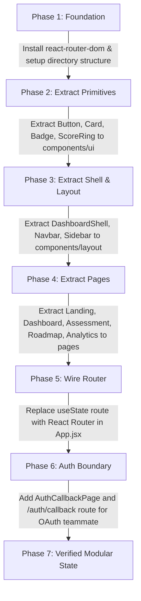

# Frontend Architecture Specification — AI-Powered Upskilling Platform

**Document Status:** Architecture Plan & Migration Strategy (v1.0)  
**Role:** Senior Frontend Engineer & UX Architect  
**Target Stack:** React 19, Vite 8, React Router DOM 7, Tailwind CSS v4, Lucide React  

---

## 1. Architectural Principles

To transition from the current monolithic prototype (`src/App.jsx`) into a scalable, enterprise-grade codebase, the architecture adheres to four foundational rules:
1. **Feature-Sliced Modularity:** Organize domain logic around features (`dashboard`, `assessment`, `roadmap`, `analytics`, `auth`) rather than purely technical layers.
2. **Strict Boundary with Backend Services:** Isolate network requests, error parsing, and token storage inside `services/` and `context/`, shielding UI components from raw HTTP contracts.
3. **URL as the Single Source of Truth:** Replace ephemeral `useState('route')` with standard browser URLs (`react-router-dom`), enabling deep linking, browser history, and seamless OAuth2 redirect interception.
4. **Zero-Regression Incremental Refactoring:** Extract existing working components into modular files before introducing new features or altering state lifecycles.

---

## 2. Target Directory Structure

The proposed structure reorganizes the codebase into clear, cohesive modules:

```
src/
├── app/                             # Core application setup & shell
│   ├── App.jsx                      # Top-level routing router configuration
│   ├── router.jsx                   # Route table definition & protected route wrappers
│   └── providers.jsx                # Global context providers (Auth, Theme, Notification)
│
├── assets/                          # Static images, branding, and local media
│   ├── hero.png                     # Verified local hero illustration
│   └── logo.svg                     # Vector brandmark
│
├── components/                      # Shared, domain-agnostic UI elements
│   ├── ui/                          # Design-system primitive components
│   │   ├── Button.jsx               # Primary, secondary, outline, ghost variants
│   │   ├── Card.jsx                 # Bordered card containers & headers
│   │   ├── Badge.jsx                # Status chips (Mastered, Gap, In-Progress, Locked)
│   │   ├── ProgressBar.jsx          # Linear milestone and quiz progress bars
│   │   ├── ScoreRing.jsx            # SVG circular completion ring
│   │   ├── MetricCard.jsx           # Diagnostic metric statistics card
│   │   └── Modal.jsx                # Accessible dialog dialogs / drawers
│   │
│   └── layout/                      # Application frame and navigational wrappers
│       ├── Navbar.jsx               # Public website top bar
│       ├── Sidebar.jsx              # Authenticated learner workspace sidebar
│       ├── MobileNav.jsx            # Responsive bottom navigation bar
│       ├── DashboardShell.jsx       # Authenticated layout frame
│       └── Footer.jsx               # Standard copyright & attribution footer
│
├── features/                        # Domain-driven feature modules
│   ├── auth/                        # Teammate OAuth integration boundary
│   │   ├── components/
│   │   │   ├── LoginForm.jsx        # Email/password input & OAuth triggers
│   │   │   └── OAuthButtons.jsx     # Google & GitHub sign-in redirect buttons
│   │   ├── pages/
│   │   │   ├── LoginPage.jsx        # Login & account entry page
│   │   │   ├── AuthCallbackPage.jsx # Receives ?code= from gateway and exchanges token
│   │   │   └── AuthErrorPage.jsx    # Displays OAuth error status & retry button
│   │   ├── hooks/
│   │   │   └── useAuth.js           # Auth context consumer hook
│   │   └── services/
│   │       └── authService.js       # Network calls to /api/auth/*
│   │
│   ├── dashboard/                   # Learner overview & habit tracking
│   │   ├── components/
│   │   │   ├── NextActionBanner.jsx # "Your Next Best Action" hero card
│   │   │   ├── StreakCalendar.jsx   # 7-day habit and streak tracker
│   │   │   ├── SkillBreakdown.jsx   # Topic-level progress bars
│   │   │   └── ActivityFeed.jsx     # Searchable recent activity list
│   │   └── pages/
│   │       └── DashboardPage.jsx    # Main dashboard view
│   │
│   ├── assessment/                  # Diagnostic & topic evaluation
│   │   ├── components/
│   │   │   ├── QuestionStepper.jsx  # 1-question-at-a-time interactive card
│   │   │   ├── OptionRadioGroup.jsx # Accessible choice selections
│   │   │   ├── DiagnosticReport.jsx # 5-knowledge area baseline summary
│   │   │   └── WeakTopicBanner.jsx  # Flags remediation topics
│   │   └── pages/
│   │       └── AssessmentPage.jsx   # Diagnostic quiz controller
│   │
│   ├── roadmap/                     # Topological learning progression
│   │   ├── components/
│   │   │   ├── RoadmapNode.jsx      # Individual milestone item with "Why this step"
│   │   │   ├── ResourceCard.jsx     # Curated video, doc, exercise card
│   │   │   └── RevisionBranch.jsx   # Remediation sub-path connector
│   │   └── pages/
│   │       └── RoadmapPage.jsx      # Interactive roadmap canvas
│   │
│   ├── skill-graph/                 # Prerequisite visual dependency map
│   │   ├── components/
│   │   │   ├── GraphCanvas.jsx      # SVG / Interactive node graph
│   │   │   └── NodeDetailDrawer.jsx # Slide-out topic overview drawer
│   │   └── pages/
│   │       └── SkillGraphPage.jsx   # Visual skill graph screen
│   │
│   └── analytics/                   # Progress analytics & retention trends
│       ├── components/
│       │   ├── RetentionChart.jsx   # Score improvements post-revision
│       │   └── GapHeatmap.jsx       # Weak-area category breakdown
│       └── pages/
│           └── AnalyticsPage.jsx    # Metrics and reports screen
│
├── pages/                           # Top-level standalone routes
│   ├── LandingPage.jsx              # Public landing page
│   └── NotFoundPage.jsx             # 404 error page
│
├── context/                         # React context providers
│   └── AuthContext.jsx              # Global user session, tokens, and role state
│
├── services/                        # Base HTTP and API client
│   └── api.js                       # Axios/fetch instance with Bearer token injection
│
└── styles/                          # Global CSS and Tailwind definitions
    └── index.css                    # Tailwind CSS v4 @theme tokens and fonts
```

---

## 3. Client-Side Routing Design

### Library Recommendation: `react-router-dom` (v7)
To support deep linking, OAuth callback URLs, and standard browser navigation, `react-router-dom` must be installed.

### Route Mapping Specification

| Route URL | Page Component | Access Level | Description |
|---|---|---|---|
| `/` | `LandingPage` | Public | Marketing landing page with hero, workflow, and CTA |
| `/login` | `LoginPage` | Public / Guest | Sign in via Google, GitHub, or email/password |
| `/auth/callback` | `AuthCallbackPage` | Public | Captures `?code=`, calls backend token exchange, redirects |
| `/auth/error` | `AuthErrorPage` | Public | Displays OAuth gateway error parameter with retry options |
| `/dashboard` | `DashboardPage` | Authenticated | Learner home, next actions, habit streak, recent activity |
| `/assessment` | `AssessmentPage` | Authenticated | 10-question adaptive diagnostic assessment |
| `/roadmap` | `RoadmapPage` | Authenticated | Personalized topological learning path & resources |
| `/graph` | `SkillGraphPage` | Authenticated | Interactive prerequisite skill dependency map |
| `/analytics` | `AnalyticsPage` | Authenticated | Empirical learning progress and weak-area heatmap |
| `*` | `NotFoundPage` | Public | Standard 404 fallback with link back to dashboard |

---

## 4. State Management Strategy

### 1. Global Session State (`AuthContext.jsx`)
- **Managed Data:**
  - `user`: `{ id, email, fullName, role }` or `null`
  - `isAuthenticated`: `boolean`
  - `accessToken`: in-memory JWT string
  - `isLoading`: `boolean` (initial session hydration)
- **Lifecycle:**
  - On mount, calls `/api/auth/me` with existing bearer token or calls `/api/auth/refresh` to restore session from the HTTP-only cookie.
  - Exposes `login()`, `logout()`, `handleOAuthCallback(code)`.

### 2. Feature & Assessment State
- **Diagnostic Engine:** State is encapsulated inside a custom hook (`useAssessment`) with automatic `sessionStorage` caching. If a learner accidentally refreshes during Question 7, their answers and progress are restored.
- **Roadmap Progress:** Cached locally in state and synchronized with backend profile data when available.

---

## 5. Incremental Migration Plan (Zero-Regression)

To decompose `src/App.jsx` safely without breaking running functionality:



1. **Step 1:** Establish directory skeleton (`components/`, `features/`, `pages/`, `services/`, `context/`).
2. **Step 2:** Surgically extract common UI components (`Button`, `Card`, `Logo`, `SkillBar`, `ScoreRing`, `MetricCard`) into `src/components/ui/` with exact props.
3. **Step 3:** Move `DashboardShell` and navigation into `src/components/layout/`.
4. **Step 4:** Extract the existing page components (`Landing`, `Dashboard`, `AssessmentPage`, `GraphPage`, `RoadmapPage`, `AnalyticsPage`) into their respective feature/page files.
5. **Step 5:** Wire `react-router-dom` in `src/app/router.jsx` and replace the single `App.jsx` view switcher with `<RouterProvider />`.
6. **Step 6:** Verify that all views render identically to the baseline before introducing visual redesigns or backend integrations.
