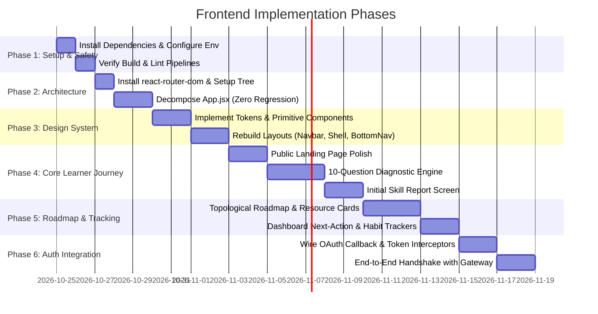

# Implementation Roadmap & Sprint Plan — AI-Powered Upskilling Platform

**Document Status:** Phased Engineering Plan (v1.0)  
**Role:** Senior Frontend Engineer & Scrum Lead  
**Execution Strategy:** Incremental, non-destructive, test-driven phases  

---

## 1. Roadmap Overview & Timeline

---

## 2. Phase-by-Phase Execution Details

### Phase 1: Setup & Safety Baseline
- **Objective:** Establish a working local development and build environment without altering source files.
- **Tasks:**
  1. Execute `npm install` to create `node_modules` according to `package-lock.json`.
  2. Create `.env.example` defining `VITE_API_BASE_URL=http://localhost:8080` and `VITE_USE_MOCK_DATA=true`.
  3. Validate that `npm run build` and `npm run lint` execute cleanly with zero errors.
- **Acceptance Criteria:** Local development server starts on port `5173`; production build finishes with exit code 0.
- **Risk:** Minor peer dependency warnings in React 19 / Tailwind 4 ecosystem.

### Phase 2: Modular Decomposition & Routing Setup
- **Objective:** Deconstruct the 30KB monolithic `src/App.jsx` into clean, testable files.
- **Tasks:**
  1. Install `react-router-dom` (`^7.0.0`).
  2. Create directory skeleton (`components/ui`, `components/layout`, `features/`, `pages/`, `services/`, `context/`).
  3. Surgically extract `Button`, `Card`, `Logo`, `SkillBar`, `ScoreRing`, `MetricCard` into `src/components/ui/`.
  4. Extract `Landing`, `Dashboard`, `AssessmentPage`, `GraphPage`, `RoadmapPage`, `AnalyticsPage` into `src/pages/`.
  5. Setup `src/app/router.jsx` with routes (`/`, `/dashboard`, `/assessment`, `/roadmap`, `/graph`, `/analytics`, `/auth/callback`).
  6. Re-wire `src/main.jsx` and `src/App.jsx`.
- **Acceptance Criteria:** Every existing view loads cleanly on its designated URL. Browser back/forward navigation operates correctly. Zero visual or functional regression compared to the baseline commit.

### Phase 3: Design System Tokens & Primitive Rebuilding
- **Objective:** Replace generic SaaS styling with the *Deep Craft Learning* design identity.
- **Tasks:**
  1. Update `src/styles/index.css` with the approved color tokens, typography scales, and surface treatments.
  2. Rebuild primitive components (`Button`, `Card`, `Badge`, `ProgressBar`) with visible keyboard focus states and high-contrast styling.
  3. Replace the third-party Pinterest URL in the hero section with the local asset `src/assets/hero.png`.
  4. Build responsive `DashboardShell` with collapsible desktop sidebar and mobile bottom navigation ribbon.
- **Acceptance Criteria:** Fully accessible, WCAG AA compliant contrast on all UI elements; mobile layout provides thumb-zone navigation.

### Phase 4: Core Learner Journey & Diagnostic Enhancement
- **Objective:** Implement the genuine Phase 1 & 2 workflow defined in `AI_Career_Roadmap_Workflow.pdf`.
- **Tasks:**
  1. Redesign Landing Page with clear value proposition and competitive comparison matrix.
  2. Expand `AssessmentPage` from 4 questions to the full **10-question sequential model across 5 knowledge areas**:
     - *Prerequisites & Foundations*
     - *Core Concepts*
     - *Theory & Architecture*
     - *Syntax & Idioms*
     - *Practical Problem Solving*
  3. Build the **Initial Skill Report** view displaying baseline score, identified knowledge gaps, and "Generate Tailored Roadmap" CTA.
  4. Implement `sessionStorage` caching so diagnostic answers survive accidental page refreshes.
- **Acceptance Criteria:** Learner can complete a 10-question diagnostic, review their knowledge report by category, and transition directly to the personalized roadmap.

### Phase 5: Personalized Roadmap & Progress Dashboard
- **Objective:** Deliver Phase 3 & 4 capabilities (topological roadmap, habit tracking, and remediation loops).
- **Tasks:**
  1. Redesign `RoadmapPage` with milestone grouping, estimated completion times, and "Why this step" rationales.
  2. Implement Curated Resource Cards (Video, Documentation, Hands-on Exercise) with duration and difficulty indicators.
  3. Implement the **Remediation Loop**: failing a topic quiz visually displays weak subtopics and inserts revision modules before re-testing.
  4. Upgrade `DashboardPage` with "Your Next Best Action" hero banner, 7-day streak ribbon, and active milestone progression.
- **Acceptance Criteria:** Learners can track progress, view resource recommendations, toggle completion, and experience simulated adaptive revision loops.

### Phase 6: OAuth & Backend Gateway Handshake
- **Objective:** Connect the frontend to the Spring Boot Gateway (`gateway/ai-upskilling-platform`) in strict alignment with teammate contracts.
- **Tasks:**
  1. Implement `AuthContext` to manage in-memory `accessToken` and user profile state.
  2. Implement `AuthCallbackPage` to intercept `?code=<ONE_TIME_CODE>`, call `POST /api/auth/oauth2/exchange`, and hydrate the session.
  3. Implement `AuthErrorPage` displaying user-friendly messages for OAuth error codes.
  4. Connect `/api/auth/me` and `/api/auth/refresh` with cookie credentials.
- **Acceptance Criteria:** End-to-end OAuth login flow with Google and GitHub successfully provisions accounts, sets secure cookies, and redirects learners directly to their personalized dashboard.

---

## 3. Future Roadmap Phases (Post-MVP)

The following capabilities documented in `AI_Roadmap_Platform_Features (1).pptx` are preserved for subsequent releases:

1. **Phase 5 Verification:** Automated GitHub Webhook commit monitoring, automated PR code review engine, and QR-verifiable certificate generation.
2. **Phase 6 Career Features:** AI ATS resume optimizer, voice-based AI mock interview simulator, and verified skill job matching.
3. **Platform Inclusivity:** PWA offline video and quiz caching, low-bandwidth text-first mode, and Hindi/Hinglish speech interface.
4. **Institutional Features:** Multi-tenant batch dashboards, trainer weak-area analytics, and bulk cohort CSV onboarding.
