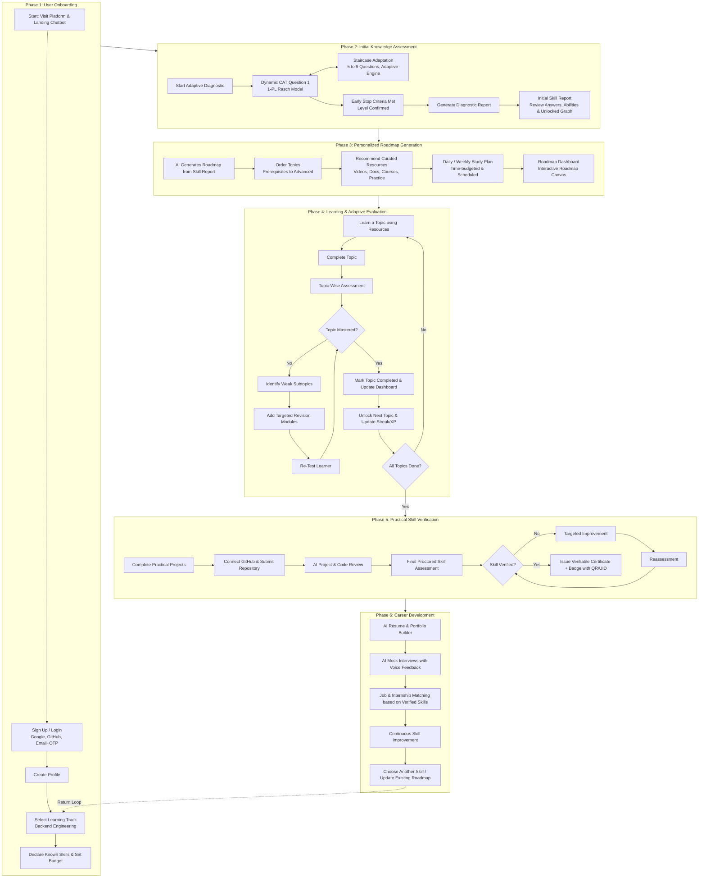

# Product Overview — AI-Powered Upskilling Platform With Progress Tracker

**Team:** Team Unix  
**Program:** EPAM Systems CoE Programme  
**Repository:** `https://github.com/LNCT-Unix/AI-Powered-Upskilling-Platform`  
**Current Milestone:** Sprint 1 Complete • Sprint 2 In-Progress  
**Document Status:** Baseline Product Specification & Implemented Capabilities (v2.0)  

---

## 1. Executive Summary & Vision

The **AI-Powered Upskilling Platform With Progress Tracker** is an intelligent, career-focused learning ecosystem built to solve the fundamental dysfunctions plaguing online learning today:
1. **Wrong starting points** caused by unverified, self-reported skills.
2. **Low trust in AI** due to ungrounded recommendations and opaque reasoning.
3. **Lost momentum and drop-offs** because roadmaps exist only in conversational AI threads without tracking or habits.
4. **Rigid, non-adaptive curricula** that treat every learner identically regardless of pace or gaps.
5. **The "Skills ≠ Job-Ready" divide**, where certificates do not translate into employer trust or interview readiness.

**Core Value Proposition:**
> *"Personalised roadmaps that adapt to you, verify what you learn, and keep you consistent — whether you're building a career or picking up a brand-new skill."*

---

## 2. Target Audiences (User Personas)

The platform serves five distinct learner segments:

| Persona | Needs & Goals | Key Platform Capabilities Used |
|---|---|---|
| **1. Career Seekers** | Building job-ready technical skills from scratch; need clear milestones, proof of competency, and interview readiness. | Diagnostic test, structured roadmap, GitHub project verification, AI mock interviews, resume/ATS tools. |
| **2. Working Professionals** | Upskilling or reskilling alongside a full-time job; time-constrained, need bite-sized resources and smart scheduling. | Daily/weekly time budget setting, modular micro-learning, smart study planner, weak-subtopic re-tests. |
| **3. College Students** | Seeking industry-relevant skills beyond university curriculum; preparing for internships and campus placements. | Skill graph prerequisites, peer study rooms, GitHub commit monitoring, verifiable credential badges. |
| **4. Curious / Hobby Learners** | Exploring new technologies without career pressure; seeking engaging, self-paced exploration. | Free-resource filtering, custom pace, multi-skill selection loop, low-pressure diagnostic exploration. |
| **5. Institutes & Trainers** | Managing cohorts; tracking student progression, completion rates, and identifying at-risk learners. | Admin/trainer dashboards, cohort analytics, weak-area batch reports, custom curriculum uploads. |

---

## 3. End-to-End Product Workflow (The 6-Phase Lifecycle)

---

## 4. Phase-by-Phase Requirement Specifications

### Phase 1: User Onboarding
- **Identity & Authentication:**
  - Google OIDC and GitHub OAuth2 with verified primary email fallback.
  - Email/Password registration with 6-digit verification OTP delivered via Gmail SMTP.
  - Self-service password reset lifecycle via email OTP.
  - Session token exchange with rotating HttpOnly refresh tokens.
- **Track Selection & Pre-Test Calibration:**
  - Select active track (`GET /api/v1/assessments/tracks`).
  - Declare already familiar skills (`GET /api/v1/assessments/tracks/{trackId}/skills`) to seed initial mastery and skip redundant questions.
- **Landing Page AI Chatbot:** Interactive generative chatbot (`LandingChatbot.jsx`) answering learner curriculum and platform inquiries.

### Phase 2: Initial Knowledge Assessment
- **Psychometric Diagnostic Engine:**
  - Item Response Theory (IRT 1-PL Rasch Model): $P_i(\theta) = \frac{1}{1 + e^{-(\theta - b_i)}}$.
  - Sequential delivery: 8 to 9 questions with step adjustments ($\pm 0.35$ logits).
  - Early stopping rule: Terminates upon confirmed ability level (`directionChanges >= 2` after minimum 8 questions).
  - High-performance indexed anti-join queries ensuring fast, deterministic item retrieval.
- **Post-Assessment Diagnostic Report:**
  - Final ability estimate ($\theta$), competency level (`BEGINNER`, `INTERMEDIATE`, `ADVANCED`), and correct count.
  - Itemized per-question review showing question stem, user choice, correct answer, and tested skill.
  - Mapped skill graph identifying newly unlocked skills (`MASTERED` and `FRONTIER`).

### Phase 3: Personalized Roadmap Generation
- **Topological Sequencing:** Directed Acyclic Graph (DAG) ordering topics from fundamental prerequisites to advanced specializations.
- **Transparent Justification:** "Why this step" rationales linking recommendations to diagnostic performance.
- **Study Planner:** Micro-learning blocks scheduled to fit the learner's daily study budget.

### Phase 4: Learning & Adaptive Evaluation Loop
- **Study Workspace:** Hand-picked documentation, video lectures, and coding sandbox exercises.
- **Remediation Loop:** Topic assessments automatically detect weak subtopics and inject focused revision modules before re-testing.

### Phase 5: Practical Skill Verification
- **GitHub Capstone Submission:** Real-world project briefs submitted via repository URL.
- **Automated AI Code Review:** Linting, architectural analysis, security vulnerability checks, and automated unit testing.
- **Verifiable Credentialing:** Digital badges with unique verification hashes for resumes and LinkedIn.

### Phase 6: Career Readiness & Progression
- **ATS Resume Builder:** Generates ATS-optimized resumes emphasizing verified skills and capstone repositories.
- **AI Mock Technical Interviews:** Voice/text interview simulator with rubric-based scoring.
- **Opportunity Matching:** Connects learners with entry-level and junior software roles matching their verified competencies.

---

## 5. Scope Separation: MVP vs. Future Horizons

| Dimension | MVP Scope (Sprint 1–2 Priority) | Future Roadmap (Subsequent Sprints) |
|---|---|---|
| **Authentication** | Spring Boot OAuth2 (Google, GitHub) + Email/Password with 6-digit OTP verification + Password Reset + Dual-token exchange | Multi-factor auth (TOTP), SAML / Enterprise SSO |
| **Diagnostic Assessment** | 1-PL Rasch CAT engine (5-9 items) with indexed anti-join queries, pre-test calibration, and detailed report | Real-time proctoring, webcam environment monitoring |
| **Skill Graph** | 56-skill Backend DAG with 72 prerequisite edges, 2-state visual filter (Ready to Learn vs Locked) | Multi-track cross-domain graph synthesis |
| **Roadmap** | Topological skill path with "Coming Soon" frontend view and async LLM synthesis queue | Dynamic real-time roadmap recalculation based on daily pacing |
| **Resources** | Curated catalog (videos, docs, exercises) with free indicators | Automated broken link crawlers, video transcription search |
| **Evaluation** | Topic completion quizzes with weak-subtopic identification and revision prompts | Full live in-browser multi-language code runner sandbox |
| **Verification** | Public GitHub repo link submission + static rubric review | Automated containerized CI/CD test runners & Docker sandbox execution |
| **Career Tools** | ATS resume export & mock interview simulator | Real-time voice AI interview simulator & recruiter talent portal |
| **Mobile & PWA** | `X-Client-Platform: mobile` header support, deep-link authentication, PWA installable manifest | Native iOS/Android App Store release via Capacitor |
