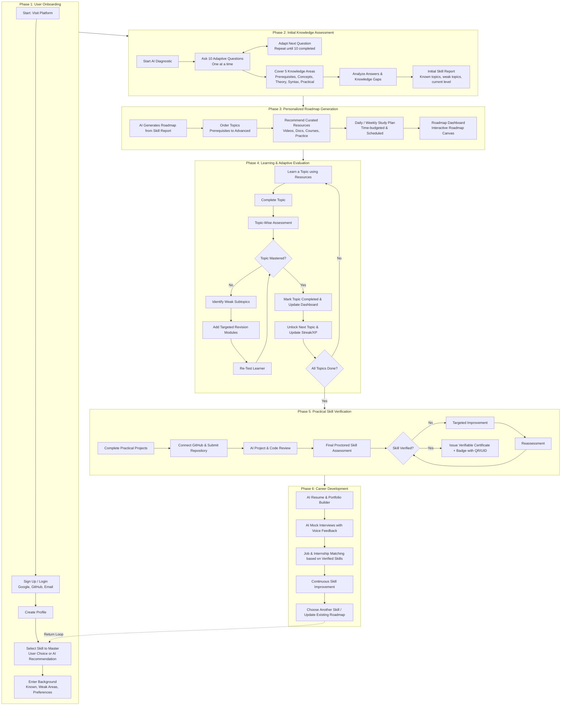

# Product Overview — AI-Powered Upskilling Platform With Progress Tracker

**Team:** Team Unix  
**Program:** EPAM Systems COE Program  
**Repository:** `https://github.com/LNCT-Unix/AI-Powered-Upskilling-Platform`  
**Current Branch:** `frontend`  
**Document Status:** Baseline Product Specification (v1.0)  
**Source Baseline Documents:**
- `AI_Career_Roadmap_Workflow.pdf` (Workflow diagram across 6 phases)
- `AI_Roadmap_Platform_Features (1).pptx` (Detailed feature catalog, architecture, MVP priorities)
- `TeamUnixFinalPPT.pptx` (Vision, problem statement, comparison matrix, target personas)

---

## 1. Executive Summary & Vision

The **AI-Powered Upskilling Platform With Progress Tracker** is an intelligent, career-focused learning ecosystem built to solve the fundamental problems plaguing online learning today:
1. **Wrong starting points** caused by unverified, self-reported skills.
2. **Low trust in AI** due to ungrounded recommendations and opaque reasoning.
3. **Lost momentum and drop-offs** because roadmaps exist only in conversational AI threads without tracking or habits.
4. **Rigid, non-adaptive curricula** that treat every learner identically regardless of pace or gaps.
5. **The "Skills ≠ Job-Ready" divide**, where certificates do not translate into employer trust or interview readiness.

**Core Value Proposition:**
> *"Personalised roadmaps that adapt to you, verify what you learn, and keep you consistent — whether you're building a career or picking up a brand-new skill."*

---

## 2. Target Audiences (User Personas)

As established in `TeamUnixFinalPPT.pptx` (Slide 5), the platform serves five distinct learner segments:

| Persona | Needs & Goals | Key Platform Capabilities Used |
|---|---|---|
| **1. Career Seekers** | Building job-ready technical skills from scratch; need clear milestones, proof of competency, and interview readiness. | Diagnostic test, structured roadmap, GitHub project verification, AI mock interviews, resume/ATS tools. |
| **2. Working Professionals** | Upskilling or reskilling alongside a full-time job; time-constrained, need bite-sized resources and smart scheduling. | Daily/weekly time budget setting, modular micro-learning, smart study planner, weak-subtopic re-tests. |
| **3. College Students** | Seeking industry-relevant skills beyond university curriculum; preparing for internships and campus placements. | Skill graph prerequisites, peer study rooms, GitHub commit monitoring, verifiable credential badges. |
| **4. Curious / Hobby Learners** | Exploring new technologies without career pressure; seeking engaging, self-paced exploration. | Free-resource filtering, custom pace, multi-skill selection loop, low-pressure diagnostic exploration. |
| **5. Institutes & Trainers** | Managing cohorts; tracking student progression, completion rates, and identifying at-risk learners. | Admin/trainer dashboards, cohort analytics, weak-area batch reports, custom curriculum uploads. |

---

## 3. End-to-End Product Workflow (The 6-Phase Lifecycle)

The platform architecture follows the comprehensive 6-phase lifecycle documented in `AI_Career_Roadmap_Workflow.pdf`:

---

## 4. Phase-by-Phase Requirement Specifications

### Phase 1: User Onboarding
- **Identity & Authentication:** Support Google OIDC, GitHub OAuth 2.0, and email/password with verification tokens.
- **Profile Configuration:** Name, educational/career stage, target roles, preferred study pace (hours/day).
- **Skill Selection:** Choose from primary technology tracks (e.g., Full-Stack Web Development, Data Science & AI, Backend Systems, Cloud Engineering) or search custom topics.
- **Background & Learning Style Preferences:**
  - Self-assessed familiarity (Beginner, Intermediate, Advanced).
  - Format preference (Video-first, Documentation-first, Hands-on project-first).
  - Language preference (English, Hindi, Hinglish).

### Phase 2: Initial Knowledge Assessment
- **Diagnostic Engine:** 10 questions administered sequentially (one at a time).
- **Adaptive Question Selection:** Difficulty adjusts based on prior answers to rapidly zero in on actual knowledge boundaries.
- **5 Knowledge Dimensions:**
  1. *Prerequisites & Foundations*
  2. *Core Conceptual Understanding*
  3. *Theory & Architecture*
  4. *Syntax, Idioms & Mechanics*
  5. *Practical Implementation & Problem-Solving*
- **Outcome:** Comprehensive Initial Skill Report showing verified baseline score (0–100%), verified strengths, identified knowledge gaps, and recommended starting tier.

### Phase 3: Personalized Roadmap Generation
- **Topic Sequencing:** Topologically sorted directed acyclic graph (DAG) ordering topics from absolute prerequisites to advanced capstone topics.
- **Transparent Justification ("Why this step"):** Every recommended topic must display explicit reasoning (e.g., *"Recommended because Diagnostic identified gap in Asynchronous Event Loop"*).
- **Curated Multi-Format Resources:**
  - Official documentation (MDN, React.dev, Python docs).
  - High-rated video lectures (YouTube, NPTEL, free lecture series).
  - Hands-on exercises (coding sandboxes, GitHub starters).
- **Study Planner:** Schedule milestones according to daily time budget (e.g., 45 mins/day -> 6-week roadmap).

### Phase 4: Learning & Adaptive Evaluation Loop
- **Active Learning Workspace:** Direct access to curated learning materials, notes, bookmarks, and source-grounded doubt resolution.
- **Modular Topic Assessments:** 3–5 targeted questions upon topic completion.
- **Adaptive Remediation Loop:**
  - If score < 75%: Flag specific weak subtopics, automatically inject targeted revision resources in an alternative format, and trigger a focused re-test.
  - If score >= 75%: Mark topic mastered, award XP/streak, and unlock downstream prerequisite nodes.

### Phase 5: Practical Skill Verification
- **Project-Based Validation:** Learners build real-world portfolio applications matching standardized specifications.
- **GitHub Integration:** Auto-inspect repository commits, branch hygiene, and structure.
- **Automated AI Code Review:** Evaluates code quality, best practices, security flaws, and performance, returning actionable line-level suggestions.
- **Verifiable Credentialing:** Final comprehensive test + verified project issue a digital certificate with unique verification hash/QR code.

### Phase 6: Career Readiness & Progression
- **ATS Resume & Portfolio Builder:** Highlights verified platform skills and verified GitHub projects.
- **AI Mock Interviews:** Realistic technical and HR voice/text simulations with feedback on problem-solving approach and precision.
- **Job/Internship Opportunity Matching:** Connects learners to openings that directly match their verified skill profile.
- **Lifelong Learning Loop:** Return arrow allows learners to branch into adjacent technologies or advanced specializations.

---

## 5. Scope Separation: MVP vs. Future Horizons

Based on `AI_Roadmap_Platform_Features (1).pptx` (Slide 12), features are strictly triaged into phases to guarantee deliverability:

| Dimension | MVP Scope (Sprint 1–2 Priority) | Future Roadmap (Subsequent Sprints) |
|---|---|---|
| **Authentication** | Spring Boot OAuth2 (Google, GitHub) + Session token exchange | Multi-factor auth, SAML / enterprise SSO |
| **Diagnostic Assessment** | 10-question sequential test across 5 knowledge areas with scoring report | Real-time webcam proctoring, audio environment monitoring |
| **Roadmap** | Topological skill path with "Why this step" rationales and milestone tracking | Dynamic real-time graph layout recalculation |
| **Resources** | Curated catalog (videos, docs, exercises) with free/paid indicators & ratings | Broken-link auto-crawlers, personalized video transcription search |
| **Evaluation** | Topic completion quizzes with weak-subtopic identification and revision prompts | Full live in-browser multi-language code runner sandbox |
| **Verification** | Manual GitHub repo link submission + static rubric verification | Automated GitHub Webhook commit parsing and automated PR test runners |
| **Career Tools** | Basic ATS resume formatting & skill export | Real-time voice AI mock interview simulations & recruiter job board |
| **Accessibility & Platform** | Responsive mobile layout, PWA installability, Capacitor mobile containerization, touch-first 44px ergonomics, multi-language (en/hi/hinglish), Web Speech voice input | Native iOS/Android app store deployment via Capacitor, background audio, full offline media caching |
| **Institutional** | Single-user dashboard | Multi-tenant trainer batch dashboards, bulk CSV import, cohort alerts |
