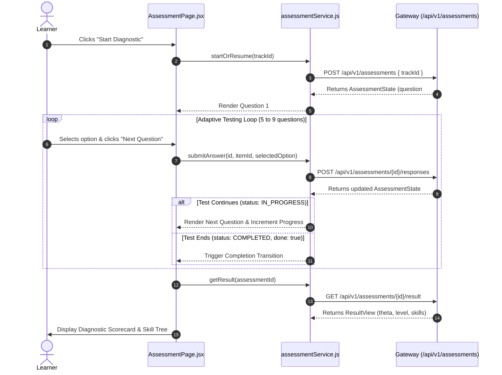

# Frontend Assessment Integration Guide

**Document Status:** Implementation Guide (v1.0)  
**Target:** Frontend Engineers wiring `AssessmentPage.jsx` to Spring Boot Gateway (`/api/v1/assessments`)  
**Companion Reference:** [`docs/api/GATEWAY_API_REFERENCE.md`](../api/GATEWAY_API_REFERENCE.md)  

---

## 1. Overview & Architecture

The **Diagnostic Assessment** is driven by an adaptive Computer Adaptive Testing (CAT) Item Response Theory (IRT) engine running in the Spring Boot Gateway. Unlike static quizzes:
1. The client **never** receives all questions up-front.
2. The client receives **one question at a time**, dynamically chosen based on previous responses.
3. The total number of questions is between **5 and 9**. The test dynamically stops once the learner's skill level is confirmed or the maximum question cap is hit.
4. Correct answers are never sent to the client during testing.



---

## 2. Service Layer Integration

Create `web-app/src/services/assessmentService.js`:

```javascript
import { apiClient } from './api';

export const assessmentService = {
  /**
   * Initializes or resumes a test session for the specified track.
   * @param {string} trackId - Track UUID.
   */
  async startOrResume(trackId) {
    return apiClient('/api/v1/assessments', {
      method: 'POST',
      body: { trackId },
    });
  },

  /**
   * Reads current active state. Ideal for restoring session on page reload.
   * @param {string} assessmentId - Assessment UUID.
   */
  async getState(assessmentId) {
    return apiClient(`/api/v1/assessments/${assessmentId}`, {
      method: 'GET',
    });
  },

  /**
   * Submits an answer for the active question.
   * @param {string} assessmentId - Assessment UUID.
   * @param {string} itemId - Question UUID.
   * @param {number} selectedOption - 0-indexed integer.
   */
  async submitAnswer(assessmentId, itemId, selectedOption) {
    return apiClient(`/api/v1/assessments/${assessmentId}/responses`, {
      method: 'POST',
      body: { itemId, selectedOption },
    });
  },

  /**
   * Fetches final diagnostic evaluation and skill tree.
   * @param {string} assessmentId - Completed assessment UUID.
   */
  async getResult(assessmentId) {
    return apiClient(`/api/v1/assessments/${assessmentId}/result`, {
      method: 'GET',
    });
  },
};
```

---

## 3. Recommended Custom Hook: `useAdaptiveAssessment`

To keep UI components clean and prevent race conditions or state desynchronization, use the following React hook:

```jsx
import { useState, useEffect, useCallback } from 'react';
import { assessmentService } from '../services/assessmentService';

export function useAdaptiveAssessment(trackId) {
  const [assessmentId, setAssessmentId] = useState(null);
  const [currentQuestion, setCurrentQuestion] = useState(null);
  const [answeredCount, setAnsweredCount] = useState(0);
  const [maxQuestions, setMaxQuestions] = useState(9);
  const [isCompleted, setIsCompleted] = useState(false);
  const [results, setResults] = useState(null);
  const [isLoading, setIsLoading] = useState(true);
  const [isSubmitting, setIsSubmitting] = useState(false);
  const [error, setError] = useState(null);

  // Initialize or resume on mount
  useEffect(() => {
    let isMounted = true;

    async function init() {
      try {
        setIsLoading(true);
        setError(null);
        const state = await assessmentService.startOrResume(trackId);
        
        if (!isMounted) return;

        setAssessmentId(state.assessmentId);
        setAnsweredCount(state.answered);
        setMaxQuestions(state.max || 9);

        if (state.done || state.status === 'COMPLETED') {
          setIsCompleted(true);
          const finalResult = await assessmentService.getResult(state.assessmentId);
          if (isMounted) setResults(finalResult);
        } else {
          setCurrentQuestion(state.question);
        }
      } catch (err) {
        if (isMounted) setError(err.message || 'Failed to initialize assessment');
      } finally {
        if (isMounted) setIsLoading(false);
      }
    }

    if (trackId) {
      init();
    }

    return () => {
      isMounted = false;
    };
  }, [trackId]);

  // Answer Submission handler
  const handleAnswer = useCallback(async (selectedOptionIndex) => {
    if (!assessmentId || !currentQuestion || isSubmitting) return;

    try {
      setIsSubmitting(true);
      setError(null);

      const nextState = await assessmentService.submitAnswer(
        assessmentId,
        currentQuestion.itemId,
        selectedOptionIndex
      );

      setAnsweredCount(nextState.answered);

      if (nextState.done || nextState.status === 'COMPLETED') {
        setIsCompleted(true);
        setCurrentQuestion(null);
        // Load final result
        const finalResult = await assessmentService.getResult(assessmentId);
        setResults(finalResult);
      } else {
        setCurrentQuestion(nextState.question);
      }
    } catch (err) {
      setError(err.message || 'Failed to record answer');
      // If 409 conflict, reload state to re-sync with server
      if (err.status === 409) {
        const reloaded = await assessmentService.getState(assessmentId);
        setCurrentQuestion(reloaded.question);
        setIsCompleted(reloaded.done);
      }
    } finally {
      setIsSubmitting(false);
    }
  }, [assessmentId, currentQuestion, isSubmitting]);

  return {
    assessmentId,
    currentQuestion,
    answeredCount,
    maxQuestions,
    isCompleted,
    results,
    isLoading,
    isSubmitting,
    error,
    handleAnswer,
  };
}
```

---

## 4. State Synchronization & Edge Cases

| Scenario | Risk | Gateway Behavior | Frontend Solution |
| :--- | :--- | :--- | :--- |
| **Page Reload / Navigation** | Learner refreshes during test | Engine stores all answers in database; assessment remains `IN_PROGRESS` | Call `startOrResume(trackId)` or `getState(assessmentId)` upon mount; seamlessly resumes without losing progress. |
| **Double Click / Spamming Next** | Concurrent submissions for same question | Row-level locking on database; second request returns `409 Conflict ("That is not the current question")` | Disable the submit button (`isSubmitting = true`) until promise resolves. Catch 409 and call `getState()`. |
| **Premature Result Request** | Client requests `/result` before completion | Gateway returns `409 Conflict ("Assessment not finished yet")` | Only request `/result` when `state.done === true` or `state.status === "COMPLETED"`. |
| **Invalid Option Selected** | Option index < 0 or $\ge$ options.length | Gateway returns `400 Bad Request ("Invalid option")` | Validate that an option is selected and within `[0, options.length - 1]` before submission. |

---

## 5. Mock vs Gateway Mode Toggle

During local UI styling when the backend server is not running, frontend developers can enable mock mode in `web-app/.env`:

```ini
VITE_USE_MOCK_AUTH=true
```

In production or connected integration sprints, set:

```ini
VITE_USE_MOCK_AUTH=false
VITE_API_BASE_URL=http://localhost:8080
```
