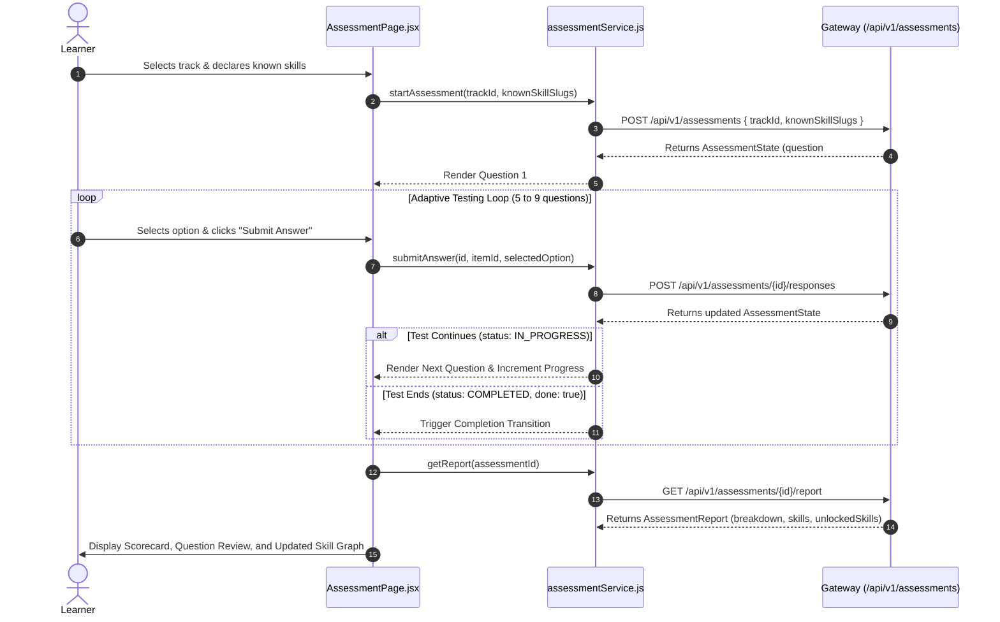

# Frontend Assessment Integration Guide

**Document Status:** Implementation Guide (v2.0)  
**Target:** Frontend Engineers wiring `AssessmentPage.jsx` and onboarding to Spring Boot Gateway (`/api/v1/assessments`)  
**Companion Reference:** [`docs/api/GATEWAY_API_REFERENCE.md`](../api/GATEWAY_API_REFERENCE.md)  

---

## 1. Overview & Architecture

The **Diagnostic Assessment** is powered by an adaptive Computerized Adaptive Testing (CAT) Item Response Theory (1-PL Rasch Model) engine running in the Spring Boot Gateway:
1. **One Question at a Time:** Questions are fetched sequentially; correct answers are never exposed to the client during active testing.
2. **Pre-Test Calibration:** During onboarding or before starting the diagnostic, learners select known skills (`knownSkillSlugs`). These declared skills pre-populate the learner's mastered set and calibrate initial difficulty.
3. **8 to 9 Questions:** The engine dynamically terminates when the learner's level is confirmed (`directionChanges >= 2` after at least 8 questions) or when 9 questions are reached.
4. **Comprehensive Post-Test Report:** Upon completion, `GET /api/v1/assessments/{id}/report` returns an itemized question review (learner answer, correct answer, tested skill) and the full skill graph with `unlockedSkills`.



---

## 2. Service Layer Implementation (`web-app/src/services/assessmentService.js`)

```javascript
import { apiClient } from './api';

export const BACKEND_TRACK_ID = '00000000-0000-0000-0000-000000000001';

export const assessmentService = {
  /**
   * Fetch all active learning tracks for the onboarding dropdown.
   * Endpoint: GET /api/v1/assessments/tracks
   */
  async getTracks() {
    return apiClient('/api/v1/assessments/tracks', { method: 'GET' });
  },

  /**
   * Fetch all skills of a track for the onboarding pre-selection checklist.
   * Endpoint: GET /api/v1/assessments/tracks/{trackId}/skills
   * @param {string} trackId - UUID of the track.
   */
  async getSkillsForTrack(trackId) {
    if (!trackId) throw new Error('Track ID is required');
    return apiClient(`/api/v1/assessments/tracks/${trackId}/skills`, { method: 'GET' });
  },

  /**
   * Start a new assessment or resume existing active test with declared skills.
   * Endpoint: POST /api/v1/assessments
   * @param {string} trackId - UUID of the learning track.
   * @param {string[]} [knownSkillSlugs=[]] - Declared skill slugs.
   */
  async startAssessment(trackId, knownSkillSlugs = []) {
    if (!trackId) throw new Error('Track ID is required');
    return apiClient('/api/v1/assessments', {
      method: 'POST',
      body: {
        trackId,
        knownSkillSlugs: Array.isArray(knownSkillSlugs) ? knownSkillSlugs : [],
      },
    });
  },

  /** Backward-compatible alias */
  async startOrResume(trackId, knownSkillSlugs = []) {
    return this.startAssessment(trackId || BACKEND_TRACK_ID, knownSkillSlugs);
  },

  /**
   * Fetch current state by assessment ID.
   * Endpoint: GET /api/v1/assessments/{id}
   */
  async getState(assessmentId) {
    if (!assessmentId) throw new Error('Assessment ID is required');
    return apiClient(`/api/v1/assessments/${assessmentId}`, { method: 'GET' });
  },

  /**
   * Submit an answer to the current question.
   * Endpoint: POST /api/v1/assessments/{id}/responses
   * @param {string} assessmentId - Assessment UUID.
   * @param {string} itemId - Question UUID.
   * @param {number} selectedOption - 0-indexed choice integer.
   */
  async submitAnswer(assessmentId, itemId, selectedOption) {
    return apiClient(`/api/v1/assessments/${assessmentId}/responses`, {
      method: 'POST',
      body: { itemId, selectedOption },
    });
  },

  /**
   * Retrieve summary score once status is COMPLETED.
   * Endpoint: GET /api/v1/assessments/{id}/result
   */
  async getResult(assessmentId) {
    return apiClient(`/api/v1/assessments/${assessmentId}/result`, { method: 'GET' });
  },

  /**
   * Retrieve full comprehensive post-assessment report once COMPLETED.
   * Endpoint: GET /api/v1/assessments/{id}/report
   */
  async getReport(assessmentId) {
    if (!assessmentId) throw new Error('Assessment ID is required');
    return apiClient(`/api/v1/assessments/${assessmentId}/report`, { method: 'GET' });
  },
};
```

---

## 3. Post-Assessment Skill Graph Integration

When an assessment finishes, the frontend updates the learner's skill graph using the `unlockedSkills` array returned by `/report`:

- **Unlocked / Ready to Learn (`unlockedSkills`):** Contains skills that are either `MASTERED` (difficulty below estimated $\theta$ or declared during setup) or `FRONTIER` (all direct prerequisites mastered, ready to study next).
- **Interactive Graph UI:** On [`InteractiveSkillGraph.jsx`](file:///e:/1.Code/ResumeProject1/AI-Powered-Upskilling-Platform/web-app/src/components/graph/InteractiveSkillGraph.jsx) and [`SkillGraphPage.jsx`](file:///e:/1.Code/ResumeProject1/AI-Powered-Upskilling-Platform/web-app/src/pages/SkillGraphPage.jsx), skills are presented with a clean 2-state visual filter:
  - **Ready to Learn** (Green checkmark / active border): Accessible nodes.
  - **Locked** (Dashed grey border / lock icon): Requires completing parent prerequisite nodes.

---

## 4. State Synchronization & Edge Cases

| Scenario | Risk | Gateway Behavior | Frontend Solution |
| :--- | :--- | :--- | :--- |
| **Page Reload / Navigation** | Learner refreshes during test | Engine stores all answers in DB; status remains `IN_PROGRESS` | Call `startAssessment(trackId)` or `getState(assessmentId)` upon mount to resume seamlessly. |
| **Double Click / Rapid Submit** | Concurrent submissions for same question | Database check rejects second answer with `409 Conflict ("That is not the current question")` | Disable submit button (`isSubmitting = true`) until promise resolves. On 409, call `getState()`. |
| **Premature Report Request** | Client requests `/report` before completion | Gateway returns `409 Conflict ("Assessment not finished yet")` | Only request `/report` when `state.done === true` or `state.status === "COMPLETED"`. |
| **Invalid Option Index** | Option < 0 or $\ge$ options.length | Gateway returns `400 Bad Request ("Invalid option")` | Enforce option selection validation before sending HTTP request. |

---

## 5. Mock vs Gateway Mode Toggle

In `web-app/.env`:
```ini
# For live testing against Spring Boot Gateway:
VITE_API_BASE_URL=http://localhost:8080
VITE_USE_MOCK_AUTH=false

# For offline frontend styling:
VITE_USE_MOCK_AUTH=true
```
