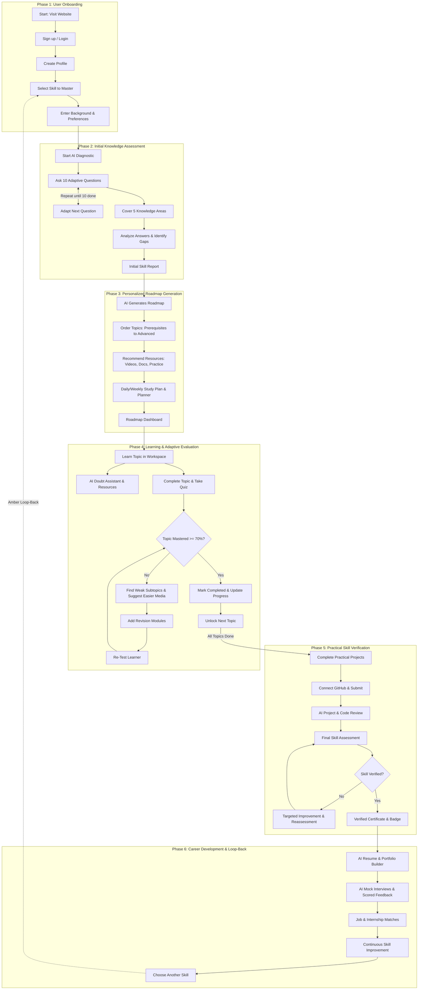

# Implementation Roadmap & Sprint Plan — AI-Powered Upskilling Platform

**Document Status:** Phased Engineering Plan (v2.0)  
**Role:** Senior Frontend Engineer & Scrum Lead  
**Execution Strategy:** 6-Phase Master Workflow Lifecycle Alignment  

---

## 1. Roadmap Overview & Master Workflow

---

## 2. Phase-by-Phase Implementation Specifications

### Phase 1: User Onboarding & Profile Setup
- **Routes:** `/`, `/login`, `/signup`, `/auth/callback`, `/onboarding`
- **Core Deliverables:**
  1. **Landing Page (`/`):** High-converting public view detailing platform value propositions, interactive preview, and direct CTA into `/signup`.
  2. **Auth Pages (`/login`, `/signup`):** Email/password and Google/GitHub OAuth with live client validation.
  3. **Multi-Step Onboarding Wizard (`/onboarding`):**
     - *Step 1 (Language & Persona):* Choose English, Hindi, or Hinglish; select learner persona (Career Seeker, Student, etc.).
     - *Step 2 (Skill Selection):* Curated technology tracks (Full-Stack, Backend, Cloud/DevOps, AI/ML).
     - *Step 3 (Background & Budget):* Known topics, self-reported weak areas, and daily study budget (hours/day).
- **Transitions:** Submitting onboarding automatically initializes the baseline state and transitions directly into `/assessment`.

---

### Phase 2: Initial Knowledge Assessment
- **Route:** `/assessment`
- **Core Deliverables:**
  1. **10-Question Sequential Diagnostic:**
     - Evaluates 5 dimensions: Prerequisites, Core Concepts, Theoretical Depth, Syntax/Implementation, and Practical Problem Solving.
     - Single-question focus with real-time feedback and dynamic difficulty adaptation.
  2. **Analysis Engine:** Calculates baseline mastery score and catalogs specific conceptual gaps.
  3. **Initial Skill Report:** Clear visual breakdown of Mastered Topics, Diagnostic Gaps, and Suggested Starting Level.
  4. **Animated AI Roadmap Generation Screen:** Clicking "Generate My Roadmap" displays transparent AI reasoning (pruning mastered prerequisites, inserting revision modules for weak topics, scheduling study blocks) before opening `/roadmap`.

---

### Phase 3: Personalized Roadmap Generation
- **Routes:** `/roadmap`, `/dashboard`
- **Core Deliverables:**
  1. **Topological Roadmap Canvas (`/roadmap`):**
     - Milestones ordered strictly from prerequisites to advanced topics.
     - Clear status chips: `Mastered`, `In-Progress`, `Revision Required`, `Locked`.
     - Transparent "Why this step" rationale flyouts.
  2. **Smart Study Planner:** Schedules topics based on the learner's daily/weekly time budget.
  3. **Student Command Center (`/dashboard`):** Prominently displays the Next Best Action, active habit streak, skill score rings, and quick learning launchers.

---

### Phase 4: Learning & Adaptive Evaluation
- **Route:** `/learn/:topicSlug`
- **Core Deliverables:**
  1. **Dedicated Study Workspace:** Clean tabs for Curated Resources (Documentation, Hand-picked Videos, Interactive Exercises).
  2. **In-Context AI Learning Assistant:**
     - Doubt-solving conversational panel available at all times.
     - Multi-language responses (English, Hindi, Hinglish).
     - Browser Web Speech voice input button.
  3. **Topic Assessment & The Remediation Loop:**
     - "Complete & Take Topic Quiz" evaluation button.
     - **Pass (>= 70%):** Mark topic completed -> Award XP & update habit streak -> Unlock next topic.
     - **Fail (< 70%):** Identify weak subtopics -> Suggest bite-sized remedial resources -> Dynamically attach Revision Module node to the roadmap -> Re-test learner until mastered.

---

### Phase 5: Practical Skill Verification
- **Route:** `/projects`
- **Core Deliverables:**
  1. **Capstone Projects Workspace:** Practical real-world project briefs aligned with the learner's track.
  2. **GitHub Submission:** Enter repository URL or link via GitHub OAuth.
  3. **AI Automated Code Review:** Instant static analysis covering code architecture, test coverage, code quality, and security best practices.
  4. **Verification & Badging:** Passing projects issue a cryptographically verifiable certificate and credential badge for resumes/LinkedIn.

---

### Phase 6: Career Development & Loop-Back
- **Route:** `/career`
- **Core Deliverables:**
  1. **AI Resume & Portfolio Builder:** Automatically highlights verified skills and completed capstone projects.
  2. **AI Mock Technical Interview Simulator:** Question-and-answer simulator with scoring and actionable feedback.
  3. **Job & Internship Matches:** Curated entry-level and mid-level opportunities matching verified skills.
  4. **"Choose Another Skill to Master" (Loop-Back):** Returns learner to Phase 1 (`Select skill to master`), allowing seamless multi-skill credential stacking.
