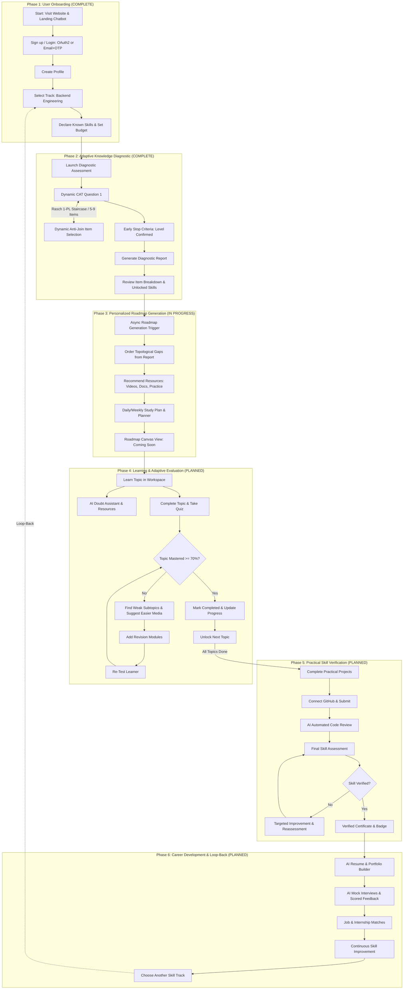

# Implementation Roadmap & Sprint Plan — AI-Powered Upskilling Platform

**Document Status:** Phased Engineering Plan & Status Review (v2.1)  
**Role:** Senior Frontend Engineer & Scrum Lead  
**Execution Strategy:** 6-Phase Master Workflow Lifecycle Alignment  
**Current Milestone:** Sprint 1 Complete • Sprint 2 Active  

---

## 1. Roadmap Overview & Master Workflow

---

## 2. Phase-by-Phase Implementation Status

### Phase 1: User Onboarding & Profile Setup
- **Status:** **COMPLETED & VERIFIED**
- **Routes:** `/`, `/login`, `/signup`, `/verify-email`, `/auth/callback`, `/auth/error`, `/onboarding`
- **Delivered Capabilities:**
  1. **Landing Page (`/`):** Enterprise presentation with workflow stages, value comparisons, and interactive embedded AI chatbot (`LandingChatbot.jsx`).
  2. **Unified Authentication:** Google OIDC, GitHub OAuth2 with verified email fallback, and email/password signup with 6-digit OTP verification via Gmail SMTP.
  3. **Multi-Step Onboarding Wizard (`/onboarding`):** Language/persona selection, track discovery (`GET /api/v1/assessments/tracks`), and pre-test declared skills calibration (`GET /api/v1/assessments/tracks/{trackId}/skills`).

---

### Phase 2: Initial Knowledge Assessment
- **Status:** **COMPLETED & VERIFIED**
- **Route:** `/assessment`
- **Delivered Capabilities:**
  1. **Adaptive CAT Engine (Rasch 1-PL):** Staircase difficulty adjustments ($\pm 0.35$ logits), 5 to 9 questions, early termination on confirmed level.
  2. **Anti-Join Query Selection:** Indexed candidate selection with LEFT JOIN anti-join on sequential responses.
  3. **Pre-Test Calibration:** Declared skills passed via `knownSkillSlugs` to immediately mark mastered skills and adapt starting difficulty.
  4. **Comprehensive Post-Test Report (`/report`):** Itemized question review (question stem, learner choice, correct answer, tested skill) and `unlockedSkills` array for updating the skill graph.

---

### Phase 3: Personalized Roadmap Generation
- **Status:** **IN PROGRESS (Sprint 2 Delivery)**
- **Routes:** `/roadmap`, `/dashboard`
- **Current State:**
  - Route `/roadmap` is accessible with a "Soon" badge in the navigation sidebar.
  - Asynchronous LLM synthesis worker design in progress in `ai-worker/`.
  - Student Dashboard (`/dashboard`) displays current readiness metrics, streak counter, and action launchers.

---

### Phase 4: Learning & Adaptive Evaluation
- **Status:** **PLANNED (Sprint 3 Delivery)**
- **Route:** `/learn/:topicSlug`
- **Scope:** Dedicated study workspace, topic quizzes, and automated revision module injection upon test failure.

---

### Phase 5: Practical Skill Verification
- **Status:** **PLANNED (Sprint 3 Delivery)**
- **Route:** `/projects`
- **Scope:** Public GitHub repository submission, automated containerized code linting, unit testing, and cryptographically signed verification badges.

---

### Phase 6: Career Development & Loop-Back
- **Status:** **PLANNED (Sprint 4 Delivery)**
- **Route:** `/career`
- **Scope:** AI resume generator, mock interview simulator with scored feedback, and loop-back to new skill tracks.

---

## 3. Supporting Features Delivered

| Feature | Location | Status |
|---|---|---|
| **Interactive Skill Graph** | `web-app/src/pages/SkillGraphPage.jsx` | Completed: 56 skills, 9 clusters, 72 prerequisite edges, 2-state visual filter (Ready to Learn vs Locked). |
| **Progress Analytics** | `web-app/src/pages/AnalyticsPage.jsx` | Completed: Study hours, retention metrics, and velocity indicators. |
| **Landing AI Chatbot** | `web-app/src/components/feature/LandingChatbot.jsx` | Completed: Dynamic question tree and answers regarding curriculum and platform. |
| **Anti-Join Item Selection** | `gateway/.../repository/AssessmentItemRepository.java` | Completed: Indexed candidate anti-join selecting nearest-difficulty items. |
| **Low-Latency Graph Queries** | `gateway/.../service/AssessmentService.java` | Completed: Joined prerequisite pre-fetching eliminating $N+1$ queries. |
