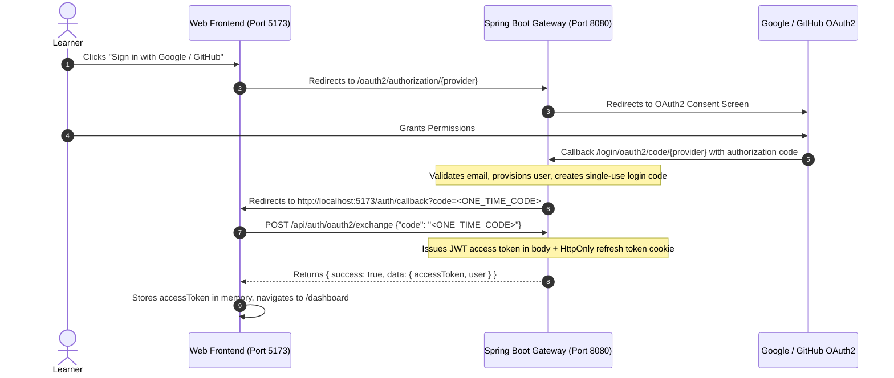

# Frontend OAuth Integration Contract & Boundary

**Document Status:** Coordinated Interface Specification (v1.0)  
**Teammate Auth Leads:** Riya (Email/Password & Core User) and Aadi (OAuth2, OIDC & Token Services)  
**Backend Service:** `gateway/ai-upskilling-platform/` (Spring Boot Gateway on port `8080`)  
**Frontend Role:** Client-side consumer & callback handler only (Strictly non-competing boundary)  
**Contract Source Documentation:**
- `docs/authentication/OAUTH_INTEGRATION_GUIDE.md` (Full Stack Architecture & Troubleshooting Guide)
- `docs/authentication/AUTHENTICATION_TEAM_CONTRACT.md`
- `docs/authentication/ENVIRONMENT.md`

---

## 1. Authentication Architecture Overview

The backend gateway handles OAuth2 protocol handshakes, provider identity extraction (`OAuthIdentity`), user provisioning, and token issuance. The frontend does **not** communicate directly with Google or GitHub APIs; all handshakes are routed through the Spring Boot gateway:



---

## 2. Confirmed Endpoints & Handshakes

### 2.1 Initiating OAuth Login
The frontend triggers OAuth by navigating the browser window directly to the gateway endpoint:
- **Google Sign-In:** `GET http://localhost:8080/oauth2/authorization/google`
- **GitHub Sign-In:** `GET http://localhost:8080/oauth2/authorization/github`

### 2.2 Callback URL & Code Delivery
Upon successful authentication, Spring Boot redirects back to the frontend URL configured in the backend environment (`APP_FRONTEND_WEB_CALLBACK_URL`):
- **Target URL:** `http://localhost:5173/auth/callback?code=<ONE_TIME_CODE>`
- **Characteristics:** The code is single-use and short-lived (60–120 seconds expiry).

### 2.3 Exchanging One-Time Code for Application Credentials
The frontend immediately extracts the `code` query parameter and sends an HTTP POST:
- **Endpoint:** `POST http://localhost:8080/api/auth/oauth2/exchange`
- **Headers:** `Content-Type: application/json`
- **Request Payload:**
  ```json
  {
    "code": "e83f2a1b-7c9d-4e5f-b0a1-2c3d4e5f6a7b"
  }
  ```
- **Success Response (`200 OK`):**
  ```json
  {
    "success": true,
    "message": "Login successful",
    "data": {
      "accessToken": "eyJhbGciOiJIUzI1NiIsInR5cCI6IkpXVCJ9...",
      "tokenType": "Bearer",
      "expiresInSeconds": 900,
      "refreshToken": null,
      "user": {
        "id": 1,
        "email": "learner@example.com",
        "fullName": "Learner Name",
        "role": "USER"
      }
    }
  }
  ```
  *Note:* On the web platform, the long-lived refresh token is securely set by the gateway as an `HttpOnly; Secure; SameSite=Lax` cookie named `refresh_token`. The `accessToken` in the response payload is held strictly in memory by the frontend.

### 2.4 Profile Hydration (`/api/auth/me`)
Used to restore session state on page refresh:
- **Endpoint:** `GET http://localhost:8080/api/auth/me`
- **Headers:** `Authorization: Bearer <accessToken>`
- **Response:** Current `UserResponse` (`id`, `email`, `fullName`, `role`).

### 2.5 Token Refreshing (`/api/auth/refresh`)
When the 15-minute access token expires:
- **Endpoint:** `POST http://localhost:8080/api/auth/refresh`
- **Credentials:** Sent with browser cookies (`credentials: 'include'`).
- **Response:** New access token and updated expiry.

### 2.6 Logout (`/api/auth/logout`)
- **Endpoint:** `POST http://localhost:8080/api/auth/logout`
- **Credentials:** Sent with browser cookies (`credentials: 'include'`).
- **Behavior:** Revokes refresh token family and clears the `refresh_token` cookie.

---

## 3. Required Frontend Routes & Error Handling

To support the authentication contract without conflict, the frontend must provide two dedicated public routes:

### 1. `/auth/callback` (`AuthCallbackPage.jsx`)
- **Lifecycle:**
  1. Parse `?code=` from `window.location.search`.
  2. If missing, redirect immediately to `/auth/error?error=MISSING_CODE`.
  3. Render an accessible loading state: *"Verifying your credentials..."*.
  4. Invoke `authService.exchangeLoginCode(code)`.
  5. On success: hydrate `AuthContext` and navigate to `/dashboard`.
  6. On failure: navigate to `/auth/error?error=<ERROR_CODE>`.

### 2. `/auth/error` (`AuthErrorPage.jsx`)
- **Lifecycle:** Displays user-friendly explanations for gateway error codes:
  - `OAUTH_EMAIL_REQUIRED`: *"Your GitHub account does not have a public verified email. Please verify your email on GitHub and retry."*
  - `OAUTH_ACCOUNT_EXISTS`: *"An account with this email already exists with a password. Please sign in with your password to link your account."*
  - `OAUTH_ALREADY_LINKED`: *"This external account is already associated with another learner profile."*
  - `OAUTH_ACCOUNT_DISABLED`: *"This account has been deactivated. Please contact support."*
  - Action button: `[Return to Login]`.

---

## 4. Teammate Boundary Rules

1. **Strict Ownership Separation:** Frontend code will **not** implement or duplicate OAuth client registration, token hashing, CSRF state verification, or database operations.
2. **Mock Interceptor for Independent Development:** When backend gateway `8080` is offline during frontend UI development, the frontend will support a mock flag (`VITE_USE_MOCK_AUTH=true`) allowing the engineering team to test `/dashboard` and `/assessment` using sample credentials without modifying production auth routes.
3. **Preservation of Existing Work:** The frontend team will not overwrite or alter backend files under `gateway/ai-upskilling-platform/` or documentation under `docs/authentication/`.
